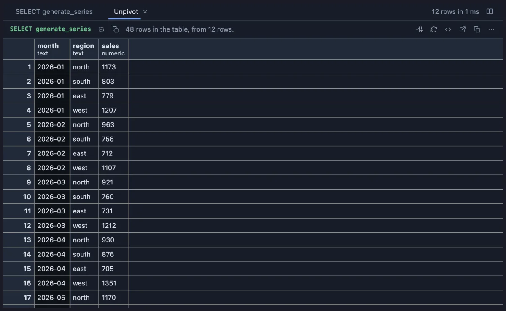
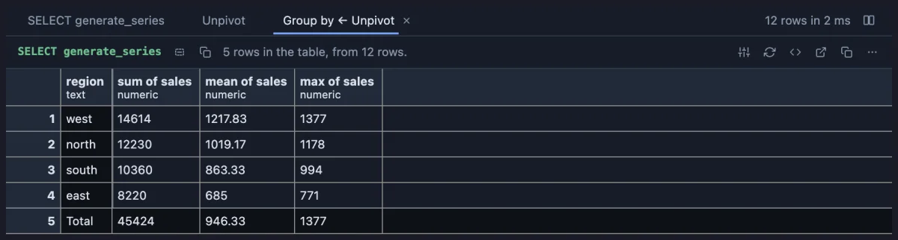

# Unpivot

Turn a wide table into a long list: a sheet with one column per month or per region becomes rows of "which column, what value", the shape charts and totals want. The opposite of a pivot.



A sales sheet with a column per region (north, south, east, west) turned into a list: one row per month and region, the region's name in one column and its sales in another. Twelve months by four regions become 48 rows.

## What it is for

- **Charting a spreadsheet-shaped table**: a chart wants one series column and one value column, not four columns of regions.
- **Totals across columns**: once the regions are rows, a group by adds them up per region, per month or both.
- **Comparing measurements**: a row of a test's results (`score_math`, `score_art`, `score_music`) becomes a list you can sort and filter.

## How to read it

An **Unpivot** tab opens beside the grid, a table of its own: for every row of the result and every column you melt, one row holding the columns you **Keep** (the month here), the melted column's name (in a column called `name`, or what you set) and its value (`value`). The value column holds numbers when every melted column is a number, and text otherwise.

## Try it

**Monthly sales by region** (any connection, made up on the spot), the picture above:

```sql
-- @extension unpivot open
-- @inputs keep=month, columns=north, south, east, west, names=region, values=sales
select to_char(m, 'YYYY-MM') as month,
       round(900 + random() * 300) as north, round(700 + random() * 300) as south,
       round(500 + random() * 300) as east, round(1100 + random() * 300) as west
from generate_series(date '2026-01-01', date '2026-12-01', interval '1 month') m;
```

**Then add it up**, through a pipeline: the long list handed to Group by, which totals the sales per region.

```sql
-- @extension unpivot | group-by open
-- @inputs unpivot: keep=month, columns=north, south, east, west, names=region, values=sales
-- @inputs group-by: by=region, m1=sales, f1=sum, m2=sales, f2=mean, m3=sales, f3=max
select to_char(m, 'YYYY-MM') as month,
       round(900 + random() * 300) as north, round(700 + random() * 300) as south,
       round(500 + random() * 300) as east, round(1100 + random() * 300) as west
from generate_series(date '2026-01-01', date '2026-12-01', interval '1 month') m;
```



## Settings

| Setting | `@inputs` key | Default | What it does |
|---|---|---|---|
| Keep | `keep` | none | The columns that identify a row (a month, an id), repeated on every output row, as a comma list |
| Columns to melt | `columns` | every column not kept | The columns turned into name and value rows, as a comma list |
| Name column | `names` | name | The header of the column holding the melted columns' names |
| Value column | `values` | value | The header of the column holding their values |
| Skip nulls | `skip` | no | `yes` leaves out the rows whose value is empty |

## Good to know

Up to 1,000,000 output rows; the rest are left out and the Log says how many. In SQL the same is a `CROSS JOIN LATERAL (VALUES ...)`; this is for a result you already have. From a script: `-- @extension unpivot` above the query, with `-- @inputs keep=month, columns=north, south, east`. The long shape feeds the other views: `-- @extension unpivot | group-by` or `-- @extension unpivot | echarts`.

## Requirements

PostgreSQL 13 or newer. Nothing runs on the server: the table is built in the result's sandbox from the rows already fetched. Stats core installs with it.
