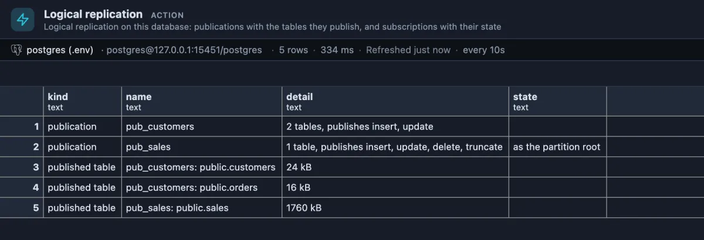
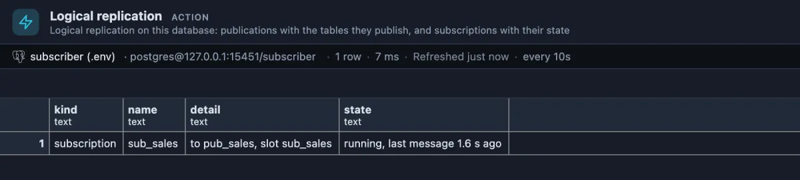

# Logical replication

What does this database send to other databases, and what does it receive? Its publications with the tables in them, and its subscriptions with whether they are running.



The publishing side. `pub_customers` sends new and changed rows of `customers` and `orders`, but not deletes; `pub_sales` sends every change of `sales`, a partitioned table, as if it were one table (`as the partition root`), so the other side needs no partitions of its own.



The receiving side, in another database: `sub_sales` follows `pub_sales` and is running; the last word from the publisher came 1.6 seconds ago.

## When to use it

- **Setting up replication** between two databases (a reporting copy, a migration to a new server, an upgrade with little downtime): check both ends are what you meant.
- **"The copy is missing rows"**: is the table in the publication at all, does it publish deletes, is the subscription running?
- **Before changing a table that is published**: see which publications carry it.

## How to read it

One row per thing, publications first:

| kind | name | detail | state |
|---|---|---|---|
| `publication` | Its name. | How many tables (or `all tables`) and which changes it sends: insert, update, delete, truncate. | `as the partition root` when a partitioned table is sent as one table. |
| `published table` | `publication: schema.table`. | The table's size on disk (its partitions' together for a partitioned table). | A warning when the table has `REPLICA IDENTITY NOTHING`, so its updates and deletes would fail. |
| `subscription` | Its name. | The publications it follows and its replication slot on the publisher. | `running, last message 1.6 s ago`, `not running` (its worker stopped: the server log says why) or `DISABLED`. |

A database with neither says so in one line.

## Try it

Open the **Extensions** side tab, find **Logical replication** and press its **Run**, once on the publisher's database and once on the subscriber's. It refreshes every ten seconds while its tab is in front, so you can watch a new subscription start.

Common fixes, once you have read the list:

```sql
alter publication pub_sales add table public.refunds;    -- send another table
alter publication pub_sales drop table public.refunds;   -- stop sending it
alter subscription sub_sales disable;                    -- restart a stuck subscription,
alter subscription sub_sales enable;                     -- after fixing what the log says
```

To try it on a **test server** started with `wal_level = logical`: `create table t (id int primary key, v text); create publication pub_t for table t;` and run it.

## Good to know

A subscription's connection string is never read: it may hold a password. The replication slots a publisher keeps for its subscribers, and how much WAL each one holds back, are in **Replication status**. It reads `pg_publication`, `pg_publication_tables`, `pg_subscription` and `pg_stat_subscription`, and only reads.

## Requirements

PostgreSQL 13 or newer. Reading publications needs no privilege; a subscription's state comes from `pg_stat_subscription`, which every role can read.
