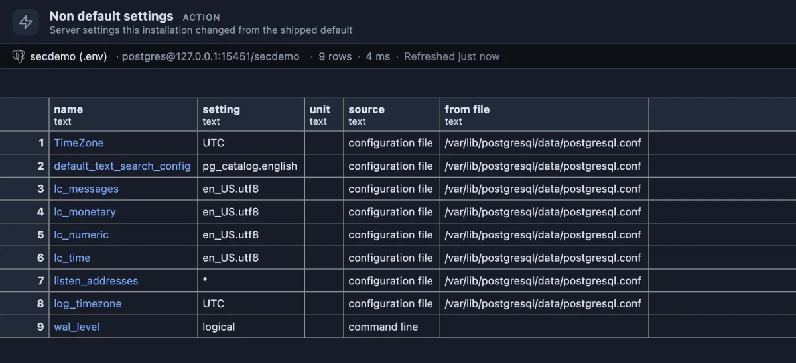
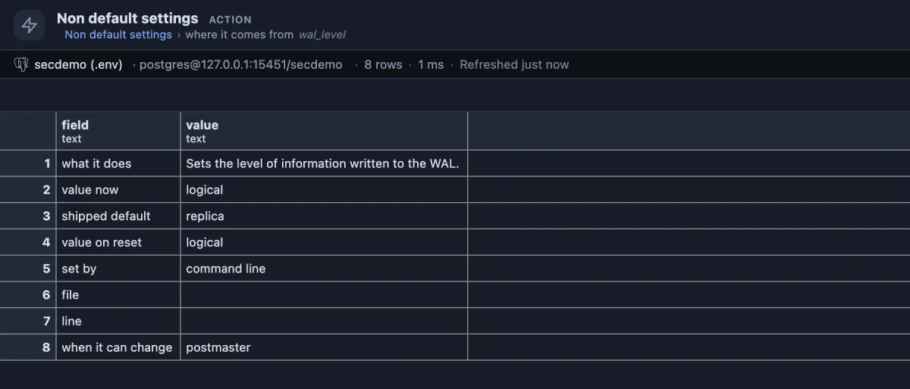

# Non-default settings

How is this server configured? Only the settings someone changed from PostgreSQL's defaults, and where each change was made.



Nine settings out of more than 350, and that is the whole story of this server's configuration: the locale and time zone written by the installer into `postgresql.conf`, `listen_addresses = '*'` so it accepts connections from other machines, and `wal_level = logical`, given on the command line, which is what lets it publish changes for logical replication.

## When to use it

- **Getting to know a server**: what someone decided, without wading through hundreds of parameters still at their defaults.
- **Two servers behave differently**: run it on both and compare the lists.
- **Before an upgrade or a move**, to know which settings to carry over.
- **"Who set this, and where?"**: the file and line of a value, or whether it came from the command line or an `ALTER SYSTEM`.

## How to read it

One row per changed setting, alphabetically:

| Column | Meaning |
|---|---|
| name | The setting. The name is a link to its card. |
| setting, unit | Its value now, and the unit it is counted in (`kB`, `ms`, `8kB` pages and so on). |
| source | Who set it: `configuration file`, `command line`, `environment variable`, `database` or `user` (set for one database or one role). |
| from file | The configuration file it came from, when it did. |

**A name** opens the setting's card: what it does, the value now, the shipped default, the value it returns to on reset, who set it, the file and line, and when a change can take effect (`postmaster` means only after a restart):



## Try it

Open the **Extensions** side tab, find **Non-default settings** and press its **Run**. A setting made for one database or one role shows up too, with its source; on a **test server**:

```sql
alter database postgres set work_mem = '32MB';
-- reconnect, run it again: work_mem appears with source "database"
alter database postgres reset work_mem;
```

## Good to know

"Changed" means the value differs from the value PostgreSQL was built with (`boot_val` in `pg_settings`), so a line the installer wrote at the default value is not listed. Values set for a single session (sources `client` and `session`), which would include what PlumeSQL itself sends when it connects, are left out. It only reads; **Server settings** lists every setting and can change one.

## Requirements

PostgreSQL 13 or newer. Reading `pg_settings` needs no privilege; the file and line show only to superusers and members of `pg_read_all_settings`.
