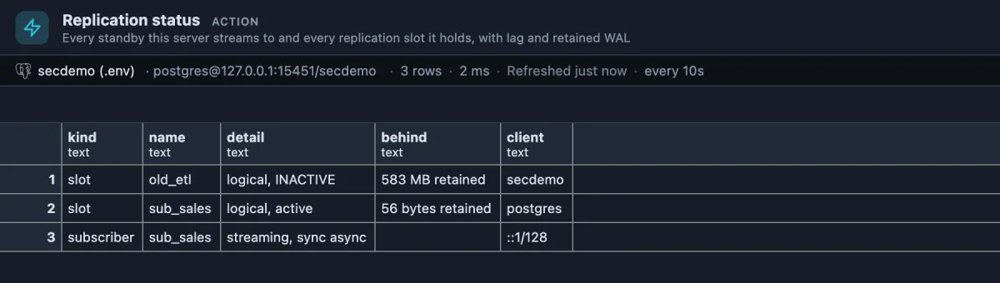

# Replication status

Are the copies of this server keeping up, and is anything quietly filling the disk? Every standby and subscriber this server sends changes to and every replication slot it holds, with how far behind each one is.



Two slots on a test server. `sub_sales` is healthy: its subscriber is connected and streaming, and it holds back only 56 bytes of WAL. `old_etl` is the problem this extension exists for: a slot that nothing reads any more (`INACTIVE`) keeps every change since it was last read, 583 MB here and growing, until the disk is full. If nothing will use it again, `select pg_drop_replication_slot('old_etl');` frees it.

## When to use it

- **Checking your standby** before you rely on it: is it connected, and how far behind is it?
- **The disk on the primary keeps growing** for no clear reason: an abandoned slot is the usual cause.
- **After setting up logical replication**, to see the subscriber connect and its slot start moving.
- **During a long migration or an upgrade**, as a chip in the status bar that refreshes itself.

## How to read it

One list for both halves of the question:

| Column | Meaning |
|---|---|
| kind | `standby` (a physical replica connected now), `subscriber` (a logical replication subscriber connected now) or `slot` (a replication slot, whether or not anyone is connected). |
| name | The standby's or subscriber's application name, or the slot's name. |
| detail | A connection's state and sync mode (`streaming`, `async` or `sync`); a slot's type and whether it is `active` or `INACTIVE`. |
| behind | A standby's replay lag (how long until a change made here is visible there); a slot's retained WAL. |
| client | The connection's address, or the slot's database. |

What to watch for:

- **`INACTIVE` with a growing `retained` size**: the slot keeps WAL for a reader that is gone. Drop it, or bring its reader back.
- **A replay lag of minutes or more** on a standby: it cannot keep up, or it is paused. A query on it reads old data.
- **A standby you expect is missing**: it is disconnected; its slot (if it has one) now shows `INACTIVE` and starts to retain WAL.

A server with no standby, no subscriber and no slot answers with one row saying so.

## Try it

It ships as a **Replication** chip in the status bar, at the bottom of the window: one click runs it. Or open the **Extensions** side tab, find **Replication status** and press its **Run**. It refreshes every ten seconds while its tab is the one in front.

Without a replica you can still watch a slot work, on a **test server** with `wal_level = logical`:

```sql
select pg_create_logical_replication_slot('try_slot', 'pgoutput');
-- write something anywhere, then look at the slot's retained size grow
select pg_drop_replication_slot('try_slot');   -- never leave it behind
```

## Good to know

Every WAL sender shows in `pg_stat_replication`; one that reads through a logical slot is a `subscriber`, any other a `standby`. Slots come from `pg_replication_slots`. A physical standby without a slot is not protected: if it falls too far behind, the WAL it needs may already be gone. The retained size stays empty on a server that is itself a standby. **Logical replication** lists publications and subscriptions database by database; **Health check** flags inactive slots too. It only reads.

## Requirements

PostgreSQL 13 or newer. Seeing other users' connections needs the `pg_read_all_stats` role or superuser.
