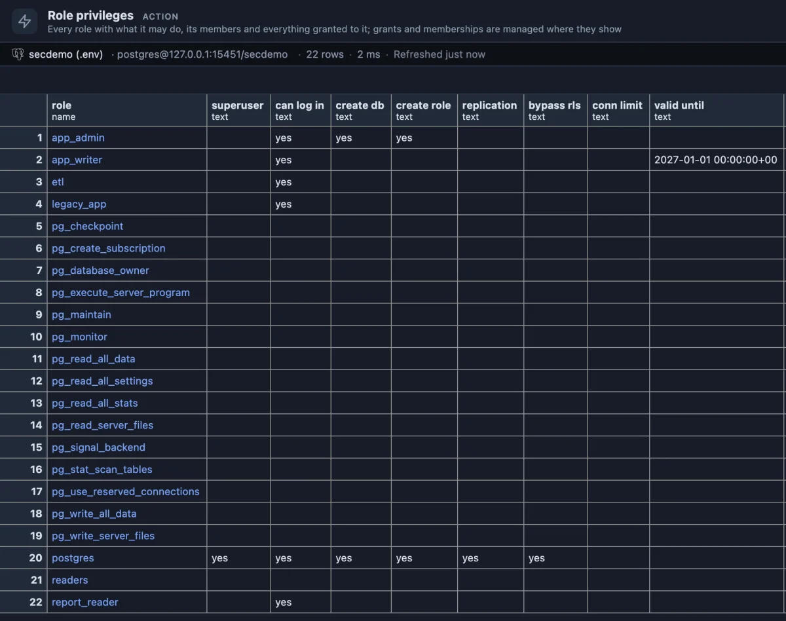
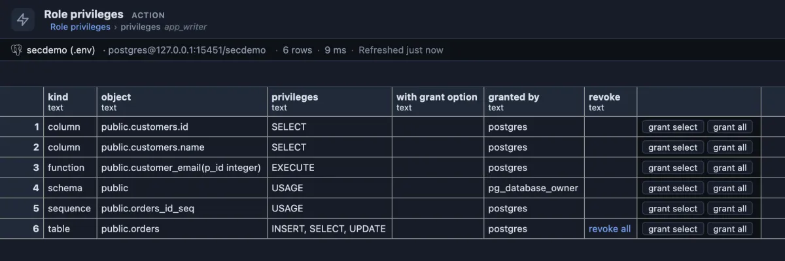
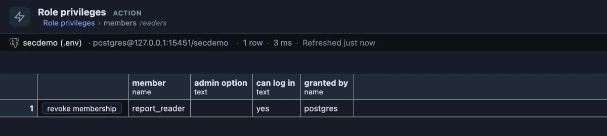

# Role privileges

Who may do what on this server? Every role with its powers and the groups it belongs to; one click shows everything granted to a role and who is in it, and the grants can be changed right there.



Every role on a test server, alphabetically, with PostgreSQL's built-in `pg_` roles among them. `app_admin` may create databases and other roles; `app_writer`'s login expires on 2027-01-01; `etl` belongs to `pg_read_server_files`, which reads the server's files; `report_reader` gets its rights through the `readers` group. Those two memberships are in the **member of** column, to the right of the picture, beside each row's **members** and **grant membership** buttons.

## When to use it

- **Someone asks for access**, or reports they cannot read a table: see what their role holds before you grant more.
- **Someone leaves**, or an application is retired: find everything their role was given, and take it back.
- **A review of who can do what**, for yourself or an auditor, without writing catalog queries.

## How to read it

One row per role:

| Column | Meaning |
|---|---|
| role | Its name. A name is a link to everything granted to it. |
| superuser | `yes`: it can do anything at all. |
| can log in | `yes`: a user or an application; empty: a group that others are members of. |
| create db, create role | It may create databases, or other roles. |
| replication | It may connect for replication. |
| bypass rls | Row security policies do not apply to it. |
| conn limit | Its connection limit, when one is set. |
| valid until | When its password stops working, when set. |
| member of | The groups it belongs to: it holds what they hold. |

**A role's name** opens what has been granted to it, explicitly: databases, schemas, tables, views, sequences, single columns, functions and procedures, with the privileges, whether it may pass them on (`with grant option`) and who granted them:



`app_writer` may read only the `id` and `name` columns of `customers` (not the e-mail), run one function, and read, insert and update `orders`. What it does not see here, it does not have, except through `PUBLIC`, through a group it is a member of, or as the owner of an object. A role with no grant anywhere says so in one row.

**members** on a role's row opens who is in that group:



## Buttons

Every change asks first, in plain words, before it runs.

- **revoke all** (privileges, on a table or view row) takes every privilege on that table or view from the role.
- **grant select** and **grant all** (privileges) ask for a schema and a table or view, each from a list, and grant to the role.
- **grant membership** (on a role's row) asks for a role and makes it a member of this one.
- **revoke membership** (members) removes a member from the group.

## Try it

Open the **Extensions** side tab, find **Role privileges** and press its **Run**. To try the buttons on a **test server**, make a group and a user first:

```sql
create role readers nologin;
create role report_reader login in role readers;
```

Run it, open **readers**, press **grant select** and pick a table: `report_reader` can now read it through the group. **revoke all** on that row takes it back. Afterwards: `DROP ROLE report_reader; DROP ROLE readers;`.

## Good to know

Built-in defaults are not grants: an object nobody granted anything on runs on its owner's defaults and lists nothing, and what `PUBLIC` holds is a grant to `PUBLIC`, not to the role. A revoke takes grants, never the object: the owner keeps owning, and the role keeps what it holds through `PUBLIC`, through its groups, or per column. Names are passed to the server as identifiers it quotes itself (`@inline ... identifier`), since `GRANT` and `REVOKE` take no parameters. It reads `pg_roles`, `pg_auth_members` and the access lists of `pg_database`, `pg_namespace`, `pg_class`, `pg_attribute` and `pg_proc`. **Security review** flags the roles with too much power.

## Requirements

PostgreSQL 13 or newer. Reading needs no privilege. Granting and revoking need ownership of the object or the privilege with grant option; memberships need ADMIN OPTION on the group or CREATEROLE.
