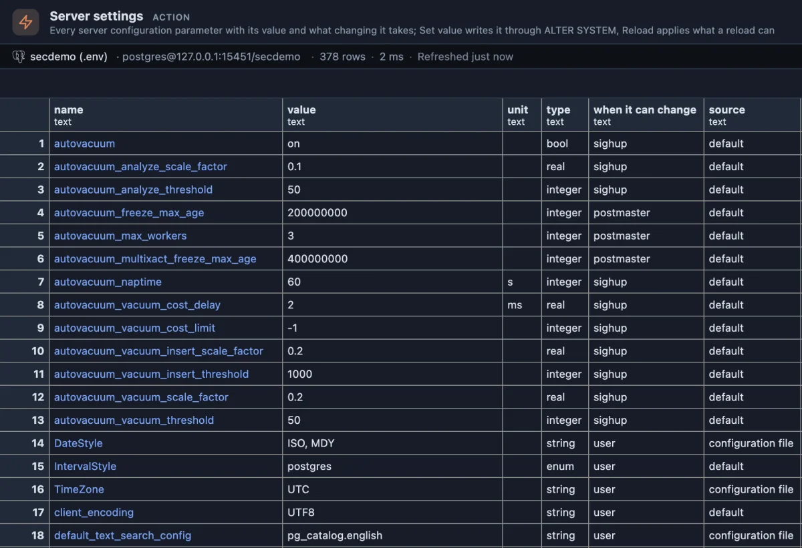
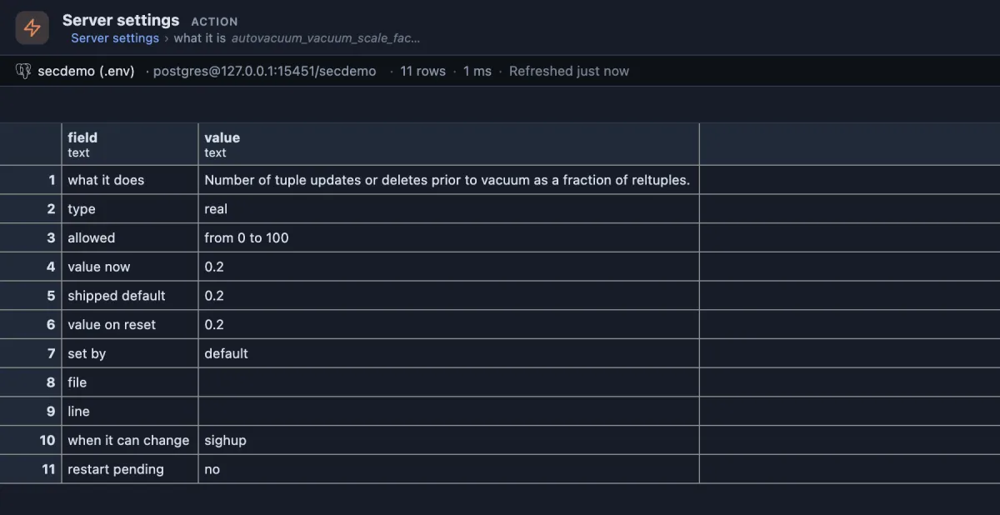

# Server settings

Every setting of the server, what it does and what changing it takes; change one, and apply it, without leaving the grid.

All 378 settings of a PostgreSQL 17 server, grouped by PostgreSQL's own categories. The column **when it can change** answers the question people ask most: `sighup` takes effect on a reload, `postmaster` only after a restart, `user` can even be changed for one session.

## When to use it

- **Tuning**: look up a setting, read what it does and what it allows, change it and reload, all in one place.
- **"Why is this slow / why did autovacuum not run?"**: check the values that govern it.
- **After changing something**: the `restart pending` column shows the settings that wait for a restart.

## How to read it

One row per setting, by category then name:

| Column | Meaning |
|---|---|
| name | The setting. The name is a link to its card. |
| value, unit | Its value now, and the unit it is counted in. |
| type | `bool`, `integer`, `real`, `string` or `enum`. |
| when it can change | `postmaster`: only after a restart; `sighup`: on a reload; `superuser`, `user` and the rest: also with `SET` in a session. |
| source | Who set the current value: `default`, `configuration file`, `command line` and so on. |
| restart pending | `yes` when a new value is written and waits for a restart. |
| category | PostgreSQL's grouping. |

**A name** opens the setting's card: what it does, its type, the values or range it allows, the value now, the shipped default, the value on reset, who set it and where, when it can change, and whether a restart is pending:

## Buttons

Each one asks first, in plain words.

- **set value** asks for the new value and writes it with `ALTER SYSTEM SET`. The server checks the value before writing anything: one the setting cannot take is refused in the server's own words. The new value lands in `postgresql.auto.conf` and takes effect on **reload**, or on a restart for a `postmaster` setting.
- **reset** removes the setting from `postgresql.auto.conf`; what `postgresql.conf` or the default says returns on the next reload.
- **reload** asks the server to read its configuration files again (`pg_reload_conf()`): every setting a reload can apply takes its new value at once; the `postmaster` ones keep waiting for a restart.

## Try it

Open the **Extensions** side tab, find **Server settings** and press its **Run**. On a **test server**, change one setting and put it back:

1. On `log_min_duration_statement`, press **set value** and answer `500` (log every statement slower than half a second).
2. Press **reload**. Run the list again (the refresh button in its header): the value is `500`, its source `configuration file`.
3. Press **reset**, then **reload**: it is back to `-1`, off.

## Good to know

The name and the value are passed to the server as an identifier and a literal it quotes itself, never pasted into the statement. A reload is server wide, as a reload always is; the answer names the row it was pressed on. The list reads `pg_settings`. **Non-default settings** shows only what someone changed.

## Requirements

PostgreSQL 13 or newer. Reading needs no privilege. `ALTER SYSTEM` and `pg_reload_conf()` need a superuser, or a role granted `ALTER SYSTEM` on the setting (PostgreSQL 15 and newer) and EXECUTE on the function; a hosted service may allow neither.
