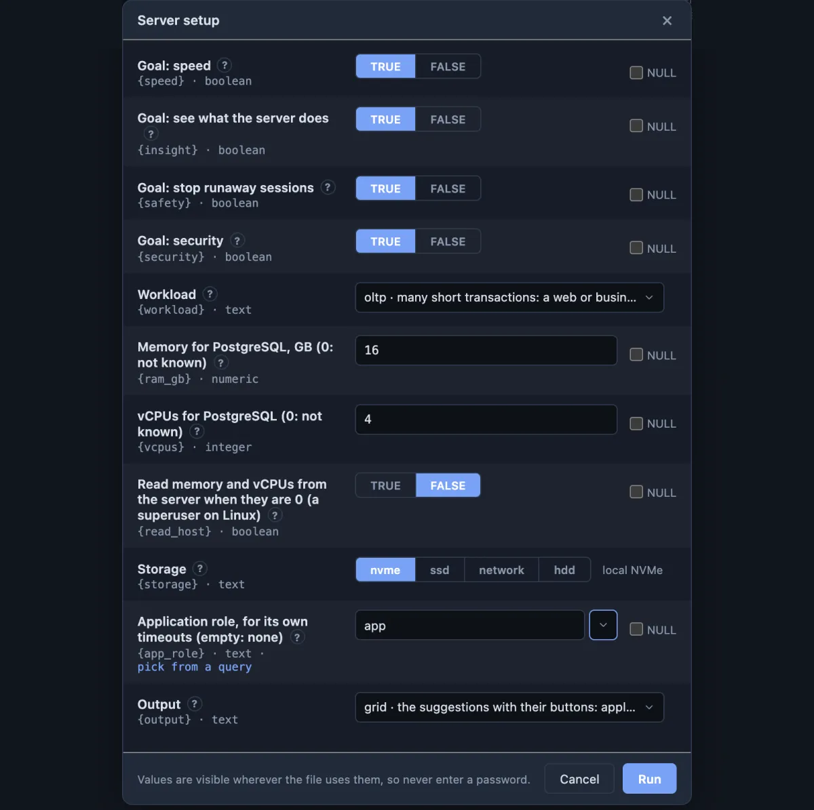
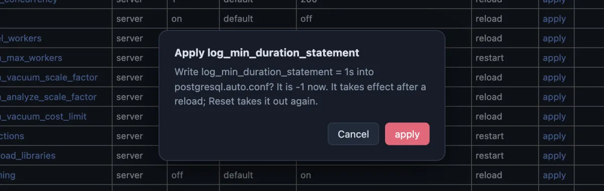
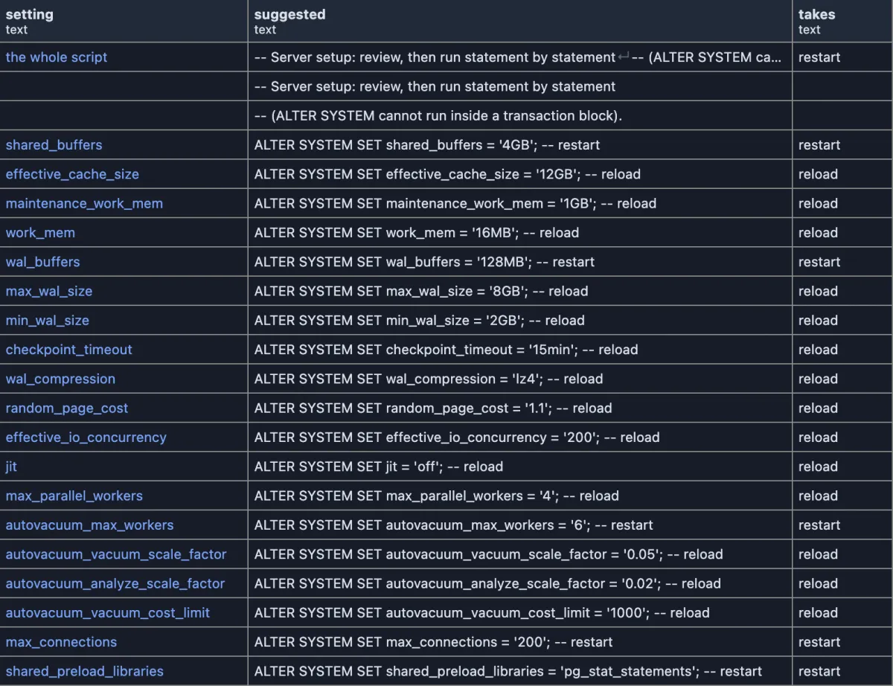

# Server setup

A fresh PostgreSQL ships set up for a small machine: a 128 MB cache, no record of slow queries, nothing that stops a session left hanging. Tell Server setup about your machine and your kind of work, and it lists what to change, each change with its reason and its own button. Nothing changes until you press one and confirm.

A fresh PostgreSQL 17 on a machine with 16 GB of memory, 4 vCPUs and NVMe disks, serving a web application. Its own cache, `shared_buffers`, is still the shipped 128 MB: a quarter of the memory, 4 GB, is suggested, and it **takes** a restart. `max_wal_size` goes from 1 GB to 8 GB, and the reason says why from this server's own statistics: all 19 of its checkpoints were forced by the amount of WAL written, not by the timer. `random_page_cost` drops from 4 to 1.1, because on NVMe a random read costs about what a sequential one does. Every row has its reason in the **why** column, to the right of the picture.

## When to use it

- **A new server**, before the application goes live: the shipped settings fit a small machine, not yours.
- **A server that got slow and nobody can say why**: the goal "see what the server does" turns on the statistics and the log lines that name the queries that cost the most.
- **Before production or an audit**: the security goal finds MD5 passwords, unencrypted connections and `pg_hba.conf` lines that let anyone in without a password.
- **The configuration lives somewhere else** (Patroni, Kubernetes, Docker Compose, a cloud service): the same suggestions come out as a script for that place.

## What you tell it

Every field has a **?** beside it that explains it. In short:

| Field | What to answer |
|---|---|
| Goals | Four switches, all on: **speed**, **see what the server does**, **stop runaway sessions**, **security**. Switch off what you do not want looked at. |
| Workload | What most of the work is: `oltp` (a web or business application), `mixed` (that, plus reports), `analytics` (few big queries), `timeseries` (a stream of inserts read by time), `vector` (similarity search with pgvector), `replica` (a read-only standby), `desktop` (your own machine). |
| Memory, vCPUs | What PostgreSQL may use: the machine's, or a container's limit. 0 when you do not know; the settings that depend on them are then left out. |
| Read memory and vCPUs from the server | For fields left at 0, read them from the server's own files. Takes a superuser and a Linux server. Off by default. |
| Storage | `nvme`, `ssd`, `network` (a cloud volume such as EBS) or `hdd`. |
| Application role | The role your application logs in as, if you want it to get its own timeouts. |
| Output | `grid` (the list with buttons), or a script for wherever the configuration lives (below). |

Everything else is read from the server: its version, its settings and where each comes from, the libraries it loads, how many checkpoints were forced, how much spilled into temporary files, sessions hanging in an open transaction, roles with MD5 passwords, the `pg_hba.conf` lines.

## How to read it

One row per suggestion, grouped by goal:

| Column | Meaning |
|---|---|
| goal, area | Which goal asks for it, and what it is about. |
| setting | The setting. The name opens its card: what it does, what it allows, where the value now comes from. |
| applies to | `server`, or `role app` for a setting given to the application role alone. |
| now, set by | The value now, and where it comes from: `default`, `postgresql.conf`, `postgresql.auto.conf` (an earlier ALTER SYSTEM), the role. |
| suggested | The value suggested. |
| takes | `reload`, `restart`, or `new sessions` for a role. |
| apply, apply to role, reset | The buttons (below); **reload** is the last column. |
| why | The reason, with this server's numbers where it has some. |

A row shows up only when the suggestion differs from the value now and the server would accept it. A setting that is already fine is not listed, so after applying everything and restarting, the list is empty.

Some rows are notes, without buttons: memory nobody gave, a certificate that `ssl` needs first, roles that still keep MD5 passwords, a `pg_hba.conf` line to edit by hand.

## Buttons

Each button asks first and names exactly what it writes.

- **apply** writes the suggested value with ALTER SYSTEM into `postgresql.auto.conf`. The server uses it after a **reload**, or after a restart for the rows that say `restart`.
- **apply to role** gives the value to the application role (ALTER ROLE ... SET); its new sessions start with it.
- **reset** takes the setting out of `postgresql.auto.conf` again.
- **reload** asks the server to read its configuration again. It is a button of its own: applying never reloads.

A restart is never done for you; the **takes** column names the settings that wait for one. After a button the list runs again.

## A script instead of the list

Choose an **Output** other than `grid` and the same suggestions come back as a script. The first row holds the whole script in one cell: copy that cell and you have all of it, or right-click it and **Open Value in Tab** to read and edit it. The rows below show it line by line, beside the setting each line is about.

| Output | What you get |
|---|---|
| `sql` | ALTER SYSTEM and ALTER ROLE statements, the reload, the settings that wait for a restart, and a commented block that puts back what was there before. |
| `conf` | Lines for the end of `postgresql.conf`. |
| `patroni`, `patroni-bootstrap` | The parameters for `patronictl edit-config`, or for `bootstrap.dcs` in `patroni.yml` when a cluster is first created. |
| `cloudnativepg`, `zalando`, `crunchy-pgo` | The parameters of a Kubernetes cluster for that operator. |
| `compose` | The `command:` of a `postgres` service in `docker-compose.yml`. |
| `aws`, `azure`, `gcloud` | The cloud's command line: an RDS parameter group, an Azure flexible server, a Cloud SQL instance. |

On Amazon RDS and Aurora, Azure, Google Cloud SQL and AlloyDB the server does not allow ALTER SYSTEM: the rows have no buttons there, and the `aws`, `azure` and `gcloud` Outputs write the command for the service instead.

## Try it

On a **test server** (**System > Get a server** makes one):

1. Open the **Extensions** side tab, find **Server setup**, press **Run**, give your memory and vCPUs, and run it.
2. On `log_min_duration_statement`, press **apply** and confirm. It is written, but the server still reads `-1` until a reload.
3. Press **reset** on the same row: it is taken out again, and the server never noticed.
4. Press **apply** once more, then **reload**: the row is gone, because the server now logs every statement slower than a second.
5. Press **Change Inputs** (the sliders button in the result's header), choose the Output `sql` and run it: copy the first row's **suggested** cell, and you have the whole script.

## How the numbers are worked out

| Setting | From |
|---|---|
| `shared_buffers` | A quarter of the memory; 35% for analytics and time series, 15% on a desktop; at most 32 GB. |
| `effective_cache_size` | Three quarters of the memory. |
| `work_mem` | 16 MB for one sort or hash on a transaction server, more for the workloads with big queries (up to 64 MB for analytics), sized for the connections that workload usually has; less when the server allows more, halved under 4 GB of memory. |
| `maintenance_work_mem` | A sixteenth of the memory (an eighth for analytics and time series), at most 4 GB. |
| `max_wal_size`, `min_wal_size`, `wal_buffers` | From `shared_buffers`; `max_wal_size` higher still when the server's checkpoints are forced by WAL. |
| `random_page_cost`, `effective_io_concurrency` | From the storage. |
| Parallel workers | From the vCPUs, with room for the background workers of TimescaleDB, pg_cron and logical replication. |
| Autovacuum | More workers and earlier runs for busy tables, by workload. |
| `max_connections` | What the workload usually needs, and only ever raised: a server that already allows more keeps them. |

The suggestions are starting points for a server you then watch: the Performance extensions (Top queries, Checkpoints, Cache hit ratio) show whether they helped.

## Good to know

The run only reads. What only some servers have (`pg_stat_checkpointer`, `pg_authid`, `pg_hba_file_rules`, the files under `/proc`) is read in a way that skips it when it is missing or not allowed, instead of failing. A value is suggested only when this server accepts it: `lz4` WAL compression only where the server was built with it, no `effective_io_concurrency` on macOS and Windows, which cannot use it. A list such as `shared_preload_libraries` is written one quoted value per library, and a library the server already loads stays first. Names and values reach ALTER SYSTEM quoted by the server itself, never pasted into the statement.

## Requirements

PlumeSQL 0.25.0 or newer, PostgreSQL 13 or newer. Reading needs no privilege; a superuser sees more (MD5 passwords, `pg_hba.conf`, certificates, the memory and CPU files). ALTER SYSTEM and `pg_reload_conf()` need a superuser, or a role granted ALTER SYSTEM on the setting (PostgreSQL 15 and newer); ALTER ROLE ... SET needs a superuser or CREATEROLE.
