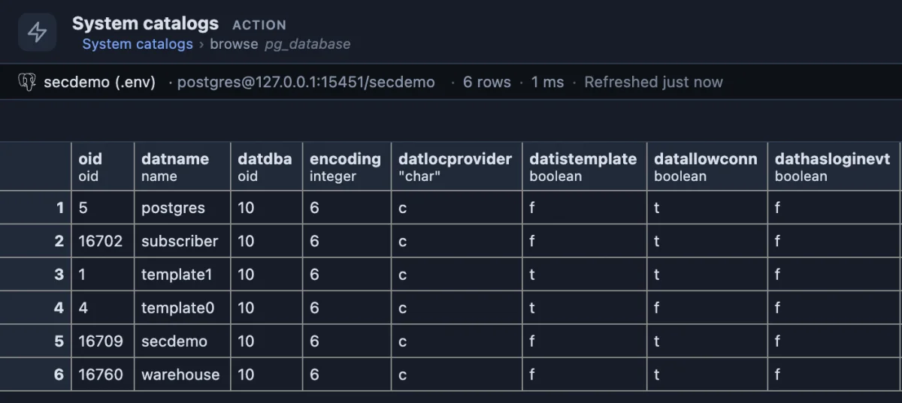

# System catalogs

Where does PostgreSQL keep that? Every system catalog and view PostgreSQL documents, each with one line saying what it holds, and any of them opened with one click.

PostgreSQL describes itself in tables: the columns of your tables are rows of `pg_attribute`, your indexes rows of `pg_index`, the running sessions rows of `pg_stat_activity`. This list is the map of those 156 tables and views, so you can find the right one by what it holds instead of by remembering its name.

## When to use it

- **You know roughly what you need and not where it is**: "which view has the locks?" (`pg_locks`), "where are the column comments?" (`pg_description`).
- **Learning how PostgreSQL works inside**, one catalog at a time, with real rows to look at.
- **Writing your own monitoring query**: find the statistics or progress view it should read.

## How to read it

One row per catalog or view, grouped by family:

| Column | Meaning |
|---|---|
| relation | Its name in `pg_catalog`. The name is a link that opens it. |
| what | One line from the PostgreSQL documentation: what its rows are. |
| family | `catalog` (the tables PostgreSQL keeps its own definitions in), `view` (friendlier views over them), `statistics` (counters of what happened) or `progress` (what a running VACUUM, CREATE INDEX or COPY is doing now). |

**A name** opens every row of that catalog or view:

## Try it

Open the **Extensions** side tab, find **System catalogs** and press its **Run**. To narrow the list, filter the **what** column (the filter button in its header) for a word such as `lock`, `index` or `vacuum`, then open a name. Good first ones: `pg_stat_activity` (every session and what it runs now), `pg_settings` (every setting), `pg_locks` (every lock held or waited for), `pg_stat_user_tables` (how each of your tables is read and written).

## Good to know

The browse reads the whole catalog or view: none of them is large on an ordinary database (`pg_largeobject`, which holds large object data, is the exception). The name is passed as an identifier the server quotes itself, because a table name cannot be a query parameter. The list is PostgreSQL 19's; on an older server a catalog that does not exist there yet answers the browse with the server's own error, and the list itself opens everywhere. It only reads.

## Requirements

PostgreSQL 13 or newer. Most catalogs are readable by every role; a few (`pg_authid`, `pg_statistic`, `pg_hba_file_rules`) only by a superuser or a role granted them.
