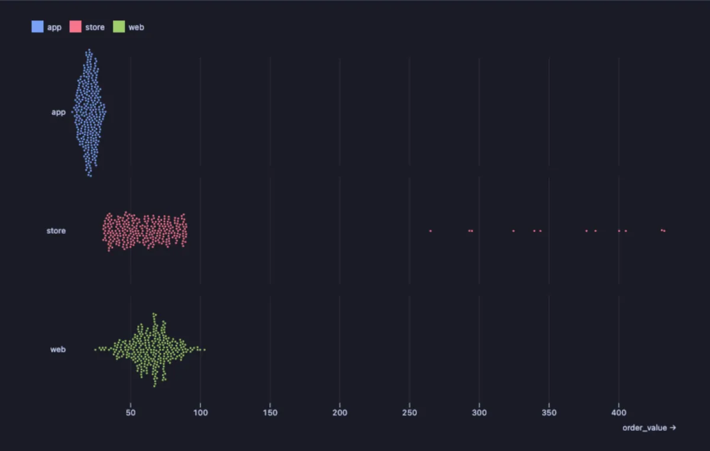
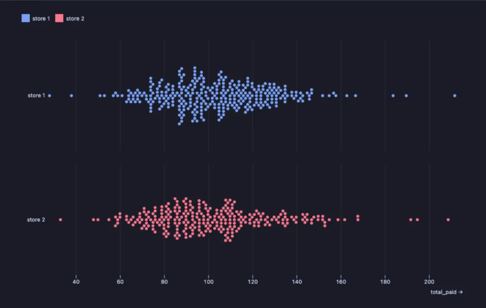

# Beeswarm

Every row as its own dot, piled up where the values are: see each order, each customer or each request, not just a summary of them.



Order values in three sales channels, one dot per order. The app sells small baskets, all alike. The web spreads wider around sixty. The store looks like the web, except for the few dots far to the right: a handful of orders five times larger than the rest, the ones worth a phone call.

## What it is for

- **Seeing individual rows, not averages**: which orders, customers or invoices stand apart from the crowd, and how many of them there are.
- **Comparing groups by shape**: are the app's users all alike while the web's vary? A swarm per group shows it at a glance.
- **Spotting a few unusual rows in a few hundred**: a slow request among fast ones, a salary far above its department, a test score far below the class.

## How to read it

Left to right is the value. Each dot is one row, and dots that would overlap are pushed up and down beside each other, so a tall pile means many rows with about that value and a thin trail means few. With a **Group**, each group gets its own swarm and colour. Hover a dot for its value.

## Try it

**Order values per sales channel** (any connection, made up on the spot), the picture above:

```sql
-- @extension plot-beeswarm open
-- @inputs value=order_value, group=channel
select channel, round(value::numeric, 2) as order_value
from (select (array['web', 'app', 'store'])[1 + g % 3] as channel,
             case g % 3
               when 0 then 20 + (random() + random() + random()) * 30
               when 1 then 8 + (random() + random()) * 12
               else case when random() < 0.95 then 30 + random() * 60 else 250 + random() * 200 end
             end as value
      from generate_series(1, 900) g) o;
```

**What each customer paid in total, per store**, in the [dvdrental](https://neon.com/postgresql/postgresql-getting-started/postgresql-sample-database) sample database: most customers spent between 80 and 140, and a few big spenders stand out at the right of each swarm.

```sql
-- @extension plot-beeswarm open
-- @inputs value=total_paid, group=store
select 'store ' || c.store_id as store, sum(p.amount) as total_paid
from payment p join customer c using (customer_id)
group by c.customer_id, c.store_id;
```



## Settings

| Setting | `@inputs` key | Default | What it does |
|---|---|---|---|
| Value | `value` | asked | The number each dot is placed by (an amount, a time, a score) |
| Group | `group` | none | A column whose values each get a swarm and a colour (a channel, a store, a team) |
| Dots drawn | `dots` | 4000 | A larger result is shown as a random sample of this many rows; the axis says so |
| Palette | `palette` | Vivid | The colours of the groups |
| Title | `title` | none | A title over the chart |

## Good to know

Dots shrink when a pile would not fit its row, so a crowded group stays inside its own band. A beeswarm shows every row, so it reads best with a few hundred to a few thousand of them; for hundreds of thousands, the dots are sampled down to **Dots drawn**, and a box plot or a ridgeline summarizes better. The whole result is read, up to a million rows, before the sample is taken. Attach it from a script with `-- @extension plot-beeswarm` above a query (add `open`, `only` or `beside` to open on the view), or from a result's own menu; `-- @inputs` answers the settings in the file so the chart draws with no dialog.

## Requirements

PostgreSQL 13 or newer. Nothing runs on the server: the chart is drawn in the result's sandbox. Observable Plot comes from `cdn.jsdelivr.net`, which has to be an allowed remote script host (the Log offers Allow host when it is not); after the first load it is kept on this machine and works offline. Plot core installs with it.
