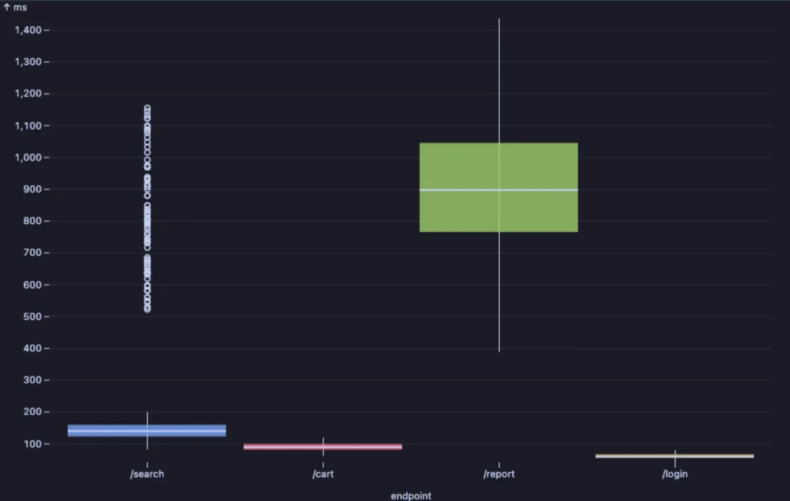
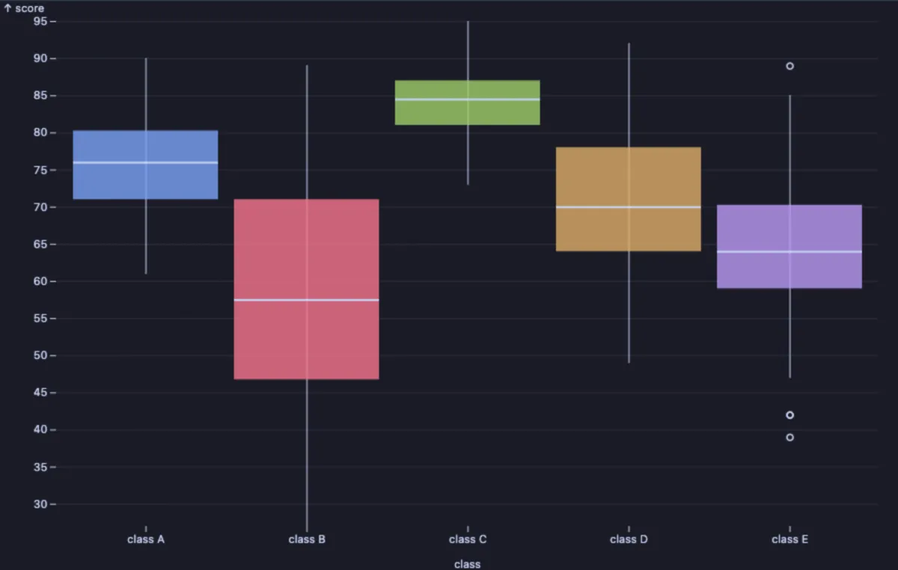
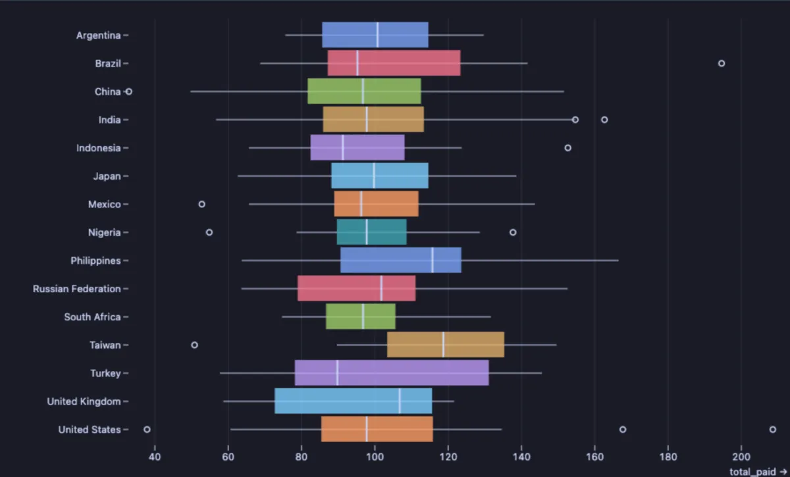

# Box plot

The typical range of a number in each group, and the rows that fall far outside it, in one small box per group.



Response times of four endpoints of an app. Login and cart are fast and steady: short, low boxes. Search is usually quick too, but the dots far above its box are requests that took ten times longer, the ones to investigate. The report endpoint is slow across the board, and its tall box says it is also unpredictable.

## What it is for

- **Comparing groups fairly**: response times per endpoint, delivery times per courier, exam scores per class. The box shows the usual range, so one extreme row does not decide the comparison the way it would an average.
- **Finding the odd ones out**: every dot outside the whiskers is a row unusually far from its group.
- **Many groups at once**: with more than twelve groups the boxes lie down, one per row, so fifty countries or servers still read.

## How to read it

For each group:

- The **line inside the box** is the median: half the rows are below it, half above.
- The **box** holds the middle half of the rows; a short box means the group is consistent, a tall one that it varies.
- The **whiskers** reach out to the furthest rows that are still not unusual.
- The **dots** beyond the whiskers are outliers: rows far from the rest of their group.

## Try it

**API response times per endpoint** (any connection, made up on the spot), the picture above:

```sql
-- @extension plot-boxplot open
-- @inputs value=ms, group=endpoint
select endpoint, round(ms::numeric, 1) as ms
from (select (array['/login', '/search', '/cart', '/report'])[1 + g % 4] as endpoint,
             case g % 4
               when 0 then 40 + (random() + random()) * 20
               when 1 then 80 + (random() + random()) * 60 + case when random() < 0.04 then 400 + random() * 600 else 0 end
               when 2 then 60 + (random() + random()) * 30
               else 300 + (random() + random() + random()) * 400
             end as ms
      from generate_series(1, 8000) g) r;
```

**Exam scores per class** (made up): class C is strong and even, class B is all over the place, and class A sits in the middle with a tight box.

```sql
-- @extension plot-boxplot open
-- @inputs value=score, group=class
select 'class ' || chr(65 + g % 5) as class,
       least(100, greatest(0, round((array[75, 60, 84, 70, 66])[1 + g % 5]
             + (random() + random() + random() - 1.5) * (array[12, 30, 8, 18, 22])[1 + g % 5])))::int as score
from generate_series(1, 600) g
order by class;
```



**What customers paid, in the fifteen countries with the most customers**, in the [dvdrental](https://neon.com/postgresql/postgresql-getting-started/postgresql-sample-database) sample database. Fifteen groups lay the boxes on their sides.

```sql
-- @extension plot-boxplot open
-- @inputs value=total_paid, group=country
with spend as (
  select co.country, sum(p.amount) as total_paid
  from payment p
       join customer c using (customer_id)
       join address a using (address_id)
       join city ci using (city_id)
       join country co using (country_id)
  group by c.customer_id, co.country
), top_countries as (
  select country from spend group by country order by count(*) desc limit 15
)
select s.country, s.total_paid
from spend s join top_countries using (country)
order by s.country;
```



## Settings

| Setting | `@inputs` key | Default | What it does |
|---|---|---|---|
| Value | `value` | asked | The number to summarize (a time, an amount, a score) |
| Group | `group` | none | A column whose values each get a box; none draws one box for all the rows |
| Palette | `palette` | Vivid | The colours of the boxes |
| Title | `title` | none | A title over the chart |

## Good to know

For statisticians: the box spans the first to the third quartile (the interquartile range, IQR), the whiskers reach the furthest values within 1.5 IQR of the box, and the dots are the values beyond. Up to 200 groups are drawn, in the order they first come; with more than twelve, the boxes are horizontal. The whole result is read, up to a million rows, and a sample of 100,000 rows is summarized when there are more. Attach it from a script with `-- @extension plot-boxplot` above a query (add `open`, `only` or `beside` to open on the view), or from a result's own menu; `-- @inputs` answers the settings in the file so the chart draws with no dialog.

## Requirements

PostgreSQL 13 or newer. Nothing runs on the server: the chart is drawn in the result's sandbox. Observable Plot comes from `cdn.jsdelivr.net`, which has to be an allowed remote script host (the Log offers Allow host when it is not); after the first load it is kept on this machine and works offline. Plot core installs with it.
