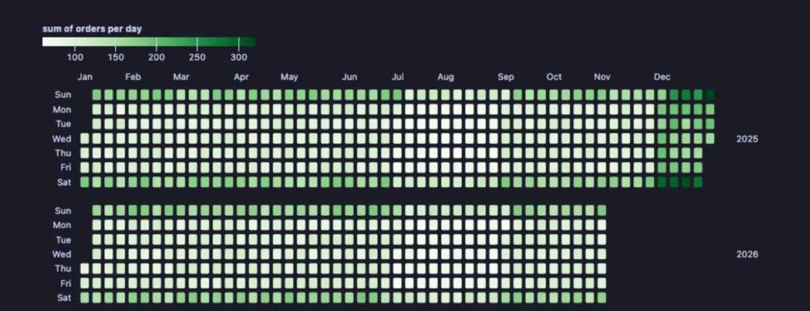
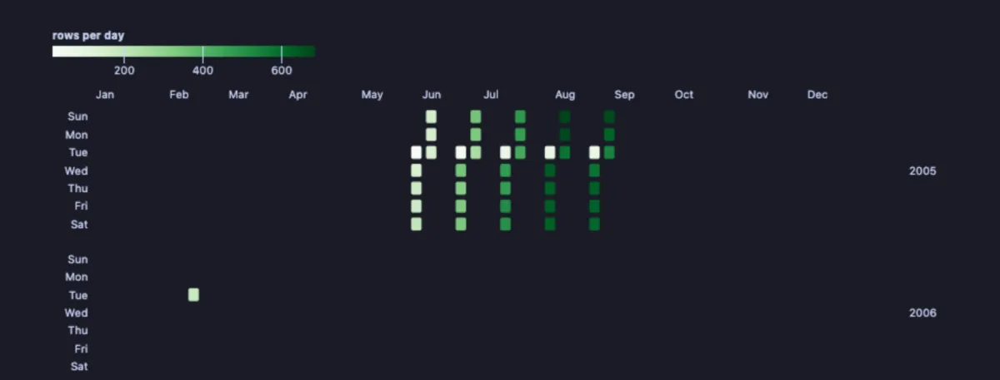

# Calendar

Every day as a small coloured square, a year to a row, like a wall calendar: busy days dark, quiet days light, and the weekly and seasonal rhythm of anything dated jumps out.



A shop's orders per day for almost two years. The darker rows of Saturdays and Sundays show weekends sell more; every December is the darkest stretch of its year, and July and August fade while customers are away. Three patterns, read without a single number.

## What it is for

- **Rhythms in anything dated**: orders, sign-ups, support tickets, deployments, rows written to a table. Weekly habits, seasons and holidays show as stripes and patches.
- **Gaps and bursts**: the days nothing happened (an outage, a broken import) and the days something exploded (a campaign, an incident).
- **A year at a glance for a team**: when are we busiest, and when should nobody plan a release?

## How to read it

Each column is a week, each row a weekday (Sunday at the top), and each year gets its own block. A square's colour is the day's number, light for low and dark for high, on the scale shown in the legend. Days with no rows stay empty. Hover a square for its date and value.

## Try it

**Orders per day in a shop** (any connection, made up on the spot), the picture above:

```sql
-- @extension plot-calendar open
-- @inputs date=day, value=orders
select d::date as day,
       round(100
             * case when extract(isodow from d) >= 6 then 1.6 else 1 end
             * case when extract(month from d) = 12 then 1.8 when extract(month from d) in (7, 8) then 0.7 else 1 end
             * (0.85 + random() * 0.3)) as orders
from generate_series(date '2025-01-01', date '2026-10-31', interval '1 day') d;
```

**When people rented**, in the [dvdrental](https://neon.com/postgresql/postgresql-getting-started/postgresql-sample-database) sample database: with no value picked, each day is coloured by how many rows fall on it. The rentals come in bursts, a few weeks each summer month of 2005 and a single day in February 2006.

```sql
-- @extension plot-calendar open
-- @inputs date=rental_date
select rental_date from rental;
```



## Settings

| Setting | `@inputs` key | Default | What it does |
|---|---|---|---|
| Date | `date` | asked | The date or timestamp each row belongs to |
| Value | `value` | none | A number to add up per day (sales, minutes, bytes); none counts the rows per day |
| Per day | `agg` | sum | How a day's values combine: `sum`, `mean`, `max`, `min` or `count` |
| Colours | `scheme` | greens | The colour scale: `greens`, `blues`, `oranges`, `purples`, `ylgnbu` or `turbo` |

## Good to know

Days are read as the server wrote them, never shifted to this machine's time zone. A timestamp column is cut to its day. The whole result is read, up to a million rows. Attach it from a script with `-- @extension plot-calendar` above a query (add `open`, `only` or `beside` to open on the view), or from a result's own menu; `-- @inputs` answers the settings in the file so the chart draws with no dialog.

## Requirements

PostgreSQL 13 or newer. Nothing runs on the server: the chart is drawn in the result's sandbox. Observable Plot comes from `cdn.jsdelivr.net`, which has to be an allowed remote script host (the Log offers Allow host when it is not); after the first load it is kept on this machine and works offline. Plot core installs with it.
