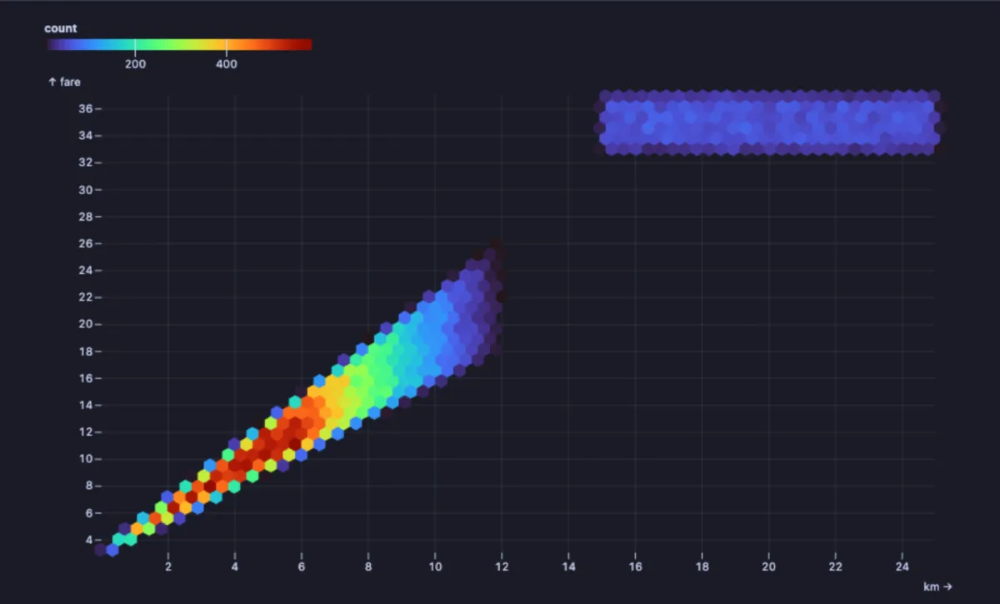
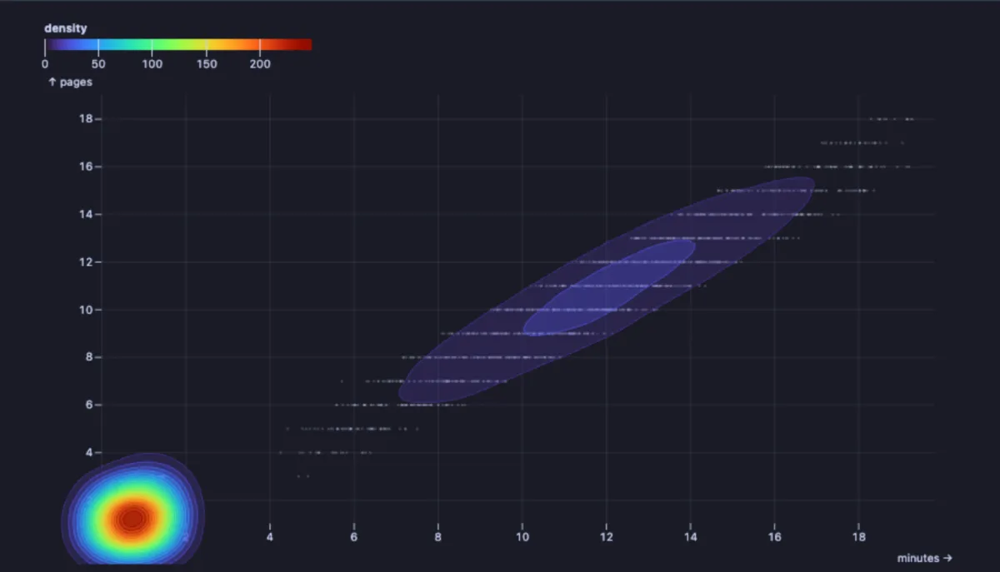

# Density

Where the dots pile up, when there are far too many to see one by one: tens of thousands of rows as a heat map of where they crowd together.



Fifty thousand taxi rides by distance and fare. As a scatter plot they would be a solid blob. Here the bright diagonal band is ordinary city rides, where the fare grows with the distance, and the separate patch on the right is the airport: long rides at one fixed fare. Two kinds of ride, plain to see.

## What it is for

- **Too many points for a scatter plot**: rides, sessions, transactions, measurements; past a few thousand, dots hide each other and only the crowd shows.
- **Finding the kinds of thing hidden in one table**: two bright patches mean two different populations (city and airport rides, browsers and buyers, cached and uncached queries).
- **Where most of the activity is**: which combinations of price and quantity, duration and size, age and income are common, and which are rare.

## How to read it

Each axis is one of the two numbers. With **Style** at `hexbin`, the area is cut into small hexagons, each coloured by how many rows fall in it: the brighter, the more. With `contours`, the crowding is drawn as nested outlines over a faint sample of the dots, like the height lines of a map: the innermost rings are the densest spots. Hover a hexagon for its count.

## Try it

**Taxi rides by distance and fare** (any connection, made up on the spot), the picture above:

```sql
-- @extension plot-density open
-- @inputs x=km, y=fare
select round(km::numeric, 2) as km, round(fare::numeric, 2) as fare
from (select case when random() < 0.15 then 15 + random() * 10 else (random() + random()) * 6 end as km
      from generate_series(1, 50000)) r,
     lateral (select case when km >= 15 then 35 + (random() - 0.5) * 4
                          else 3 + km * 1.6 * (0.8 + random() * 0.4) end as fare) f;
```

**Visits to a website**, as contours (made up): most visitors leave within a minute after a page or two; a second group reads for five to twenty minutes and opens many pages.

```sql
-- @extension plot-density open
-- @inputs x=minutes, y=pages, style=contours
select round(minutes::numeric, 2) as minutes, pages
from (select case when random() < 0.6 then random() * 1.5 else 4 + (random() + random()) * 8 end as minutes
      from generate_series(1, 20000)) s,
     lateral (select greatest(1, round(minutes * 0.9 + (random() - 0.5) * 3))::int as pages) p;
```



## Settings

| Setting | `@inputs` key | Default | What it does |
|---|---|---|---|
| X | `x` | asked | The number across (a distance, a time, a price) |
| Y | `y` | asked | The number up (a fare, a count, a size) |
| Style | `style` | hexbin | `hexbin`: hexagons coloured by how many rows they hold; `contours`: outlines of the crowded areas |
| Hex size (px) | `bin` | 12 | How big a hexagon is on screen: smaller for detail, larger for a smoother picture |
| Colours | `scheme` | turbo | The colour scale: `turbo`, `viridis`, `magma`, `ylgnbu`, `blues` or `oranges` |
| Title | `title` | none | A title over the chart |

## Good to know

The whole result is read, up to a million rows, and every row counts towards the colours; the contours style draws a sample of 4,000 dots under its outlines. For statisticians: contours are a two-dimensional kernel density estimate. For a few hundred rows a plain scatter (Scatter GL, Regression) shows more. Attach it from a script with `-- @extension plot-density` above a query (add `open`, `only` or `beside` to open on the view), or from a result's own menu; `-- @inputs` answers the settings in the file so the chart draws with no dialog.

## Requirements

PostgreSQL 13 or newer. Nothing runs on the server: the chart is drawn in the result's sandbox. Observable Plot comes from `cdn.jsdelivr.net`, which has to be an allowed remote script host (the Log offers Allow host when it is not); after the first load it is kept on this machine and works offline. Plot core installs with it.
