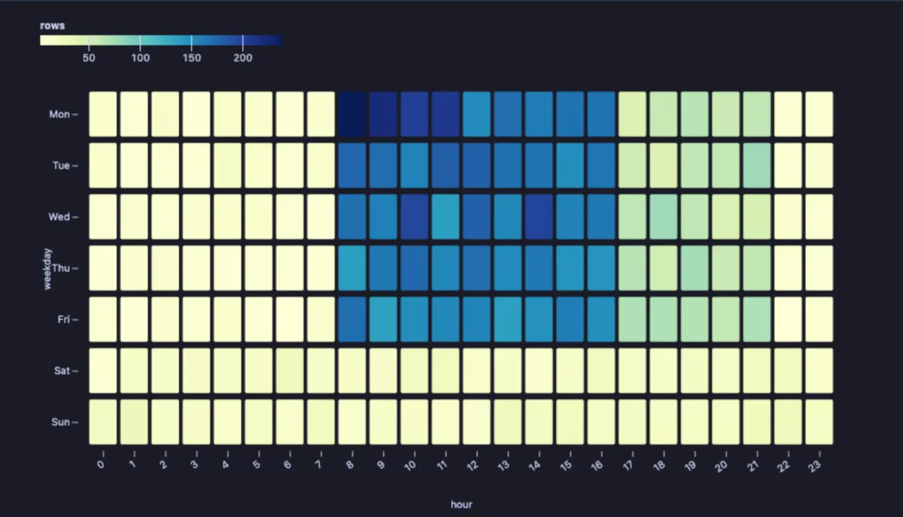
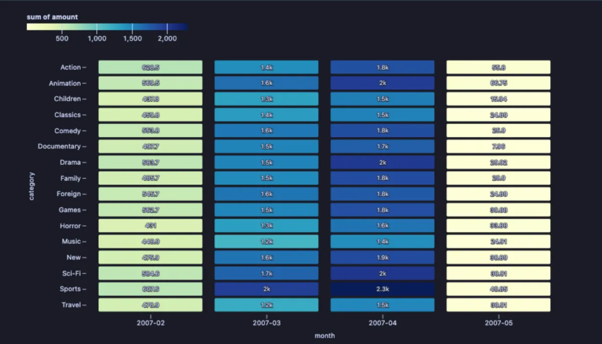

# Heatmap

A table of two categories, every cell coloured by a number: the hot spots (the busiest hour of the week, the best-selling category in a month) stand out at once.



Support tickets for four weeks, by weekday and hour. Office hours on weekdays are warm, evenings cool down, and the weekend is almost empty. The hottest block is Monday from eight to eleven: the weekend's problems arriving at once, which is when to have the most people on the desk.

## What it is for

- **When things happen**: tickets, orders, logins or slow queries by weekday and hour, to staff a desk, plan maintenance or schedule a campaign.
- **Which combinations sell**: revenue by product and month, by region and channel, by category and store.
- **Comparing many small numbers at once**: a 7 by 24 table of numbers is hard to read; the same table in colour is read in a second.

## How to read it

Columns are the values of **X**, rows the values of **Y**, in the order they first come in the result (an `ORDER BY` sets it). A cell's colour is its number on the scale in the legend; when the cells are wide enough, the number is written in them too. An empty cell had no rows. Hover a cell for its exact value.

## Try it

**Support tickets by weekday and hour** (any connection, made up on the spot), the picture above. With no value, each cell counts its rows.

```sql
-- @extension plot-heatmap open
-- @inputs x=hour, y=weekday
select to_char(t, 'Dy') as weekday, extract(hour from t)::int as hour
from (select timestamp '2026-09-07' + random() * interval '28 days' as t
      from generate_series(1, 40000)) s
where random() < case when extract(isodow from t) >= 6 then 0.1
                      when extract(hour from t) between 8 and 16 then 0.9
                      when extract(hour from t) between 17 and 21 then 0.35
                      else 0.05 end
                 * case when extract(isodow from t) = 1 and extract(hour from t) between 8 and 11 then 1.0 else 0.75 end
order by extract(isodow from t), hour;
```

**Revenue by film category and month**, in the [dvdrental](https://neon.com/postgresql/postgresql-getting-started/postgresql-sample-database) sample database: which months carried the business, and which categories in them.

```sql
-- @extension plot-heatmap open
-- @inputs x=month, y=category, value=amount, agg=sum
select to_char(p.payment_date, 'YYYY-MM') as month, c.name as category, p.amount
from payment p
     join rental r using (rental_id)
     join inventory i using (inventory_id)
     join film_category fc using (film_id)
     join category c using (category_id)
order by 1, 2;
```



## Settings

| Setting | `@inputs` key | Default | What it does |
|---|---|---|---|
| X (columns of the grid) | `x` | asked | The category across (an hour, a month, a region) |
| Y (rows of the grid) | `y` | asked | The category down (a weekday, a product, a store) |
| Value | `value` | none | The number each cell is coloured by; none counts the rows in each cell |
| Per cell | `agg` | mean | How the rows of a cell combine: `mean`, `sum`, `max`, `min` or `count` |
| Colours | `scheme` | ylgnbu | The colour scale: `ylgnbu`, `blues`, `greens`, `oranges`, `turbo`, `viridis` or `rdylbu` |
| Title | `title` | none | A title over the chart |

## Good to know

Up to 200 values across and 200 down are drawn; the rest are left out. Note that **Per cell** starts at `mean`: for totals, set it to `sum`. The whole result is read, up to a million rows. Attach it from a script with `-- @extension plot-heatmap` above a query (add `open`, `only` or `beside` to open on the view), or from a result's own menu; `-- @inputs` answers the settings in the file so the chart draws with no dialog.

## Requirements

PostgreSQL 13 or newer. Nothing runs on the server: the chart is drawn in the result's sandbox. Observable Plot comes from `cdn.jsdelivr.net`, which has to be an allowed remote script host (the Log offers Allow host when it is not); after the first load it is kept on this machine and works offline. Plot core installs with it.
