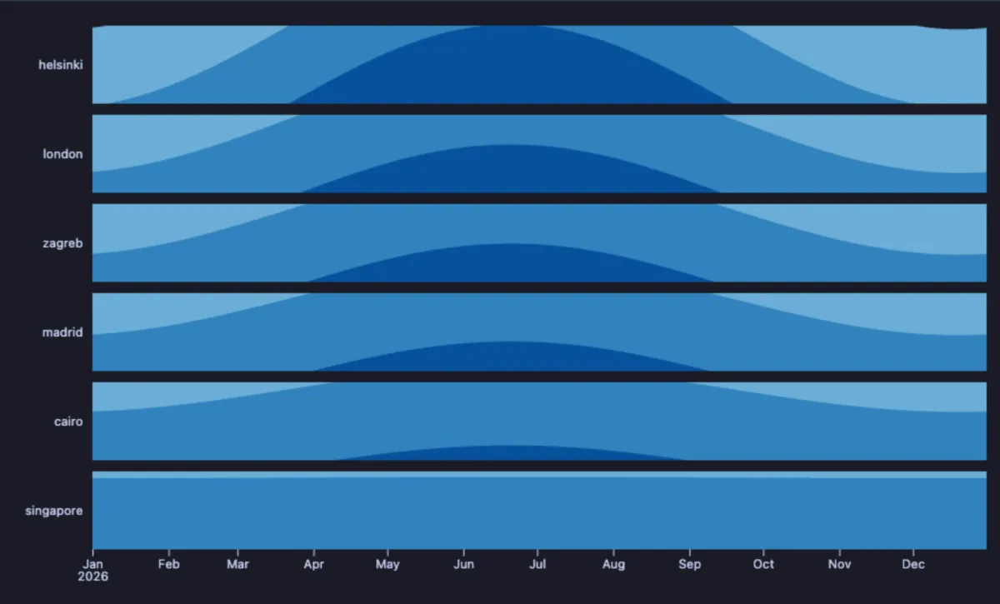

# Horizon

Many lines over the same time, each squeezed into one thin strip that gets darker the higher it goes: compare a dozen servers, stores or sensors in the space of a single chart.


CPU load of eight servers over one day, one strip each. The web servers get busy through the afternoon together, but web_3 has a dark spike late in the morning that the others do not: something happened there. The database follows office hours, the cache never works hard, and the batch server sleeps all day and runs flat out from two to four at night.

## What it is for

- **Watching many things at once**: CPU per server, sales per store, sign-ups per country, temperature per room. Ten line charts take a screen; ten horizon strips take a hand's width.
- **Spotting the one that behaves differently**: a spike, a gap or a shift that only one strip has.
- **Seeing when things happen together**: dark bands lining up across strips mean the load moves together.

## How to read it

Time runs left to right, one strip per series. The darker a strip, the higher its value: a value up to a third of the top is drawn in the lightest shade, the next third is folded on top of it in a darker shade, the last third in the darkest (with **Bands** at 3). So you read height as colour: pale is low, dark is high, and every strip uses the same scale. Hover anywhere for every series' value at that moment.

## Try it

**CPU load of eight servers over a day** (any connection, made up on the spot), the picture above. Each series is a column of the result.

```sql
-- @extension plot-horizon open
-- @inputs x=at, series=web_1, web_2, web_3, db_main, db_replica, cache, queue, batch
select timestamp '2026-10-12' + m * interval '1 minute' as at,
       round((20 + 45 * greatest(0, sin(pi() * (h - 7) / 14)) + random() * 8)::numeric, 1) as web_1,
       round((20 + 45 * greatest(0, sin(pi() * (h - 7) / 14)) + random() * 8)::numeric, 1) as web_2,
       round((20 + 45 * greatest(0, sin(pi() * (h - 7) / 14)) + random() * 8
              + case when h between 11 and 11.5 then 30 else 0 end)::numeric, 1) as web_3,
       round((30 + 40 * greatest(0, sin(pi() * (h - 8) / 11)) + random() * 6)::numeric, 1) as db_main,
       round((15 + 25 * greatest(0, sin(pi() * (h - 8) / 11)) + random() * 6)::numeric, 1) as db_replica,
       round((12 + random() * 5)::numeric, 1) as cache,
       round((10 + 30 * greatest(0, sin(pi() * (h - 9) / 10)) + random() * 10)::numeric, 1) as queue,
       round((case when h between 2 and 4 then 85 + random() * 10 else 5 + random() * 4 end)::numeric, 1) as batch
from generate_series(0, 1439) m, lateral (select m / 60.0 as h) t;
```

**Hours of daylight in six cities over a year** (made up from the sun's yearly swing): the further north, the darker the summer and the paler the winter; Singapore, on the equator, is the same shade all year.

```sql
-- @extension plot-horizon open
-- @inputs x=day, series=helsinki, london, zagreb, madrid, cairo, singapore
select d::date as day,
       round((12.5 + 6.5 * s)::numeric, 2) as helsinki,
       round((12.2 + 4.3 * s)::numeric, 2) as london,
       round((12.1 + 3.6 * s)::numeric, 2) as zagreb,
       round((12.1 + 2.9 * s)::numeric, 2) as madrid,
       round((12.0 + 1.8 * s)::numeric, 2) as cairo,
       round((12.1 + 0.05 * s)::numeric, 2) as singapore
from generate_series(date '2026-01-01', date '2026-12-31', interval '1 day') d,
     lateral (select sin(2 * pi() * (extract(doy from d) - 80) / 365) as s) t;
```



## Settings

| Setting | `@inputs` key | Default | What it does |
|---|---|---|---|
| X (a column, or the row order) | `x` | asked | Time across: a timestamp draws a time axis, a number a numeric one, anything else categories |
| Series (one row each) | `series` | asked, every number column offered | The columns to draw, one strip each, as a comma list |
| Bands | `bands` | 3 | How many shades the height is folded into, 1 to 5: more shades tell finer differences apart |
| Colours | `scheme` | blues | The shades: `blues`, `greens`, `oranges`, `purples` or `reds` |

## Good to know

A moment with no row is not drawn as zero: the strip runs straight from the row before to the row after. Give every moment a row (a `generate_series` of the days, joined to the data, as in the dvdrental example) when the gaps matter. Every strip shares the same scale, set by the highest value of all, so a strip that stays pale really is low. Values below zero are not drawn (the strips fold upward only). The data is wide: one column per series. A long table (a server column and a value column) turns into this shape with the Pivot extension, `-- @extension pivot | plot-horizon`. Each series is reduced to what the pixels can show, so a million rows still draw quickly. Attach it from a script with `-- @extension plot-horizon` above a query (add `open`, `only` or `beside` to open on the view), or from a result's own menu; `-- @inputs` answers the settings in the file so the chart draws with no dialog.

## Requirements

PostgreSQL 13 or newer. Nothing runs on the server: the chart is drawn in the result's sandbox. Observable Plot comes from `cdn.jsdelivr.net`, which has to be an allowed remote script host (the Log offers Allow host when it is not); after the first load it is kept on this machine and works offline. Plot core installs with it.
