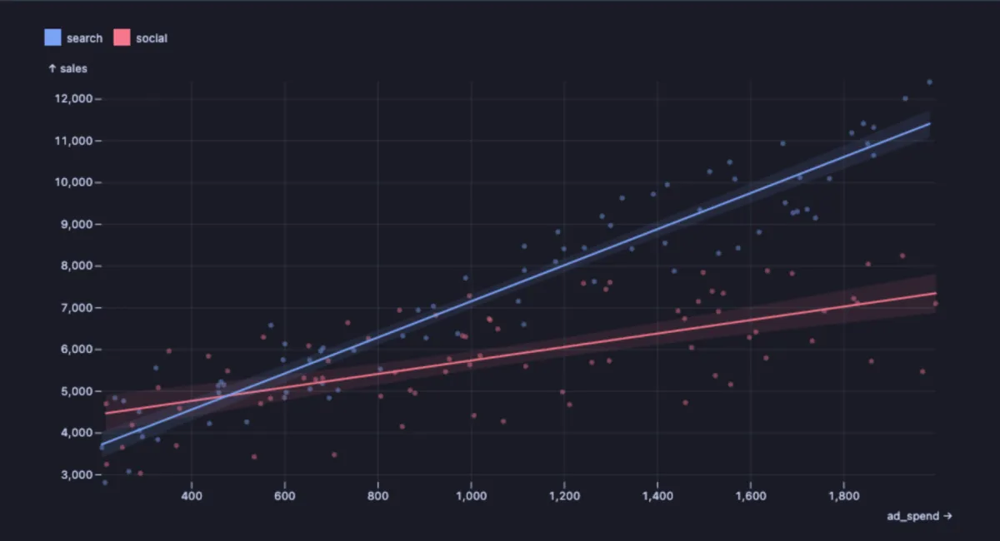
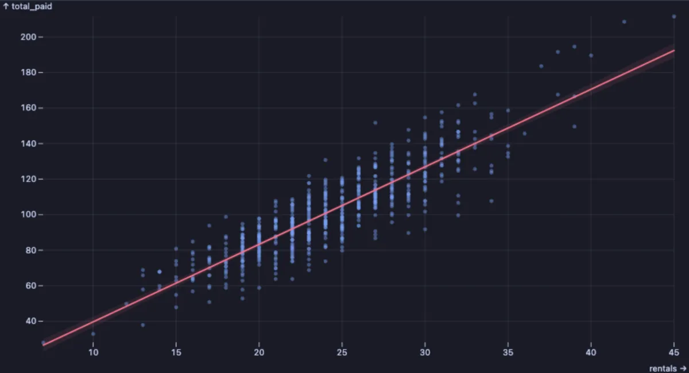

# Regression

A cloud of dots with the straight line that fits them best: does more of one thing bring more of the other, and by how much?



A year and a half of weekly ad spend and sales, for two ad channels. Both lines climb, so spending more sells more on both. But search's line is far steeper: each extra euro there brings about four in sales, against about one and a half on social. The shaded band around each line is how sure the fit is.

## What it is for

- **How much does one thing move another?** Ad spend and sales, house size and price, table size and query time, hours studied and test score. The slope of the line is the answer: how much Y grows for each unit of X.
- **Comparing groups**: with a **Group**, each gets its own line, so a steeper line is the group where the effect is stronger.
- **Finding the rows that do not follow the rule**: the dots far from the line are the exceptions worth a look.

## How to read it

Each dot is a row, X across and Y up. The line is the straight line closest to all the dots; the shaded band around it is where the true line probably lies (narrow when the dots agree, wide when they scatter or are few). A steep line means Y changes a lot with X, a flat one that it hardly does. Dots far from the line are rows the rule does not explain.

## Try it

**Ad spend and sales per week, for two channels** (any connection, made up on the spot), the picture above:

```sql
-- @extension plot-regression open
-- @inputs x=ad_spend, y=sales, color=channel
select channel,
       round(spend::numeric) as ad_spend,
       round((base + spend * slope + (random() - 0.5) * noise)::numeric) as sales
from (select (array['search', 'social'])[1 + g % 2] as channel,
             200 + random() * 1800 as spend,
             (array[3000, 4000])[1 + g % 2] as base,
             (array[4.2, 1.6])[1 + g % 2] as slope,
             (array[2500, 3500])[1 + g % 2] as noise
      from generate_series(1, 150) g) w;
```

**Do customers who rent more also pay more?**, in the [dvdrental](https://neon.com/postgresql/postgresql-getting-started/postgresql-sample-database) sample database: a tight line, each extra rental worth about 4.20.

```sql
-- @extension plot-regression open
-- @inputs x=rentals, y=total_paid
select c.customer_id, count(*) as rentals, sum(p.amount) as total_paid
from payment p join customer c using (customer_id)
group by c.customer_id;
```



## Settings

| Setting | `@inputs` key | Default | What it does |
|---|---|---|---|
| X | `x` | asked | The number that might drive the other (spend, size, hours) |
| Y | `y` | asked | The number that might follow (sales, price, score) |
| Group (optional) | `color` | none | A column whose values each get a colour and their own line |
| Dots drawn | `dots` | 15000 | A larger result shows a random sample of this many dots; the line is still fitted on every row |
| Palette | `palette` | Vivid | The colours of the groups |
| Title | `title` | none | A title over the chart |

## Good to know

For statisticians: the line is an ordinary least squares fit of Y on X, and the band its 95% confidence interval. A straight line only finds a straight-line relation; a curve (rising, then falling) fits poorly and the dots say so. A line says the two move together, not that one causes the other. The whole result is read, up to a million rows. The Correlation extension gives the strength of the link as one number for many pairs of columns at once. Attach it from a script with `-- @extension plot-regression` above a query (add `open`, `only` or `beside` to open on the view), or from a result's own menu; `-- @inputs` answers the settings in the file so the chart draws with no dialog.

## Requirements

PostgreSQL 13 or newer. Nothing runs on the server: the chart is drawn in the result's sandbox. Observable Plot comes from `cdn.jsdelivr.net`, which has to be an allowed remote script host (the Log offers Allow host when it is not); after the first load it is kept on this machine and works offline. Plot core installs with it.
