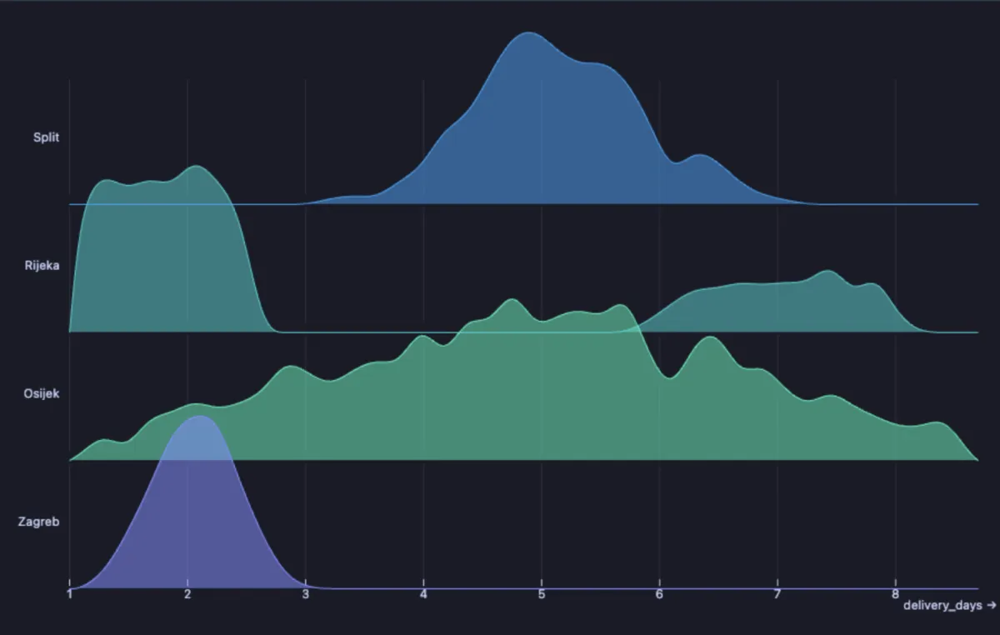
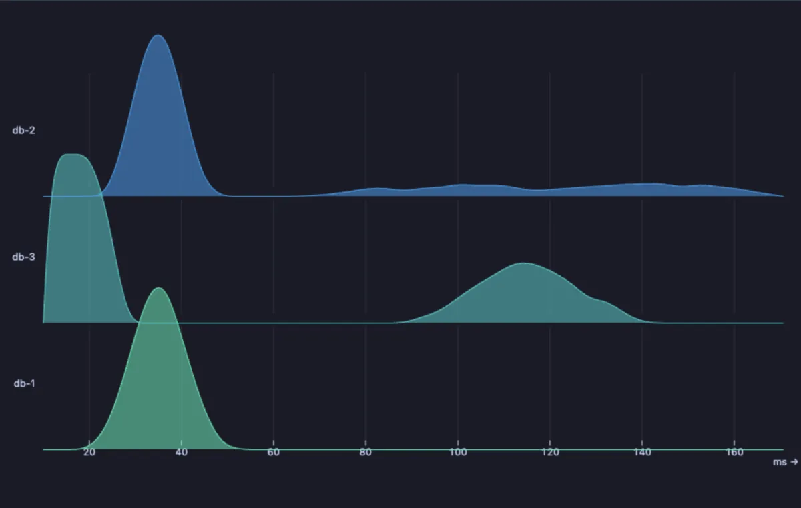

# Ridgeline

See how values spread out in each group, not just their average: one small mountain range per group, high where many rows have that value.



Delivery times in four cities. Their averages are close, but the picture tells four different stories: Zagreb is fast and steady, Split is slow and steady, Osijek is a lottery, and Rijeka is usually fast with a group of deliveries that take a week. That second hump is something to go and ask about; the average hides it.

## What it is for

- **Is the average telling the truth?** Two shops with the same average delivery time can be one that is always on time and one that is either very fast or very late.
- **Comparing many groups at once**: response times per server, order values per country, salaries per department, test scores per class, each its own ridge, stacked so they read side by side.
- **Spotting two kinds of thing mixed together**: a second hump usually means two different cases in one group (express and standard shipping, cached and uncached queries, weekday and weekend).

## How to read it

Each group is one row. Left to right is the value (here, days); the height of the ridge says how many rows have that value: a tall, narrow peak means most rows are alike, a low, wide ridge means they vary a lot, and two peaks mean two typical values. With **Height** at `per group` every ridge is scaled to its own tallest point, so a small group is as readable as a large one; `shared` keeps one scale, so a bigger group stands taller.

## Try it

**Delivery times per city** (any connection, made up on the spot), the picture above:

```sql
-- @extension plot-ridgeline open
-- @inputs value=delivery_days, group=city
select city, round(days::numeric, 1) as delivery_days
from (select (array['Zagreb', 'Split', 'Rijeka', 'Osijek'])[1 + g % 4] as city,
             case g % 4
               when 0 then 1 + (random() + random() + random()) * 0.7
               when 1 then 3 + (random() + random() + random()) * 1.4
               when 2 then case when random() < 0.7 then 1 + random() * 1.5 else 6 + random() * 2 end
               else 1 + (random() + random()) * 4
             end as days
      from generate_series(1, 4000) g) d;
```

**Query times per server** (any connection, made up on the spot): one server is fast and steady, one has a tail of slow queries, and one has two humps, the queries its cache answers and the ones that go to disk.

```sql
-- @extension plot-ridgeline open
-- @inputs value=ms, group=server
select server, round(ms::numeric, 1) as ms
from (select (array['db-1', 'db-2', 'db-3'])[1 + g % 3] as server,
             case g % 3
               when 0 then 20 + (random() + random() + random()) * 10
               when 1 then 25 + (random() + random()) * 10 + case when random() < 0.3 then 40 + random() * 90 else 0 end
               else case when random() < 0.6 then 10 + random() * 15 else 90 + (random() + random()) * 25 end
             end as ms
      from generate_series(1, 6000) g) q;
```



## Settings

| Setting | `@inputs` key | Default | What it does |
|---|---|---|---|
| Value | `value` | asked | The number whose spread you want to see (a time, a price, a size) |
| Group (one ridge each) | `group` | asked | The column whose values each get a ridge (a city, a category, a server) |
| Height | `scale` | per group | `per group`: every ridge as tall as it can be, to compare shapes; `shared`: one scale, to compare sizes too |
| Bins | `bins` | 40 | How finely the values are cut: more for a detailed outline, fewer for a smoother one |
| Palette | `palette` | Cool | The colours of the ridges |
| Title | `title` | none | A title over the chart |

## Good to know

Up to 120 groups are drawn. Each ridge is a histogram (the rows counted in 40 equal slices of the value range) drawn as an outline, so the shape depends a little on **Bins**. A result of up to a million rows is read and reduced before drawing. Attach it from a script with `-- @extension plot-ridgeline` above a query (add `open`, `only` or `beside` to open on the view), or from a result's own menu; `-- @inputs` answers the settings in the file so the chart draws with no dialog.

## Requirements

PostgreSQL 13 or newer. Nothing runs on the server: the chart is drawn in the result's sandbox. Observable Plot comes from `cdn.jsdelivr.net`, which has to be an allowed remote script host (the Log offers Allow host when it is not); after the first load it is kept on this machine and works offline. Plot core installs with it.
