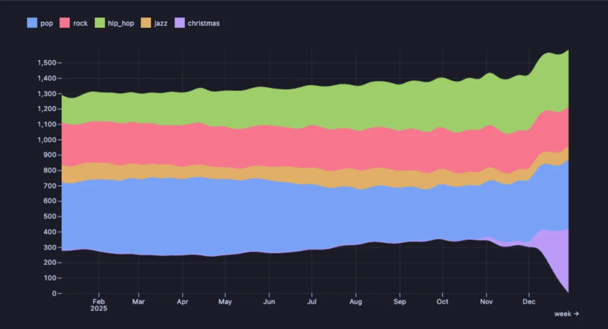
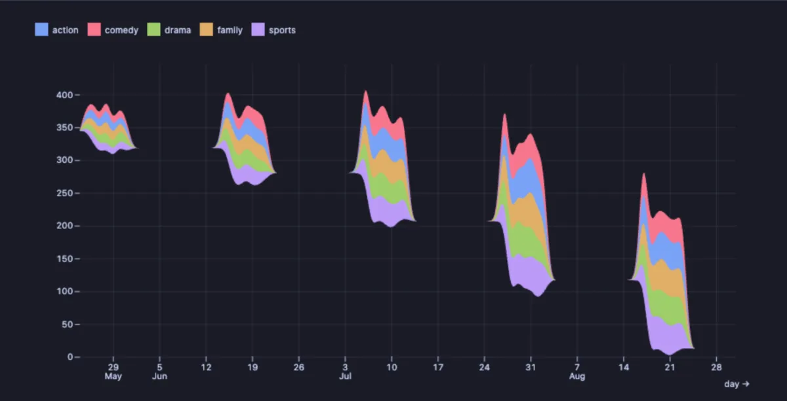

# Streamgraph

How a whole splits into its parts over time, drawn as flowing bands: watch each part grow, shrink, appear and vanish.



A year of weekly music streams by genre. Pop is the biggest share and comes in waves, hip hop grows all year long, rock and jazz hold steady, and Christmas music, a thin thread for eleven months, swells into one of the widest bands in December.

## What it is for

- **The mix behind a total**: sales by product line, traffic by source, tickets by type, storage by table, over weeks or months.
- **Shifts in the mix**: a part that is slowly taking over, one that is fading, a newcomer arriving.
- **Seasonal parts**: the things that only matter at one time of year show as bands that swell and shrink.

## How to read it

Time runs left to right. Each part is a band, and its thickness at a moment is its value then: a band that widens is growing. The bands are stacked on each other, so the height of the whole stream is the total. The stream is centred and wobbles to keep the bands smooth, so read the thickness of a band, not its height above the bottom. Hover a band to read it.

## Try it

**Music streams per genre over a year** (any connection, made up on the spot), the picture above. Each part is a column of the result.

```sql
-- @extension plot-streamgraph open
-- @inputs x=week, series=pop, rock, hip_hop, jazz, christmas
select w::date as week,
       round(400 + 80 * sin(n / 8.0) + random() * 40) as pop,
       round(250 + random() * 30) as rock,
       round(150 + n * 4 + random() * 30) as hip_hop,
       round(90 + 20 * cos(n / 5.0) + random() * 15) as jazz,
       round(case when extract(month from w) = 12 then 450 * extract(day from w) / 31.0
                  when extract(month from w) = 11 then 30 else 5 end) as christmas
from generate_series(date '2025-01-06', date '2025-12-29', interval '7 days') with ordinality as s(w, n);
```

**Rentals per day by film category**, in the [dvdrental](https://neon.com/postgresql/postgresql-getting-started/postgresql-sample-database) sample database, over the summer of 2005: the whole stream swells in the busy weeks and thins to nothing in the quiet ones, and the categories keep about the same shares. Every day gets a row from `generate_series`, so the quiet days are zeros.

```sql
-- @extension plot-streamgraph open
-- @inputs x=day, series=action, comedy, drama, family, sports
select d::date as day,
       count(*) filter (where c.name = 'Action') as action,
       count(*) filter (where c.name = 'Comedy') as comedy,
       count(*) filter (where c.name = 'Drama') as drama,
       count(*) filter (where c.name = 'Family') as family,
       count(*) filter (where c.name = 'Sports') as sports
from generate_series(date '2005-05-24', date '2005-08-31', interval '1 day') d
     left join rental r on r.rental_date::date = d::date
     left join inventory i using (inventory_id)
     left join film_category fc using (film_id)
     left join category c using (category_id)
group by 1
order by 1;
```



## Settings

| Setting | `@inputs` key | Default | What it does |
|---|---|---|---|
| X (a column, or the row order) | `x` | asked | Time across: a timestamp draws a time axis, a number a numeric one, anything else categories |
| Series (Y) | `series` | asked, every number column offered | The parts, one column each, as a comma list |
| Palette | `palette` | Vivid | The colours of the bands |
| Title | `title` | none | A title over the chart |

## Good to know

The data is wide: one column per part. A long table (a category column and a value column) turns into this shape with the Pivot extension, `-- @extension pivot | plot-streamgraph`. An empty value counts as zero, but a moment with no row at all is bridged smoothly from its neighbours: give every moment a row (a `generate_series` of the days, joined to the data, as in the dvdrental example) when the gaps matter. With many rows, neighbouring moments are averaged into one per pixel, so a million rows still draw as a smooth shape. For statisticians: the layout is a stacked area with the "wiggle" offset. Attach it from a script with `-- @extension plot-streamgraph` above a query (add `open`, `only` or `beside` to open on the view), or from a result's own menu; `-- @inputs` answers the settings in the file so the chart draws with no dialog.

## Requirements

PostgreSQL 13 or newer. Nothing runs on the server: the chart is drawn in the result's sandbox. Observable Plot comes from `cdn.jsdelivr.net`, which has to be an allowed remote script host (the Log offers Allow host when it is not); after the first load it is kept on this machine and works offline. Plot core installs with it.
