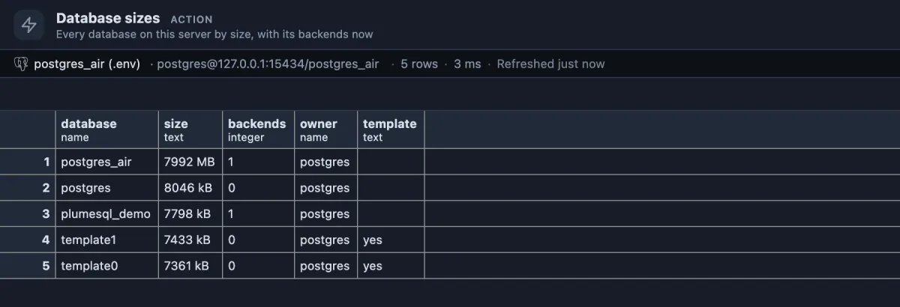

# Database sizes

Every database on the server by size, the biggest first, with how many sessions are connected to each right now.

The [postgres_air](https://github.com/hettie-d/postgres_air) sample server: one real database of almost 8 GB, and around it the small ones every server has. `template0` and `template1` are the templates a new database is copied from (`yes` in the last column); about 7 MB is what an empty database costs.

## When to use it

- **The disk is filling up** and you need to know which database it is before looking at tables.
- **On a server you have just been given**: what lives here, how big, and which databases anyone actually uses (**backends**).
- **Cleaning up old databases**: a big one with no sessions for weeks is a candidate to archive and drop.
- **Before a backup or a move**, to know how much there is to copy.

## How to read it

One row per database, the largest first:

| Column | Meaning |
|---|---|
| database | Its name. |
| size | On disk, all in: tables, indexes, TOAST. Empty where your connection may not connect to that database (a hosted service keeps its own, like `rdsadmin`, out of reach). |
| backends | Sessions connected to it right now, yours included. |
| owner | The role that owns it. |
| template | `yes` for template databases. |

From here, Table sizes (connected to the big database) shows which tables make up its size, and Table bloat how much of that is empty space.

## Try it

Run it from its button under the right strip's tabs, or from the Extensions side tab (**Run** on its row). There is nothing to set up: every server has databases.

## Good to know

It reads `pg_database` with `pg_database_size()` and the session counts of `pg_stat_database`. The size of a database is asked only where the connection holds CONNECT on it, so the query never fails on a database it may not see. The WAL, the server's logs and its configuration live outside the databases and are not counted. Reads only. Ships pinned to the right strip under its tabs (`@toolbar right-below`).

## Requirements

PostgreSQL 13 or newer.
