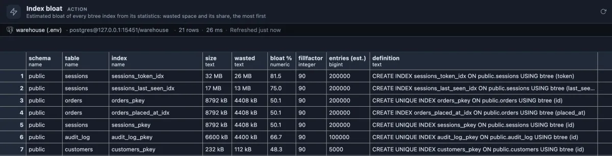

# Index bloat

How much of each index is empty space: the btree indexes that take more room than their entries need, the most wasted first, with the statement to rebuild each one.



The same shop as in Table bloat. Every session's `token` and `last_seen` were changed three times, so their two indexes received four entries per session and kept the room for all of them after the old ones were removed: 81 and 75 percent empty. The primary keys sit at about half, the usual mark of an index whose pages split while rows were updated in the middle of it. The last two, a page each, are nothing to act on.

## When to use it

- **Indexes take more space than the table**, or more than they did last month.
- **After a big batch of updates or deletes**, above all on a column that is indexed and changed (a status, a timestamp, a random token).
- **A query that walks an index got slower** with no change in the data's size: it reads half empty pages.
- **Before a maintenance window**: to rebuild the few indexes where it pays.

## How to read it

One row per btree index whose estimate says it holds more pages than its entries need:

| Column | Meaning |
|---|---|
| schema, table, index | The index and its table. |
| size | Its pages, as the last VACUUM or ANALYZE counted them. |
| wasted | The pages beyond what the entries need. |
| bloat % | The wasted share of the size. |
| fillfactor | The share of each page the index fills on purpose (90 by default for btree); the space it keeps free on purpose is not counted as waste. |
| entries (est.) | The entry count the estimate works from. |
| definition | The `CREATE INDEX` statement, to rebuild it by. |

What the numbers mean:

- **Under about 30 percent**: normal for an index that is written to. Pages split as new entries arrive, and a half full page fills up again over time.
- **Over 50 percent on a big index**: a rebuild gives the space back and makes scans read fewer pages. `REINDEX INDEX CONCURRENTLY index_name;` builds a fresh copy beside the old one and swaps them, without blocking reads or writes; it needs room for the copy while it runs.
- **The same index bloated again soon after a rebuild**: the pattern of writes causes it. An index on a column that is updated often is a candidate to drop, if queries do not need it (Unused indexes tells).

## Try it

Run it from the Extensions side tab (**Run** on its row). This makes a bloated index to see it work. **On a test database**:

```sql
create table index_demo (id integer primary key, code uuid not null) with (autovacuum_enabled = off);
create index index_demo_code_idx on index_demo (code);
insert into index_demo select g, gen_random_uuid() from generate_series(1, 100000) g;
update index_demo set code = gen_random_uuid();
update index_demo set code = gen_random_uuid();
vacuum index_demo;
analyze index_demo;
```

Run Index bloat again: `index_demo_code_idx` is about 12 MB and three quarters of it is waste. Rebuild it and run it once more:

```sql
reindex index concurrently index_demo_code_idx;
analyze index_demo;
```

The index is down to about 3 MB, its waste about one percent. Clean up with `drop table index_demo;`.

## Good to know

The estimate is the well known one computed from the planner's statistics: for every indexed column it takes the average width and null fraction from `pg_stats` (an expression index's own statistics for an expression), builds the size of an average index entry with its header and alignment, and derives the leaf pages the entries need at the index's fillfactor. What the index has beyond that is the waste. It reads no index, and indexes whose columns the statistics do not cover are left out rather than guessed at. For an exact figure on one index, the `pgstattuple` extension's `pgstatindex()` reads it page by page.

The estimate knows nothing of btree deduplication (PostgreSQL 13 and newer), which stores a repeated value once: an index on a column with few distinct values can be much smaller than the estimate expects, and then it does not show at all. The figure is a lower bound there, never an exaggeration. Only btree indexes are estimated; GIN, GiST, BRIN and hash indexes are not listed.

Reads only: nothing is rebuilt here. The system catalogs' indexes are left out: their waste is a page or two.

## Requirements

PostgreSQL 13 or newer (`REINDEX ... CONCURRENTLY` needs 12 or newer, so it is always there). `pg_stats` shows only the columns the current role may read, so a role that cannot read a table does not see its indexes.
