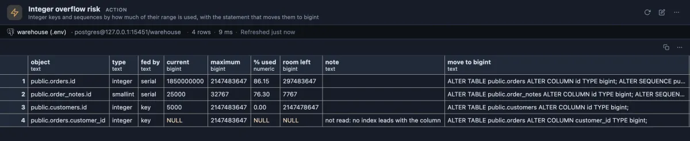

# Integer overflow risk

Which ID columns are running out of numbers: every `integer` and `smallint` key and sequence by how much of its range is used, with the statement that moves it to `bigint`.



The shop's `orders.id` is an `integer` fed by a sequence that has handed out 1.85 billion numbers: 86 percent of the range is gone and about 297 million inserts are left. `order_notes.id` is a `smallint`, and 25,000 notes have used three quarters of its 32,767. Both rows carry the statement that fixes them. `orders.customer_id` was not measured: no index starts with it, and the extension never scans a table to find out (see Good to know).

## When to use it

- **Once a quarter on a database that has been running for years.** An `integer` key stops at 2,147,483,647 and a `smallint` one at 32,767; the insert after that fails, every time, until the column is changed. Checking ahead turns an outage into a planned change.
- **When inserts suddenly fail** with `nextval: reached maximum value of sequence` or `integer out of range`: the row at the top is the one.
- **Before a migration or a big import** that will add many rows to a table with an `integer` key.

## How to read it

One row per `smallint` or `integer` column that is a primary key, a foreign key, an identity or fed by a sequence, and per integer sequence no such column owns, the fullest first:

| Column | Meaning |
|---|---|
| object | `schema.table.column`, or `schema.sequence` for a sequence of its own. |
| type | `smallint` or `integer`. |
| fed by | `identity`, `serial` (a sequence the column owns), `key` (a primary or foreign key with no sequence) or `sequence`. |
| current | The sequence's last value, or the largest value in the column. |
| maximum | The largest value the type holds. |
| % used | How much of the range is used. |
| room left | How many values are left. |
| note | Why a row has no numbers: `not used yet` for a sequence that never gave a value, `not read: no index leads with the column` for a key column only a full table scan could measure. |
| move to bigint | The statement that removes the limit: the `ALTER TABLE ... TYPE bigint`, and for a serial column the `ALTER SEQUENCE ... AS bigint` its sequence needs too. |

What to do about it:

- **Under 50 percent**: nothing yet. Health check flags the same risks from 50 percent on, beside its other checks.
- **Over 50 percent and growing**: plan the change. Work out how fast it grows (the room left divided by the rows added per day) to know how much time there is.
- **Over 80 percent**: change it soon. Copy the statement from the last column into a script. It rewrites the whole table under an exclusive lock, so on a large table run it in a maintenance window. Change the foreign keys that point at the column too (they are listed as their own rows, as `key`), or they stay `integer`.

## Try it

Run it from the Extensions side tab (**Run** on its row). The form asks from which percentage to show; leave it at 0 to see everything. A quiet database shows its keys at 0 percent; this makes one that is nearly full. **On a test database**:

```sql
create table overflow_demo (id serial primary key, note text);
select setval('overflow_demo_id_seq', 2000000000);
```

Run it again: `public.overflow_demo.id` comes first at 93.13 percent, with 147,483,647 values left and the statement `ALTER TABLE public.overflow_demo ALTER COLUMN id TYPE bigint; ALTER SEQUENCE public.overflow_demo_id_seq AS bigint;`. Clean up with `drop table overflow_demo;`.

## Settings

| Input | Default | What it does |
|---|---|---|
| Show from (percent used) | 0 | Leaves out everything below this percentage. 50 shows only what needs planning. |

## Good to know

It reads cheaply: a column fed by a sequence is measured by its sequence, and any other key column by `max()` only when an index starts with it, so the answer comes from the index and the table is never scanned. A key column with no such index is listed with the note instead of a number. The statements in the last column are not run here.

An identity column's sequence follows its column's type when the column changes; a serial's sequence does not, which is why a serial row carries the second statement.

## Requirements

PostgreSQL 13 or newer. A column the current role may not read is listed without numbers.
