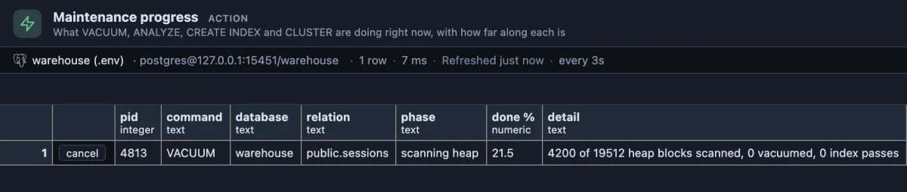

# Maintenance progress

What VACUUM, ANALYZE, CREATE INDEX and CLUSTER are doing right now, and how far along each one is, refreshed every three seconds.



A `VACUUM` of the shop's `sessions` table, slowed down on purpose: it has read 4,200 of the table's 19,512 blocks, so it is about a fifth of the way through its first phase. The row starts with its **cancel** button; to the right of the picture it goes on with how long it has run (14 seconds), who started it and its statement. The row stays while it runs and moves on to the next phase as the vacuum does.

## When to use it

- **"Is it still doing anything?"**: a `CREATE INDEX` or `VACUUM FULL` started half an hour ago, and the session that runs it just waits.
- **The disk is busy and nobody runs anything**: autovacuum's own work shows here, with `autovacuum` in **started by**.
- **Planning around a long job**: the percentage and the running time give a fair idea of how long the rest will take.
- **Stopping a job that came at the wrong moment**: the **cancel** button on its row.

## How to read it

One row per running operation, on every database of the server, the longest running first:

| Column | Meaning |
|---|---|
| pid | The backend doing the work. |
| command | `VACUUM`, `ANALYZE`, `CREATE INDEX`, `CREATE INDEX CONCURRENTLY`, `REINDEX`, `CLUSTER` or `VACUUM FULL`. |
| database, relation | Where it works. The relation is named for the database you are connected to; elsewhere it shows its oid. |
| phase | The step PostgreSQL reports, word for word (`scanning heap`, `vacuuming indexes`, `building index`, ...). |
| done % | How far along the current phase is, where PostgreSQL counts it. Empty where nothing measures it. |
| detail | The raw counters behind the percentage. |
| running for | Since the statement started. |
| started by | The user, or `autovacuum`. |
| query | The statement. |

The percentage belongs to the PHASE, not to the whole job: a VACUUM counts the blocks it scans, then stands still while it cleans the indexes (the index passes count in the detail), then counts the blocks it cleans; a CREATE INDEX counts blocks while it reads the table and rows while it sorts and writes them. A job can therefore reach 100 percent, start over at 0 and still be fine.

**cancel** on a row asks first, then runs `pg_cancel_backend()` on its pid. The operation stops where it is. A cancelled `CREATE INDEX CONCURRENTLY` leaves an invalid index behind to drop (Table indexes shows it as not valid); a cancelled autovacuum simply comes back later.

## Try it

Run it from the Extensions side tab (**Run** on its row) and leave its tab open: it refreshes on its own. A quiet database shows nothing, so give it something to watch. **On a test database**, in another session (another tab or psql):

```sql
create table progress_demo as
select g as id, md5(g::text) as hash from generate_series(1, 3000000) g;
set vacuum_cost_delay = 10;
vacuum (disable_page_skipping, analyze) progress_demo;
```

The table takes about 200 MB. `vacuum_cost_delay` makes this session's vacuum pause between batches of pages, so it takes half a minute instead of two seconds, long enough to watch the row climb from 0 to 100 percent and change phase. A `create index on progress_demo (hash);` shows up the same way. Clean up with `drop table progress_demo;`.

## Good to know

It reads the `pg_stat_progress_vacuum`, `pg_stat_progress_analyze`, `pg_stat_progress_create_index` and `pg_stat_progress_cluster` views. A CLUSTER through an index counts rows against the table's estimated row count, so its percentage stops at 99.9 until it is done. Refreshes every 3 seconds (`@refresh 3s`), only while its tab is the active one, and opens on its result (`@face result`).

## Requirements

PostgreSQL 13 or newer. Seeing other users' statements needs the `pg_read_all_stats` role or superuser; cancelling another user's backend needs `pg_signal_backend` or superuser.
