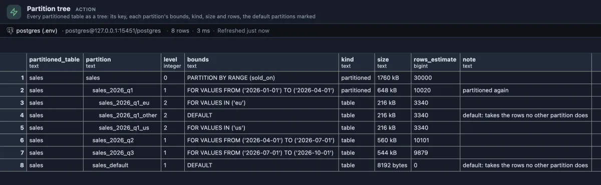

# Partition tree

Every partitioned table as a tree: how it is split, which rows each partition takes, how big each one is, and the default partitions that catch what fits nowhere else.



A `sales` table split by quarter on `sold_on`, its first quarter split again by region. Each partition takes a third of its quarter's rows; `sales_2026_q1_other` is the default of the first quarter and holds the `apac` sales, which no region list names. `sales_default` at the bottom is empty, which is how it should be: every sale so far had a quarter to go to.

## When to use it

- **Before the next period starts**: is next quarter's partition already there? If not, its rows will land in the default partition.
- **A default partition that grows** is the first sign that partitions are not being created ahead of time. Rows that sit in a default have to be moved before a matching partition can be attached.
- **Uneven partitions**: one much bigger than its siblings means the split key does not spread the rows as expected.
- **Before dropping old data**: which partition holds which range, and how much space dropping it gives back.

## How to read it

One row per table in the tree, each partition under its parent and indented by its level:

| Column | Meaning |
|---|---|
| partitioned_table | The table at the top of the tree. |
| partition | The partition, indented by its level. |
| level | 0 for the top, 1 for its partitions, 2 for theirs. |
| bounds | On the top row the split: `PARTITION BY RANGE (sold_on)`. On a partition the rows it takes: `FOR VALUES FROM (...) TO (...)` for a range, `FOR VALUES IN (...)` for a list, `WITH (MODULUS ..., REMAINDER ...)` for a hash, or `DEFAULT`. A range includes its FROM value and stops just before its TO value. |
| kind | `partitioned` (split again), `table`, or `foreign table`. |
| size | On disk with indexes and TOAST; a partitioned table's is its partitions' together. |
| rows_estimate | The planner's estimate from the last ANALYZE; a partitioned table's is its partitions' together. |
| note | `default: takes the rows no other partition does` on a default partition, `partitioned again` on one split again. |

## Try it

Run it from the Extensions side tab (**Run** on its row). This builds a table like the one above, without its third quarter. **On a test database**:

```sql
create table sales (id bigint generated always as identity, sold_on date not null, region text not null, amount numeric(10,2))
    partition by range (sold_on);
create table sales_2026_q1 partition of sales for values from ('2026-01-01') to ('2026-04-01') partition by list (region);
create table sales_2026_q1_eu partition of sales_2026_q1 for values in ('eu');
create table sales_2026_q1_us partition of sales_2026_q1 for values in ('us');
create table sales_2026_q1_other partition of sales_2026_q1 default;
create table sales_2026_q2 partition of sales for values from ('2026-04-01') to ('2026-07-01');
create table sales_default partition of sales default;
insert into sales (sold_on, region, amount)
select date '2026-01-01' + g % 180, (array['eu', 'us', 'apac'])[1 + g % 3], round((random() * 500)::numeric, 2)
from generate_series(1, 20000) g;
insert into sales (sold_on, region, amount) values ('2026-08-15', 'eu', 120.00);
analyze sales;
```

Partition tree now shows the first two quarters with about 10,000 rows each, and `sales_default` with 1 row: the August sale had no quarter to go to. That is the moment to create the next partition, after moving the stray row out of the default. Clean up with `drop table sales;`, which drops every partition with it.

Partitions are drawn as a tree, folded and sized, by the Tree extension too:

```sql
-- @extension tree open
-- @inputs id=child, link=parent, size=bytes
select c.oid::regclass::text as child,
       h.inhparent::regclass::text as parent,
       pg_catalog.pg_total_relation_size(c.oid) as bytes
from pg_catalog.pg_class c
     left join pg_catalog.pg_inherits h on h.inhrelid = c.oid
where c.relkind in ('r', 'p')
  and (h.inhparent is not null or exists (select 1 from pg_catalog.pg_inherits x where x.inhparent = c.oid));
```

## Good to know

It reads `pg_partition_tree()` for every partitioned table outside the system schemas, and the bounds through `pg_get_expr()`, word for word as PostgreSQL writes them. The indentation uses non-breaking spaces (on a UTF8 database), because the grid would collapse plain ones; a copied value carries them. Row counts are estimates and are 0 until a table has been analyzed. Sizes are read at the moment of the run. Reads only.

## Requirements

PostgreSQL 13 or newer, declarative partitioning (`PARTITION BY`). Tables split by inheritance alone are not partitioned tables and are not listed. pg_partman's partition sets have their own extension, Partition sets.
