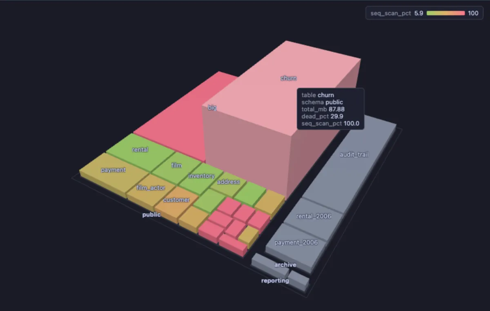

# Storage city

Walk around your database as a city: every table a building in its schema's district, as wide as the space it takes, as tall as its share of dead rows, coloured by how often it is read without an index. The tables to look at first stand out from across town: wide, tall and red.

A database after a busy week. The `churn` table stands out at once: wide (it takes a lot of space), tall (almost a third of its rows are dead, waiting for vacuum) and red (it is always read by scanning it whole). `big` is wider still but low: plenty of data, no dead rows, but also read without an index. The small green buildings are tables read through their indexes, and the grey ones in the archive district were never read at all.

## What it is for

- **Where the space goes**: the widest buildings are the largest tables, with their indexes and TOAST.
- **What vacuum has not caught up with**: tall buildings carry many dead rows (left behind by updates and deletes), which bloat the table and slow its reads.
- **Missing indexes**: red buildings are read by sequential scans, the whole table every time; a big red one is the first place to look for a missing index.

## How to read it

| In the city | Column | Read it as |
|---|---|---|
| District | `schema` | where the table lives |
| Footprint | `total_mb`, the table with its indexes and TOAST, by its square root | where the space goes, the small tables still in sight |
| Height | `dead_pct`, dead rows among all rows | what vacuum has not caught up with |
| Colour, green to red | `seq_scan_pct`, sequential scans among all scans | read without an index |

A table never scanned has no share and is muted grey. Hover a building for its numbers; click it to select its row in the grid, which carries the rest: the size in words, live and dead rows, the days since the last vacuum (`vacuum_days`, manual or automatic) and the scan counts.

Steering: drag with the left button to turn the city, with the right button (or Shift and drag) to slide it, wheel to zoom; **Spin** turns it slowly and **Reset camera** (or a double-click) brings the camera back.

## Try it

Open the **Extensions** side tab and press **Run** on Storage city, on any connection: the grid of tables opens with the **City** tab drawn beside it. To colour by the vacuum's age instead of the scans, set **Colour by** to `vacuum_days` with the sliders button in the City tab's header. To keep a variant of your own (another colour, only one schema), **Fork to Scripts** copies the extension's file into your scripts, where its `-- @inputs` line and its query are yours to change.

## Good to know

The statistics are PostgreSQL's own (`pg_stat_user_tables`), estimates that `ANALYZE` and autovacuum keep up to date, counted since the last statistics reset; a table nobody touched since the reset looks quiet even if it is large. For exact numbers per table, Table bloat, Vacuum candidates and Sequential scans give them in a grid. An empty table has no footprint and is left out of the city, not out of the grid. The view's inputs are set in the file (`-- @inputs`): the sliders button in the view's header changes them for this result. The city is drawn by City 3D, which installs with it.

## Requirements

PostgreSQL 13 or newer. Reads `pg_class` and `pg_stat_user_tables`, nothing else: no extension, no privilege beyond seeing the tables. three.js comes from `cdn.jsdelivr.net`, which has to be an allowed remote script host (the Log offers Allow host when it is not).
