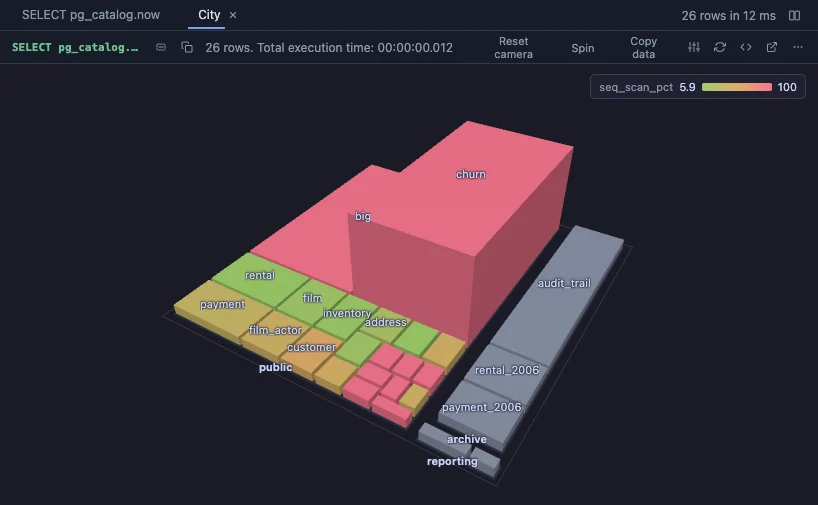

# Storage city

Every table of the database as a building you can walk around: the schemas are districts, a table's size is its footprint, its share of dead rows is its height and its share of sequential scans is its colour. The tables to look at first stand out from across the city: wide, tall and red.

## What it shows

The tables and materialized views of the current database in a grid, largest first, opened on a **City** tab drawn by City 3D (which installs with it):

| In the city | Column | Read it as |
|---|---|---|
| District | `schema` | where the table lives |
| Footprint | `total_mb`, the table with its indexes and TOAST, by its square root | where the space goes, the small tables still in sight |
| Height | `dead_pct`, dead rows among all rows | what vacuum has not caught up with |
| Colour, green to red | `seq_scan_pct`, sequential scans among all scans | read without an index |

A table never scanned has no share and is muted. The grid carries the rest: the size in words, live and dead rows, the days since the last vacuum (`vacuum_days`, manual or automatic) and the scan counts. Hover a building for its numbers, click it to select its row. To colour by the vacuum's age instead, set Colour by to `vacuum_days` with the sliders button in the City tab's header.

The statistics are PostgreSQL's own (`pg_stat_user_tables`), estimates that `ANALYZE` and autovacuum keep up to date, counted since the last statistics reset. For exact numbers per table, Table bloat, Vacuum candidates and Sequential scans give them in a grid.

## Requirements

PostgreSQL 13 or newer. Reads `pg_class` and `pg_stat_user_tables`, nothing else: no extension, no privilege beyond seeing the tables. three.js comes from `cdn.jsdelivr.net`, which has to be an allowed remote script host (the Log offers Allow host when it is not).

## Notes

An empty table has no footprint and is left out of the city, not out of the grid. The view's inputs are set in the file (`-- @inputs`): the sliders button in the view's header changes them for this result, and Fork to Scripts makes a copy of your own to change them for good.
