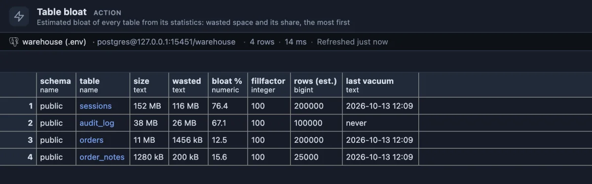
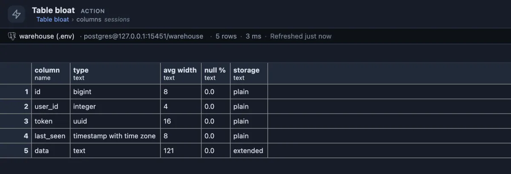

# Table bloat

How much of each table is empty space it carries around: the tables that take more room on disk than their rows need, the most wasted first.



A small shop database. Every row of `sessions` was rewritten three times while autovacuum was switched off for it, then vacuumed by hand: the dead copies are gone, but the space they took is not, so 116 MB of its 152 MB holds nothing. `audit_log` lost two thirds of its rows to a `DELETE` and nobody has vacuumed it since (`never`). The three tables at 12 to 20 percent are healthy: that much is the estimate's own margin.

## When to use it

- **The database keeps growing** while the number of rows does not: bloat is the usual reason.
- **A table got slow to scan** after a big `UPDATE` or `DELETE`: a query that reads the whole table reads the empty space too.
- **Before a cleanup window**: to pick the one or two tables where `VACUUM FULL` or `pg_repack` is worth its lock.
- **After switching autovacuum off** on a table (or tuning it down): to see what that cost.

## How to read it

One row per table or materialized view that holds more pages than its rows need:

| Column | Meaning |
|---|---|
| schema, table | The table. Click the name for the inputs of its estimate (below). |
| size | Its rows and TOAST, as the last VACUUM or ANALYZE counted them. Indexes are not included; Index bloat measures those. |
| wasted | The space beyond what the live rows need. |
| bloat % | The wasted share of the size. |
| fillfactor | The share of each page the table fills on purpose (100 unless set). The space it keeps free on purpose is not counted as waste. |
| rows (est.) | The row count the estimate works from. |
| last vacuum | The later of the manual and the automatic run, or `never`. |

What the numbers mean:

- **Under about 20 percent**: normal. An estimate of this kind is a few percent off by nature, and a table in use always carries some free space that new rows fill.
- **Over 50 percent on a table that matters**: worth a look. Ask first whether autovacuum keeps up with it (Vacuum candidates shows its dead rows and who holds them).
- **A large waste that comes back after every cleanup**: autovacuum runs too rarely on that table. Lower its threshold (`ALTER TABLE ... SET (autovacuum_vacuum_scale_factor = 0.02)`) rather than cleaning harder.

How to give the space back: a plain `VACUUM` makes the waste reusable by new rows but rarely returns it to the operating system. `VACUUM FULL table_name` (or `CLUSTER`) rewrites the table to its real size, holding an exclusive lock for the whole rewrite, so nobody reads or writes the table meanwhile. The `pg_repack` extension does the same without the long lock.

**Columns** on a table name opens the inputs of its estimate, one row per column: its type, the average width and null share the statistics hold, and how it is stored. A column with `no statistics` is where an odd figure comes from; `ANALYZE table_name` fills it in.



## Try it

Run it from the Extensions side tab (**Run** on its row). On a quiet database the list may be short or empty; this makes a bloated table to see it work. **On a test database**:

```sql
create table bloat_demo (id integer primary key, payload text) with (autovacuum_enabled = off);
insert into bloat_demo select g, repeat('x', 100) from generate_series(1, 100000) g;
update bloat_demo set payload = payload || '';
update bloat_demo set payload = payload || '';
update bloat_demo set payload = payload || '';
vacuum bloat_demo;
analyze bloat_demo;
```

Run Table bloat again: `bloat_demo` takes about 54 MB with 40 MB of it wasted (75 percent). Each update wrote a new copy of every row; the vacuum removed the old copies but kept their pages. Now give the space back and run it once more:

```sql
vacuum (full, analyze) bloat_demo;
```

The table is down to about 13 MB and its waste under one percent. Clean up with `drop table bloat_demo;`.

## Good to know

The estimate is the well known one computed from the planner's statistics (`pg_stats`): from each column's average width and null fraction it builds the size of an average row, with its header and alignment, and from that the pages the live rows need at the table's fillfactor, plus a share for TOAST. What the table has beyond that is the waste. So it reads no table and costs one catalog query whatever the size of the database, and it is as good as the last `ANALYZE`: a table never analyzed, or one with a column the statistics do not cover (a `name` column, a column the current role may not read), is left out rather than guessed at. For an exact figure on one table, the `pgstattuple` extension reads it page by page.

Reads only: nothing is vacuumed or rewritten here. For a superuser the system catalogs are listed too; their waste is usually a few kilobytes and harmless.

## Requirements

PostgreSQL 13 or newer. `pg_stats` shows only the columns the current role may read, so a role that cannot read a table does not see its estimate.
