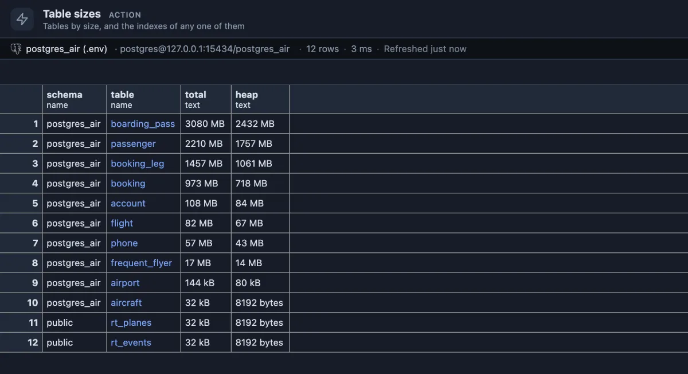
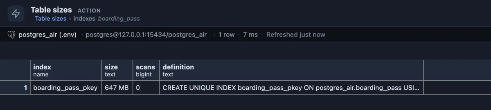

# Table sizes

Which tables take the most space, all in and their rows alone, with the indexes of any one of them a click away.

The [postgres_air](https://github.com/hettie-d/postgres_air) sample: four tables make up almost all of its 8 GB. The difference between the two columns is what the indexes and TOAST take: `boarding_pass` holds 2.4 GB of rows and another 0.6 GB beside them.

## When to use it

- **The database is bigger than expected** and you want to know where the space went.
- **Before archiving or partitioning**: the few tables at the top are where it pays.
- **When an index might be the problem**: a total much bigger than the heap means the indexes (or large values kept in TOAST) weigh a lot.
- **To get to know a database** you have not seen before: the big tables are usually the important ones.

## How to read it

One row per table (partitioned tables included), the largest first:

| Column | Meaning |
|---|---|
| schema, table | The table. Click the name for its indexes (below). |
| total | On disk, all in: rows, indexes and TOAST (where PostgreSQL keeps long values). |
| heap | The rows alone. |

**indexes** on a table name opens its indexes, each with its size, how often it has been read and its definition:

`boarding_pass` has a single index, its primary key, at 647 MB, and nothing has read it since the statistics were last reset. On a production database a big index with 0 scans is worth a second look (Unused indexes lists them all); a primary key stays regardless, since it guarantees the rows are unique.

## Try it

Run it from its button under the right strip's tabs, or from the Extensions side tab (**Run** on its row). There is nothing to set up.

## Good to know

Sizes come from `pg_total_relation_size()` and `pg_relation_size()` at the moment of the run. A partitioned table's own row counts nothing: its partitions are listed as tables of their own (Partition tree shows them together). The scan counts in the drill-down come from `pg_stat_user_indexes` and start from zero when the statistics are reset. The table's name and schema travel into the drill-down as bound values, never pasted into the statement. Reads only. Ships pinned to the right strip under its tabs (`@toolbar right-below`).

## Requirements

PostgreSQL 13 or newer.
