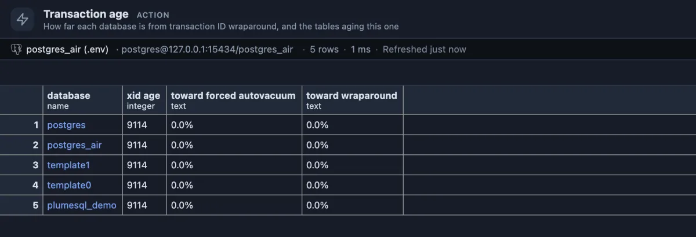

# Transaction age

How far each database is from transaction ID wraparound, the one limit that can stop a PostgreSQL server from accepting writes, and which tables carry the age.

A healthy server, the [postgres_air](https://github.com/hettie-d/postgres_air) sample: the oldest row nobody has frozen yet in each database is 9,114 transactions old, nothing on the scale of 200 million or two billion. This is what it should look like nearly always. The extension is there for the day it does not.

## When to use it

- **As a standing glance**: it ships as a chip in the status bar ("Wraparound"), one click away.
- **On a server with heavy writes** (millions of transactions a day), where the age climbs fast if vacuum falls behind.
- **When autovacuum works hard on a table nobody changed**: that is the forced, anti-wraparound kind, and this shows why.
- **After a long-running transaction or an abandoned replication slot** was finally cleared: to see the age come down.

## How to read it

One row per database, the oldest first:

| Column | Meaning |
|---|---|
| database | Its name. Click it (for the database you are connected to) for its oldest tables. |
| xid age | How many transactions old the oldest unfrozen row of this database is. |
| toward forced autovacuum | The age as a share of `autovacuum_freeze_max_age` (200 million by default). |
| toward wraparound | The age as a share of two billion, where the server stops accepting writes to protect the data. |

What the numbers mean:

- **toward forced autovacuum near or above 100 percent**: routine. Autovacuum starts a freezing vacuum on the oldest tables by itself and the age drops again.
- **toward wraparound creeping up past 10 or 20 percent**: vacuum is not keeping up. The usual causes are a transaction left open for days, a replication slot nobody reads, a prepared transaction never committed, or autovacuum switched off. Find and end the cause, then `VACUUM (FREEZE)` the oldest tables.
- **toward wraparound near 50 percent**: treat it as urgent. Close to 100 percent PostgreSQL first writes warnings to its log, then refuses new transactions until the database is vacuumed.

**its oldest tables** on the database you are connected to opens the tables carrying the age, oldest first, with their sizes: those are the ones a freezing vacuum must reach. Ages are kept per table and readable only inside their own database, so to look into another database from the list, connect to it.

## Try it

Run it from the status bar chip, or from the Extensions side tab (**Run** on its row). There is nothing to set up: every server has an age. To watch it move on a test database, `select txid_current();` run many times raises it by one each time, and `vacuum (freeze);` in a database brings that database's age down again.

## Good to know

Every transaction that changes data takes a number (a transaction ID) from a counter that wraps around after about four billion; rows are stamped with it. So that old rows never look like they come from the future, vacuum "freezes" them, marking them as visible to everyone. The age is the distance between the counter and the oldest row not yet frozen: `age(datfrozenxid)` for a database, `age(relfrozenxid)` for a table. Reads only.

Ships as a chip in the status bar (`@toolbar statusbar`) labelled "Wraparound".

## Requirements

PostgreSQL 13 or newer.
