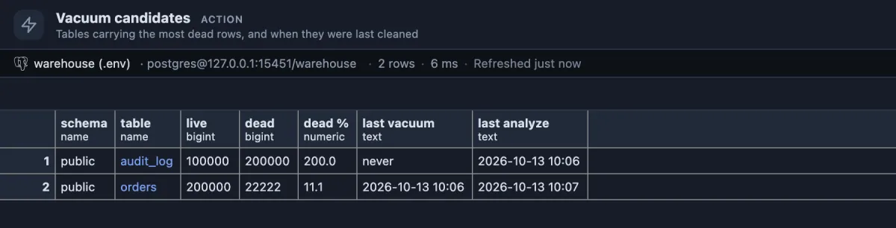
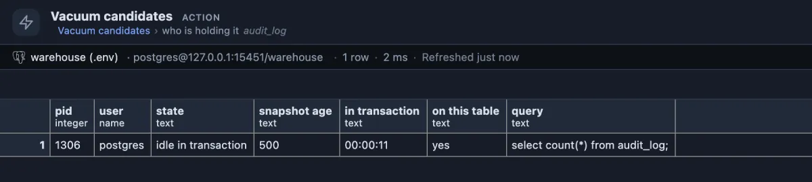

# Vacuum candidates

Which tables carry the most dead rows waiting to be cleaned up, when each was last vacuumed, and who is stopping the cleanup.



The shop's `audit_log` lost two thirds of its rows to a `DELETE`, and autovacuum is switched off for it: twice as many dead rows as live ones (200 percent), `never` vacuumed. `orders` has 11 percent dead after an update of some prices, below the 20 percent at which autovacuum steps in by default, so it simply waits its turn.

## When to use it

- **A table keeps growing** although its row count does not: dead rows are not being cleared.
- **Queries on one table got slower** after many updates or deletes: every scan steps over the dead rows.
- **Autovacuum seems to do nothing** on a table: the drill-down shows the session that holds the rows alive.
- **After a large `DELETE` or `UPDATE`**, to decide whether to run `VACUUM` now rather than wait for autovacuum.

## How to read it

One row per table with dead rows, the most first:

| Column | Meaning |
|---|---|
| schema, table | The table. Click the name for who is holding its dead rows (below). |
| live, dead | Rows the statistics see as live, and dead ones (old versions left by updates and deletes) waiting for vacuum. |
| dead % | Dead rows as a share of live ones. |
| last vacuum, last analyze | The later of the manual and the automatic run, or `never`. |

What the numbers mean:

- **Dead under 20 percent**: normal. Autovacuum by default starts on a table when about a fifth of it is dead.
- **Far above that, and the last vacuum is old or `never`**: autovacuum is not running on it. Check the table's settings (`autovacuum_enabled = off` in its storage parameters is one cause) or run `VACUUM table_name;` yourself.
- **High, and the last vacuum is recent**: vacuum ran but could not remove the rows, because a session still needs them. Open **who is holding it**.

**Who is holding it** on a table name opens every backend of this database that holds a snapshot, the oldest first. Vacuum cannot remove a row that a snapshot older than the row's death might still need, and that snapshot may belong to ANY session of the database, one sitting `idle in transaction` on another table just the same. The one at the top is what every table is waiting for; ending its transaction (or the session) lets vacuum do its work.



Here one session opened a transaction, counted the rows of `audit_log` and went quiet. 500 transactions have finished since its snapshot was taken, and none of the rows they deleted can be cleaned up while it stays open. `on this table` says it also holds a lock on `audit_log` (from its read), which blocks `VACUUM FULL` too.

## Try it

Run it from the Extensions side tab (**Run** on its row), or from its button under the right strip's tabs. To see it catch something, **on a test database**:

```sql
create table dead_demo (id integer primary key, note text) with (autovacuum_enabled = off);
insert into dead_demo select g, 'row ' || g from generate_series(1, 30000) g;
delete from dead_demo where id % 2 = 0;
```

A few seconds later `dead_demo` shows 15,000 live and 15,000 dead rows, `never` vacuumed. To see a holder, open a second session (another tab, or psql) and leave this open:

```sql
begin isolation level repeatable read;
select count(*) from dead_demo;
```

**Who is holding it** on `dead_demo` now lists that session, `idle in transaction`. End it with `rollback;`, then `vacuum dead_demo;` clears the dead rows. Clean up with `drop table dead_demo;`.

## Good to know

The counts come from `pg_stat_user_tables`, the statistics PostgreSQL keeps as rows change; they are estimates, refreshed within a few seconds of each change and reset when the statistics are. A replication slot or a prepared transaction holds dead rows too and does not show in the drill-down; Replication status and `pg_prepared_xacts` cover those.

Reads only: nothing is vacuumed here. Ships pinned to the right strip under its tabs (`@toolbar right-below`).

## Requirements

PostgreSQL 13 or newer. Seeing other users' statements in the drill-down needs the `pg_read_all_stats` role or superuser.
