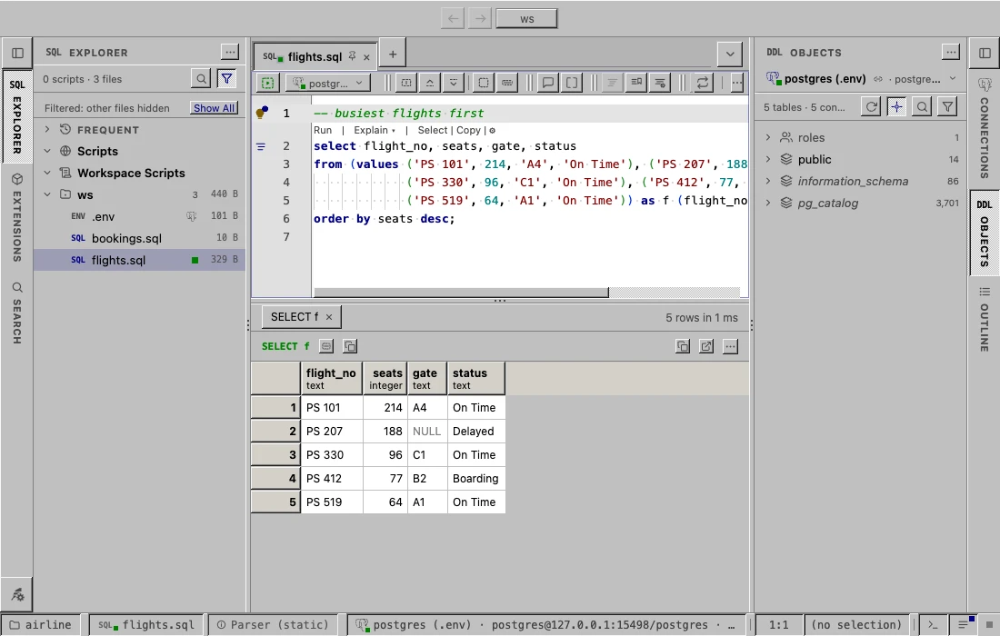
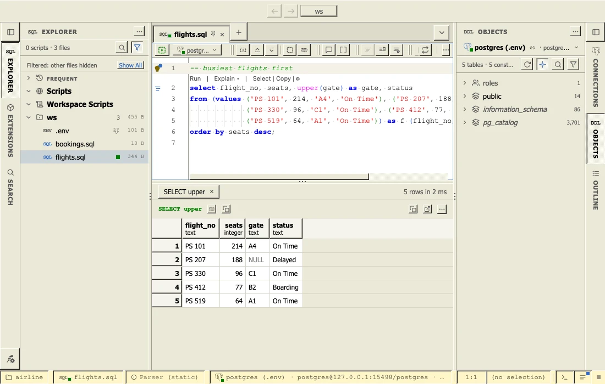
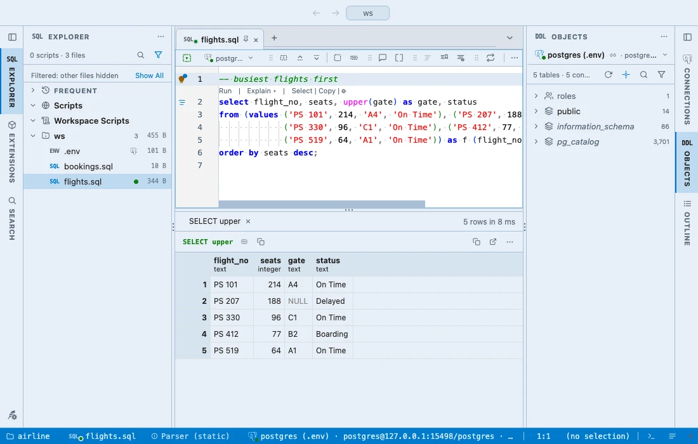

# Desktop 95

Desktops of three eras for PlumeSQL. The first two draw the controls in
relief: every button raised, every field sunken, the editor's tabs a
taskbar whose active button is pressed in, a results grid with raised
column headers and row numbers over white cells. The third is flat.

## The themes

- **Desktop 95**, light: the grey window face of the mid nineties, the
  documents white, navy for focus and links, the sky blue of the period
  for a selection, and in the editor a form designer's code colors: navy
  keywords, green comments, maroon strings.
- **Studio Classic**, light: a database studio of the next decade, its
  beige face in soft relief, Tahoma for the interface and Courier New for
  the code, the studio's code colors (blue keywords, red strings, magenta
  functions, dark green comments, grey operators) and a pale yellow
  status bar.
- **Studio Modern**, light: the same studio today, flat and light blue,
  the same code colors in Consolas, Segoe UI for the interface and a blue
  status bar.

Desktop 95 keeps your system's fonts. The studios name Tahoma and
Courier New, or Segoe UI and Consolas; on a computer without them they
fall back to the system's.

## Use it

Install, then pick one in **Select Color Theme** (the cog menu, the
command palette or its shortcut): the window repaints as the highlight
moves, and Escape puts your theme back. Needs PlumeSQL 0.29.0 or later,
the first release that draws controls in relief.
