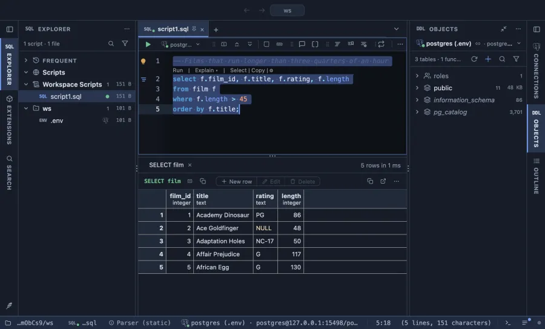
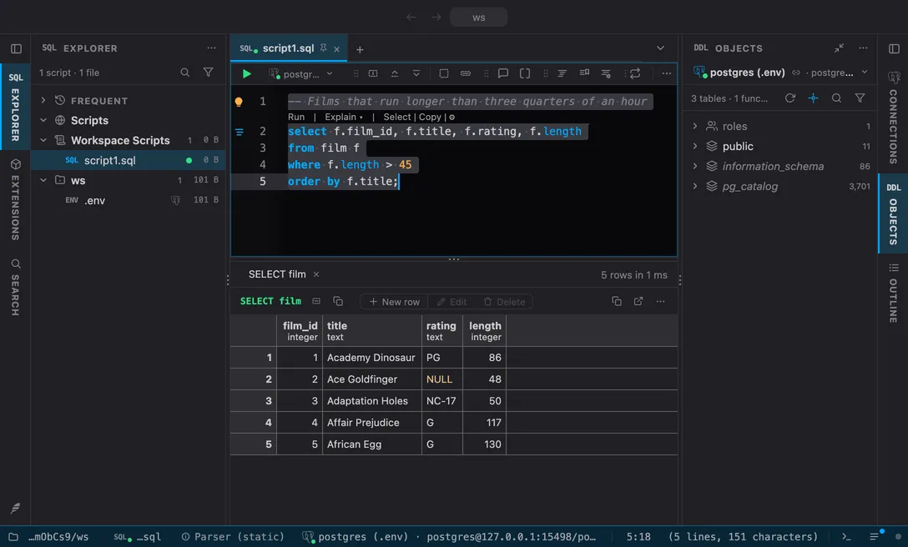

# PlumeSQL Classic

The look PlumeSQL had until 0.27.0, when the built-in Dark and Light themes turned to neutral greys: Classic Dark, a blue slate with a periwinkle accent and Tokyo Night style syntax, and Classic Light, its daylight face.

## The themes

- **Classic Dark**, dark
- **Classic Light**, light

## Use it

Install, then pick one in **Select Color Theme** (the cog menu, the command palette or its shortcut): the window repaints as the highlight moves, and Escape puts your theme back. The extension's page in the Extensions tab draws every theme as a small window with a **Use** button.

Everything follows the theme: the editor and its syntax colors, the object tree, the result grid, the terminal, and every chart view that paints with the palette it is handed.

## Credits

Made for PlumeSQL: its built-in themes from the first release to 0.26.
