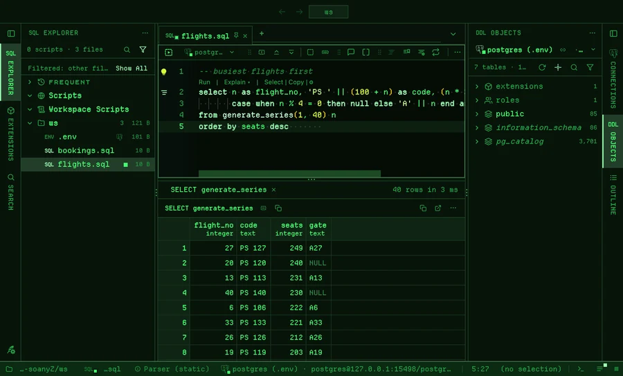
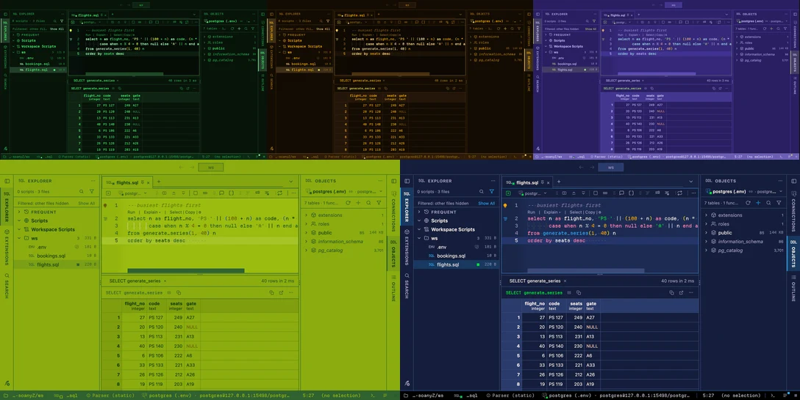

# Retro

Five pixel themes for PlumeSQL: square corners, hard shadows, and code in
Departure Mono, the pixel font PlumeSQL carries.

## The themes

- **Phosphor Green**, dark: a green phosphor terminal, every letter in Departure Mono.
- **Phosphor Amber**, dark: the amber one beside it.
- **Breadbin 64**, dark: a home computer's blue screen, with its light blue frame for a status bar.
- **Handheld**, light: a handheld console's four greens.
- **Fantasy Console**, dark: the sixteen colors of a fantasy console, on its dark blue.

The last three keep your system's font for the interface and the
results, so names and numbers read at any size; the code is pixels.

## Use it

Install, then pick one in **Select Color Theme** (the cog menu, the
command palette or its shortcut): the window repaints as the highlight
moves, and Escape puts your theme back.

PlumeSQL carries Departure Mono, so it works on every computer. A font
you picked yourself (the editor's, the interface's, the pages', the
results') stays yours: the theme's faces only fill what you left at its
default. Needs PlumeSQL 0.28.0 or later.

## Credits

The font: [Departure Mono](https://departuremono.com) by Helena Zhang,
under the SIL Open Font License, shipped with PlumeSQL.
