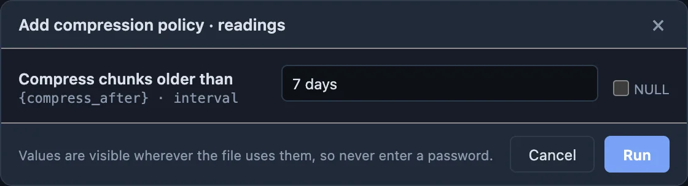
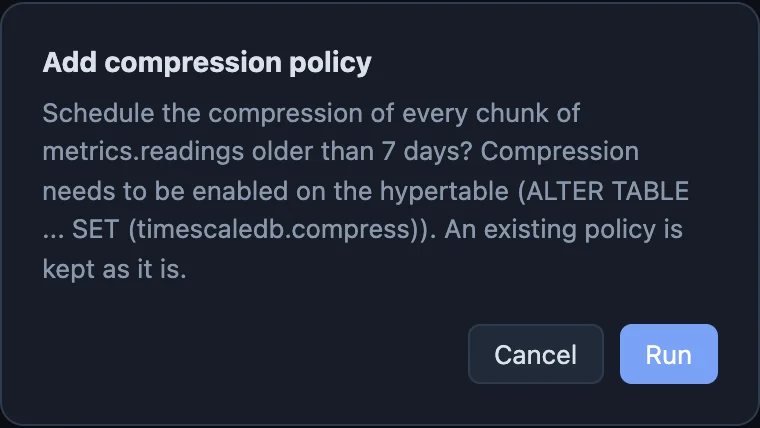

# Add compression policy

Tell TimescaleDB to compress a hypertable's older data on its own, from now on: chunks older than an age you choose get compressed by a background job, every few hours.





Opened on `metrics.readings`: the form asks the age, the question repeats it with the table's name. The answer is the new policy's job number (1003 here), which Hypertable policies and Background jobs then list.

**TimescaleDB** is a PostgreSQL extension for data that arrives over time, stored in **hypertables** that are split by time into small tables called **chunks**. Compressing a chunk rewrites its rows column by column; time series data often shrinks to a fifth of its size or less, and still reads as usual. A **compression policy** does it for you, chunk by chunk, as the data ages.

## When to use it

- **A hypertable grows without end** and its old rows are only read now and then (reports, history): compressing them is the cheapest disk you will ever buy.
- **You compressed old chunks by hand once** (Compress chunks) and want new data to follow without anyone remembering.
- **Recent data must stay fast to write**: a policy with an age of a few days leaves the chunks still receiving rows alone.

## What it does

1. You open it on a hypertable (see Try it).
2. A form asks how old a chunk must be before it is compressed: `7 days` by default; any PostgreSQL interval works (`2 days`, `1 month`).
3. It asks before it changes anything, naming the hypertable and the age.
4. It calls `add_compression_policy(hypertable, compress_after => age, if_not_exists => true)` and answers with the new job's number. `-1` means the hypertable already had a compression policy, which is left exactly as it was.

From then on the policy runs on its own schedule (half the chunk interval: every 12 hours for daily chunks) and compresses every chunk whose whole time range is older than the age. Background jobs and Hypertable policies show it, its runs and any failure.

## Settings

| Setting | Default | What it does |
|---|---|---|
| Compress chunks older than (`compress_after`) | 7 days | The age a chunk must reach, measured from its end, before the policy compresses it. |

## Try it

Open a hypertable from the object tree (its row's menu offers **Run Add compression policy**), or open the table and press the **Add compression policy** pin in the title bar. It only appears on hypertables.

Compression must be switched on for the hypertable first, once, choosing how rows are grouped; the question reminds you. On a test database, with the `sensor_data` table from Hypertables' example:

```sql
alter table sensor_data set (timescaledb.compress, timescaledb.compress_segmentby = 'sensor');
```

Then run Add compression policy on `sensor_data` with `7 days`. Hypertable policies, opened on the same table, now lists the policy with `{"compress_after": "7 days"}`.

## Good to know

To change the age, remove the policy and add it again: `select remove_compression_policy('sensor_data');` then run this once more. A compressed chunk still accepts inserts and updates, more slowly. From TimescaleDB 2.18 on, compression is also called the "columnstore" and the job is named Columnstore Policy; this call keeps working. `{object}` is the hypertable it was opened on, bound as a parameter; the function is the extension's own and not schema qualified on purpose.

## Requirements

PostgreSQL 13 or newer with the `timescaledb` extension; without it the run answers with the server's own error. Compression switched on for the hypertable (`ALTER TABLE ... SET (timescaledb.compress)`), and ownership of the hypertable.
