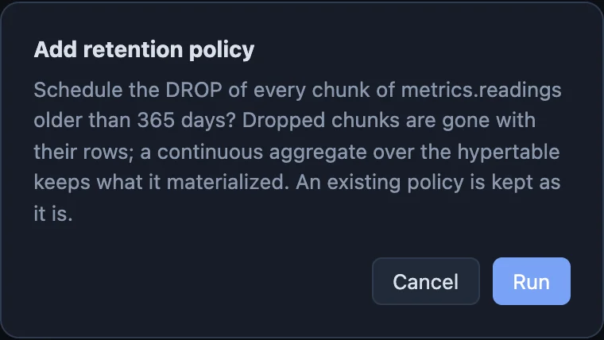

# Add retention policy

Tell TimescaleDB to delete a hypertable's old data on its own: chunks older than an age you choose are dropped by a background job, once a day.



Opened on `metrics.readings` with 365 days: the question says in so many words that dropped chunks are gone with their rows, and that a continuous aggregate over the table keeps what it already summarized.

**TimescaleDB** is a PostgreSQL extension for data that arrives over time, stored in **hypertables** that are split by time into small tables called **chunks**. Deleting old rows one by one is slow and leaves bloat behind; dropping a whole chunk is instant. A **retention policy** drops every chunk that has grown older than the age you set, every day, so the table keeps a moving window of history.

## When to use it

- **Rules say how long you may keep data** (logs for 90 days, personal data for a year): the policy enforces it without anyone remembering.
- **The disk fills with history nobody reads**: raw readings older than a few months are often worth less than the space they take, especially when a continuous aggregate keeps the hourly or daily summary.
- **You delete old rows with a nightly `DELETE`**: the policy does the same far cheaper.

## What it does

1. You open it on a hypertable (see Try it).
2. A form asks the age: `90 days` by default; any PostgreSQL interval works (`6 months`, `2 years`).
3. It asks before it changes anything, and the question says plainly that dropped chunks are gone with their rows.
4. It calls `add_retention_policy(hypertable, drop_after => age, if_not_exists => true)` and answers with the new job's number. `-1` means the hypertable already had a retention policy, which is left exactly as it was.

From then on the policy runs once a day and drops every chunk whose whole time range is older than the age. A continuous aggregate over the hypertable keeps what it already summarized, so you can drop raw rows and keep their daily totals.

## Settings

| Setting | Default | What it does |
|---|---|---|
| Drop chunks older than (`drop_after`) | 90 days | The age a chunk must reach, measured from its end, before the policy drops it with all its rows. |

## Try it

Open a hypertable from the object tree (its row's menu offers **Run Add retention policy**), or open the table and press the **Add retention policy** pin in the title bar. It only appears on hypertables.

On a test database, with the `sensor_data` table from Hypertables' example (a month of rows), run it with `14 days`, then run the job at once instead of waiting a day (the number is the one the run answered with):

```sql
call run_job(1000);
```

Hypertables then shows about 15 chunks instead of 31: the older half is gone.

## Good to know

This destroys data on a schedule; check the age twice. To change it, remove the policy and add it again: `select remove_retention_policy('sensor_data');`. Hypertable policies shows the policy and its `drop_after`; Background jobs shows every run. `{object}` is the hypertable it was opened on, bound as a parameter; the function is the extension's own and not schema qualified on purpose.

## Requirements

PostgreSQL 13 or newer with the `timescaledb` extension; without it the run answers with the server's own error. Ownership of the hypertable.
