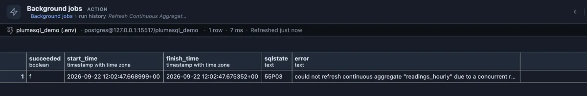

# Background jobs

Every job TimescaleDB runs on its own in this database (compression, retention, summary refreshes and its housekeeping), with how the last run went, and the error of every failed run one click away.

Five jobs: two of TimescaleDB's own housekeeping, then the three policies of the sensor readings. All last ran with `Success`. Further right, beyond the picture, come when each last started, how many runs and failures it has had and when it runs next: the refresh policy of `readings_hourly` and the telemetry job have one failure each in their past.

**TimescaleDB** is a PostgreSQL extension for data that arrives over time. Much of its work happens in **background jobs** it schedules itself: a compression policy compresses old data every few hours, a retention policy drops what is too old, a refresh policy keeps a summary table (a continuous aggregate) current. When one of them stops working, nothing tells you; this list does.

## When to use it

- **Something TimescaleDB should do is not happening**: old chunks stay uncompressed, old data is not dropped, a summary is stale. Find the job and look at its last run and failures.
- **After an upgrade or a restore**: check that every job is enabled and has a next start in the future.
- **A failure count went up**: open the job's run history for the error, word for word.

## How to read it

One row per job:

| Column | Meaning |
|---|---|
| id, job | The job's number and name (the policy, or a job you added). |
| hypertable | The table it works on, when it works on one. |
| every | How often it runs. |
| enabled | Whether it is scheduled (`t`) or paused (`f`). |
| last run, started | How the last run ended and when it started. |
| runs, failures | How many times it has run since it was created, and how many of those failed. |
| next_start | When it runs next. |

What to look for: `failures` above zero (open the history), `last run` reading `Failed`, `enabled` `f`, or a `next_start` well in the past, which usually means the job scheduler is not running (`timescaledb.max_background_workers` too low, or the database was just restored).

**Run history** on a job's name opens its recent runs, newest first, with the SQLSTATE and the message of each failure:

Why the refresh failed that one time: on 22 September another refresh of the same summary was already running (SQLSTATE `55P03`, a lock not available). A one-off that fixed itself; the same error every hour would mean two refreshes keep colliding.

## Try it

Run it from the Extensions side tab: its row's **Run**. Every TimescaleDB database has at least two jobs of TimescaleDB's own (Telemetry Reporter and Job History Log Retention Policy); the policies you add join them. Hypertable policies has a recipe that adds three.

## Good to know

Reads only. It reads `timescaledb_information.jobs`, `job_stats` and, for the history, `job_history`, which arrived in TimescaleDB 2.15 (an older server answers the drill-down with its own error). By default TimescaleDB records failed runs in the history; successful ones too only when `timescaledb.enable_job_execution_logging` is on. The views are not schema qualified on purpose: they live wherever the extension was installed.

## Requirements

PostgreSQL 13 or newer with the `timescaledb` extension; without it the run answers with the server's own error.
