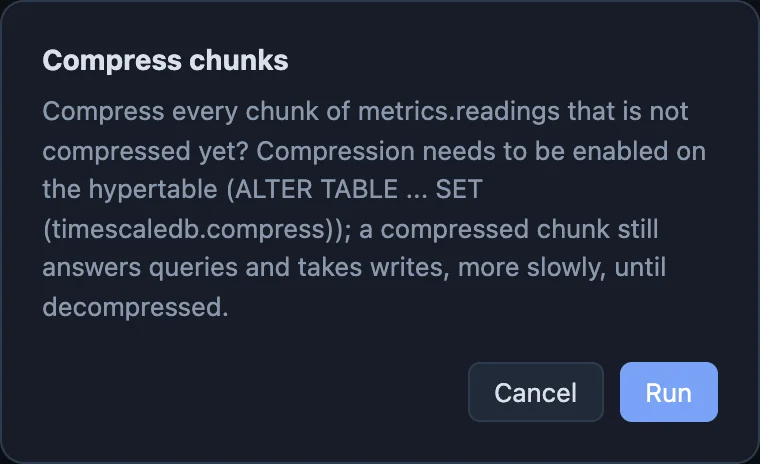
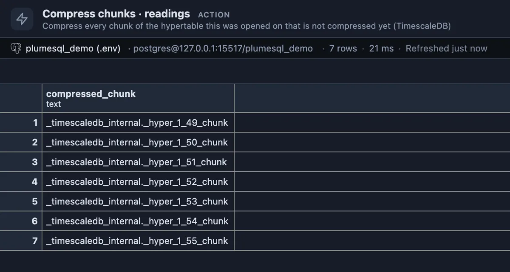

# Compress chunks

Compress every part of a TimescaleDB hypertable that is not compressed yet, right now, in one run.





Opened on `metrics.readings`, whose newest seven chunks were not compressed yet: the answer lists exactly those seven, oldest first. The 44 chunks already compressed were left alone.

**TimescaleDB** is a PostgreSQL extension for data that arrives over time, stored in **hypertables** that are split by time into small tables called **chunks**. Compressing a chunk rewrites its rows column by column, which usually shrinks time series data a great deal. A compression policy does it gradually as data ages; this extension does it at once, for every chunk still waiting.

## When to use it

- **You just switched compression on** for a big hypertable and want the space back today, not as the policy gets around to it.
- **Before a backup or a copy** of the database: compressed chunks make a smaller dump and a faster transfer.
- **After a backfill** of old data that the policy will not look at again.

## What it does

1. You open it on a hypertable (see Try it).
2. It asks first, and the question says that compressed data is slower to change until decompressed.
3. It compresses every chunk of the hypertable that is not compressed yet, oldest first, and answers with one row per chunk it compressed. Chunks already compressed are skipped; when every chunk already is, the answer is empty.

This includes the newest chunk, the one still receiving rows. That is usually fine on a quiet table; on a busy one, prefer a policy (Add compression policy), which leaves recent chunks alone.

## Try it

Open a hypertable from the object tree (its row's menu offers **Run Compress chunks**), or open the table and press the **Compress chunks** pin in the title bar. It only appears on hypertables.

Compression must be switched on for the hypertable first. On a test database, with the `sensor_data` table from Hypertables' example:

```sql
alter table sensor_data set (timescaledb.compress, timescaledb.compress_segmentby = 'sensor');
```

Then run Compress chunks on `sensor_data`: it answers with all 31 chunks. Hypertable compression shows what they saved.

To undo it for one chunk: `select decompress_chunk('_timescaledb_internal._hyper_1_31_chunk');` (the name from Hypertable chunks).

## Good to know

A compressed chunk still answers every query and accepts inserts and updates; changes to it cost more until it is decompressed. `{schema}` and `{name}` are the hypertable it was opened on, bound as parameters; the TimescaleDB functions are not schema qualified on purpose. Version 1.0.1 passes only the chunks not compressed yet, so the answer lists what this run did; 1.0.0 listed every chunk of the hypertable.

## Requirements

PostgreSQL 13 or newer with the `timescaledb` extension; without it the run answers with the server's own error. Compression switched on for the hypertable (`ALTER TABLE ... SET (timescaledb.compress)`), and ownership of the hypertable.
