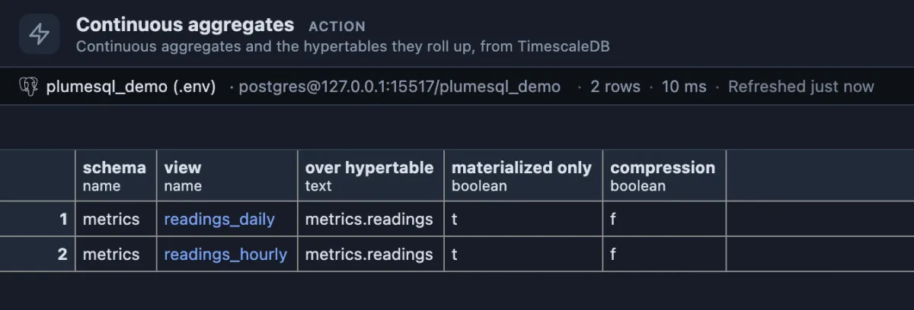

# Continuous aggregates

The continuous aggregates in the database (TimescaleDB's self-updating summaries), the hypertable each one summarizes, and the query that defines it.



Two summaries of the sensor readings: `readings_hourly` (the hourly average temperature and highest humidity of every device) and `readings_daily` (each device's lowest and highest temperature and average humidity of the day). Both are materialized only, so a dashboard reading them sees the newest hour after the next refresh.

**TimescaleDB** is a PostgreSQL extension for data that arrives over time. A **continuous aggregate** is a summary of a hypertable (hourly averages, daily totals) that TimescaleDB keeps up to date by itself, refreshing only the stretch of time that changed. Dashboards read the small summary instead of scanning millions of raw rows.

## When to use it

- **You inherit a TimescaleDB database** and want to know which summaries exist and what they are built from.
- **A dashboard shows old numbers**: check whether the summary returns only what was materialized (`materialized only`), then look at its refresh policy (Hypertable policies, opened on the aggregate).
- **Before you change a hypertable** (drop a column, add a retention policy): every summary over it is listed here.

## How to read it

One row per continuous aggregate:

| Column | Meaning |
|---|---|
| schema, view | The summary, which you query like a view. |
| over hypertable | The hypertable it summarizes. |
| materialized only | `t`: a query returns only what has been refreshed so far, so the newest rows show up after the next refresh. `f` ("real time"): the newest raw rows are added on the fly, always current but slower. |
| compression | Whether the summary's own stored results are compressed. |

**Definition** on a view's name opens the query that defines it, as the server keeps it (the `time_bucket(...)` and the aggregates).

## Try it

Run it from the Extensions side tab: its row's **Run**.

On a test database, with the `sensor_data` table from Hypertables' example, an hourly summary:

```sql
create materialized view sensor_hourly with (timescaledb.continuous) as
select time_bucket('1 hour', time) as hour, sensor, avg(value) as avg_value
from sensor_data group by 1, 2;
```

It appears here over `public.sensor_data`. Query it like any view: `select * from sensor_hourly order by hour desc limit 24;`. To keep it current on its own, give it a refresh policy (Hypertable policies has the line).

## Good to know

Reads only. It reads `timescaledb_information.continuous_aggregates`, not schema qualified on purpose: it lives wherever the extension was installed. The refresh policies that keep each summary current show under Background jobs and, per summary, under Hypertable policies. Since TimescaleDB 2.13 a new continuous aggregate is `materialized only` unless you ask otherwise (`timescaledb.materialized_only = false`).

## Requirements

PostgreSQL 13 or newer with the `timescaledb` extension; without it the run answers with the server's own error.
