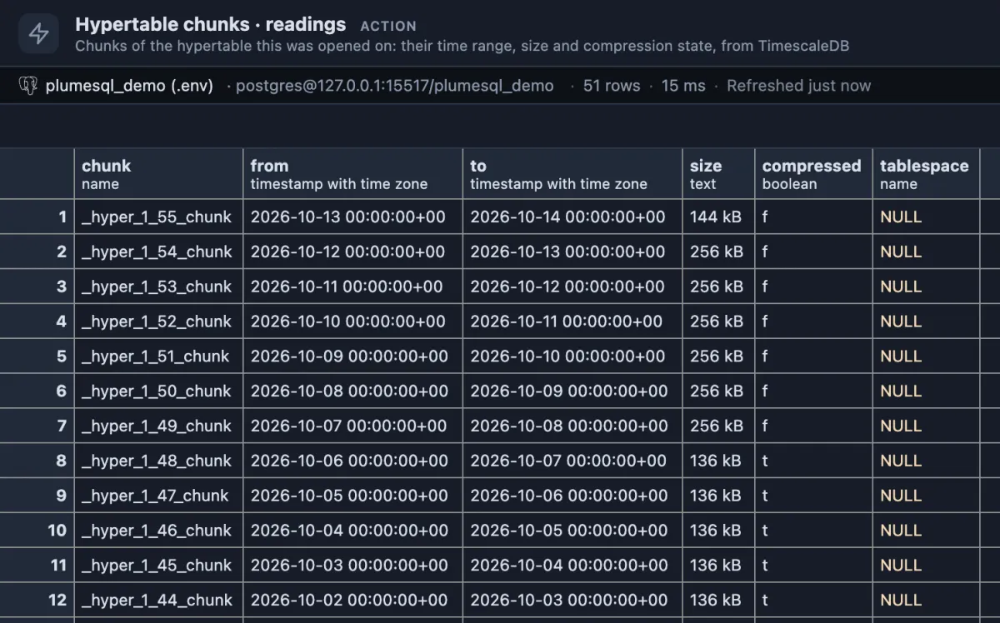

# Hypertable chunks

The chunks of one TimescaleDB hypertable, newest first: the stretch of time each one holds, how big it is and whether it is compressed.



One chunk per day of sensor readings. The newest seven are not compressed and take 256 kB each (today's, still filling, 144 kB); from 6 October back they are compressed and take 136 kB, about half. `NULL` under tablespace means the database's default place.

**TimescaleDB** is a PostgreSQL extension for data that arrives over time. A **hypertable** looks like one table but is stored as many small tables called **chunks**, each holding one stretch of time (a day, a week). This extension lists those chunks for the hypertable you open it on.

## When to use it

- **Did compression happen?** After adding a compression policy, the older chunks should read `t` and the newest ones `f` (the policy leaves recent data alone so it stays fast to write).
- **Where is the space?** One chunk far bigger than its neighbours points at a burst of data, a backfill or a day of duplicates.
- **Is the chunk size right?** TimescaleDB works best when the newest chunk and its indexes fit in memory. Thousands of tiny chunks or a few enormous ones both say the chunk interval should change (`set_chunk_time_interval`).

## How to read it

One row per chunk, newest first:

| Column | Meaning |
|---|---|
| chunk | The chunk's own table name (in the `_timescaledb_internal` schema). |
| from, to | The stretch of time it holds: rows with a time from `from` up to, not including, `to`. |
| size | What it takes on disk, its indexes included; for a compressed chunk, the compressed size. |
| compressed | Whether it is compressed (`t`) or not (`f`). A compressed chunk can still be read as usual; writes to it are slower. |
| tablespace | Where it is stored; `NULL` means the database's default place. |

## Try it

Open a hypertable from the object tree (its row's menu offers **Run Hypertable chunks**), or open the table and press the **Hypertable chunks** pin in the title bar. It only appears on hypertables.

On a test database, a month of readings makes thirty-odd chunks to look at:

```sql
create extension if not exists timescaledb;
create table sensor_data (time timestamptz not null, sensor int, value double precision);
select create_hypertable('sensor_data', by_range('time', interval '1 day'));
insert into sensor_data
select t, s, random() * 100
from generate_series(now() - interval '30 days', now(), interval '1 minute') t,
     generate_series(1, 4) s;
```

Compress everything older than a week and run it again: the older chunks turn `t` and shrink.

```sql
alter table sensor_data set (timescaledb.compress, timescaledb.compress_segmentby = 'sensor');
select compress_chunk(c) from show_chunks('sensor_data', older_than => interval '7 days') c;
```

## Good to know

Reads only. The sizes come from `chunks_detailed_size()`, which counts a compressed chunk's data where TimescaleDB really keeps it (a companion table); the chunk's own table is nearly empty once compressed. `{schema}` and `{name}` are the hypertable it was opened on, bound as parameters. The TimescaleDB views and functions are not schema qualified on purpose: they live wherever the extension was installed.

Version 1.0.1 fixes the size of compressed chunks, which 1.0.0 showed as 8192 bytes (the empty chunk table alone).

## Requirements

PostgreSQL 13 or newer with the `timescaledb` extension; without it the run answers with the server's own error.
