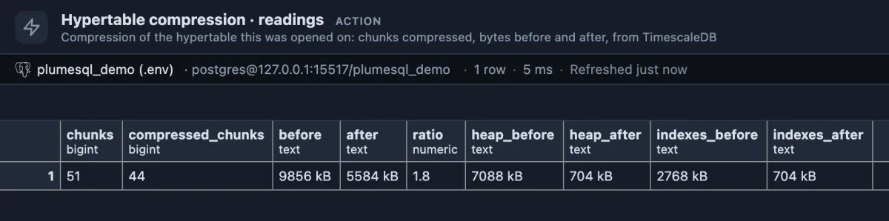

# Hypertable compression

How much compression saves on one TimescaleDB hypertable: how many chunks are compressed, the size before and after, and the ratio.



44 of the 51 chunks are compressed; the policy leaves the newest week alone. Those 44 took 9.6 MB and now take 5.5 MB, a ratio of 1.8. The rows themselves shrank tenfold (heap 7088 kB to 704 kB) and the indexes fourfold; most of what remains is the compressed data, which TimescaleDB keeps in PostgreSQL's store for large values (TOAST) and which only the totals count. A modest ratio, because these chunks are small, a few thousand readings a day; compression gains most on big chunks (the example below reaches 3.5).

**TimescaleDB** is a PostgreSQL extension for data that arrives over time. A **hypertable** is stored as many small tables called **chunks**, one per stretch of time, and old chunks can be **compressed**: TimescaleDB rewrites their rows column by column, which time series data usually shrinks a great deal. This extension says what that bought you.

## When to use it

- **Was compression worth it?** The ratio answers in one number: 2 means half the space, 10 means a tenth.
- **Is the policy keeping up?** Compressed chunks should be nearly all of them, short of the newest few the policy leaves alone on purpose.
- **Before you change the compression settings** (which column to segment by, the order): note the ratio, change, recompress, and compare.

## How to read it

One row for the hypertable:

| Column | Meaning |
|---|---|
| chunks, compressed_chunks | How many chunks it has, and how many of them are compressed. |
| before, after | The compressed chunks' size before compression and now. Only compressed chunks count here; the uncompressed ones are left out of both. |
| ratio | before divided by after: 3.0 means the compressed data takes a third of the space it used to. |
| heap_before, heap_after | The table part alone. After compression it holds little; the compressed rows themselves are stored as large values (TOAST), counted in `before` and `after` only. |
| indexes_before, indexes_after | The indexes alone. |

Before any chunk is compressed the size columns are empty: there is nothing to measure yet. A ratio under 2 is worth a look: the rows may be too few per chunk, or the `segmentby` column may split them into many tiny groups (one row per group compresses badly).

## Try it

Open a hypertable from the object tree (its row's menu offers **Run Hypertable compression**), or open the table and press the **Hypertable compression** pin in the title bar.

On a test database, with the `sensor_data` table from Hypertables' example:

```sql
alter table sensor_data set (timescaledb.compress, timescaledb.compress_segmentby = 'sensor');
select compress_chunk(c) from show_chunks('sensor_data', older_than => interval '7 days') c;
```

On the test machine this run reported 23 of 31 chunks compressed, 10 MB before and 2.9 MB after, a ratio of 3.5: random values compress less than real readings, which often reach 10 and more.

## Good to know

Reads only. It reads `hypertable_compression_stats()`, the extension's own function, not schema qualified on purpose. `{object}` is the hypertable it was opened on, bound as a parameter. From TimescaleDB 2.18 on, compression is also called the "columnstore"; the numbers are the same.

## Requirements

PostgreSQL 13 or newer with the `timescaledb` extension; without it the run answers with the server's own error.
