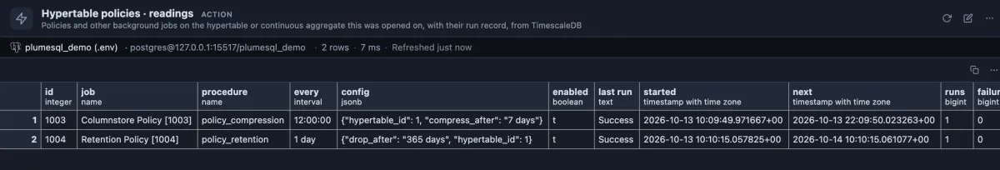

# Hypertable policies

The automatic jobs TimescaleDB runs on one hypertable or continuous aggregate (compressing, dropping old data, refreshing), with when they last ran, how that went and when they run next.



Two policies keep `readings` in shape: every 12 hours, compress chunks older than 7 days; every day, drop chunks older than 365 days. Both last ran with `Success`, none has failed, and the next runs are scheduled.

**TimescaleDB** is a PostgreSQL extension for data that arrives over time, stored in **hypertables** that are split into chunks by time. Instead of compressing or deleting old chunks by hand, you give a hypertable **policies**: "compress chunks older than 7 days", "drop chunks older than a year", "refresh this summary every hour". TimescaleDB runs them as background jobs. This extension shows the ones attached to the object you open it on.

## When to use it

- **Old data is not being compressed or dropped** and you want to know whether a policy exists, what it is set to, and whether its last run failed.
- **A summary (continuous aggregate) looks stale**: its refresh policy's last run and next start say whether it is running at all.
- **Before changing a policy**: its current settings are in the `config` column, exactly as TimescaleDB keeps them.

## How to read it

One row per job attached to the object:

| Column | Meaning |
|---|---|
| id, job | The job's number and name: Columnstore Policy (compression), Retention Policy, Refresh Continuous Aggregate Policy, or a job of your own. |
| procedure | What it runs (`policy_compression`, `policy_retention`, `policy_refresh_continuous_aggregate`). |
| every | How often it runs. |
| config | Its settings: `compress_after`, `drop_after`, the refresh window's `start_offset` and `end_offset`. |
| enabled | Whether it is scheduled (`t`) or paused (`f`). |
| last run, started | How the last run ended (`Success`, `Failed`) and when it started. |
| next | When it runs next. |
| runs, failures | How many times it has run, and how many of those failed. |

What to look for: `failures` above zero, a `last run` of `Failed`, a `next` in the past (the job scheduler may be stopped), or `enabled` `f`. Background jobs opens any job's run history with the error message of each failure.

## Try it

Open a hypertable or a continuous aggregate from the object tree (the row's menu offers **Run Hypertable policies**), or open it and press the **Hypertable policies** pin in the title bar.

On a test database, with the `sensor_data` table from Hypertables' example, three policies to look at:

```sql
alter table sensor_data set (timescaledb.compress, timescaledb.compress_segmentby = 'sensor');
select add_compression_policy('sensor_data', compress_after => interval '7 days');
select add_retention_policy('sensor_data', drop_after => interval '90 days');
create materialized view sensor_hourly with (timescaledb.continuous) as
select time_bucket('1 hour', time) as hour, sensor, avg(value) as avg_value
from sensor_data group by 1, 2;
select add_continuous_aggregate_policy('sensor_hourly', start_offset => interval '3 days',
       end_offset => interval '1 hour', schedule_interval => interval '1 hour');
```

Opened on `sensor_data` it lists the first two; opened on `sensor_hourly`, the refresh policy.

## Good to know

Reads only. A continuous aggregate's jobs are registered on an internal table TimescaleDB keeps its results in (the materialization hypertable); the extension translates the aggregate's name, so opening it on the aggregate itself answers as you would expect. `{schema}` and `{name}` are the object it was opened on, bound as parameters. It reads `timescaledb_information.jobs`, `job_stats` and `continuous_aggregates`.

To add policies: Add compression policy and Add retention policy. To see every job in the database at once, with the error of each failed run: Background jobs.

## Requirements

PostgreSQL 13 or newer with the `timescaledb` extension; without it the run answers with the server's own error.
