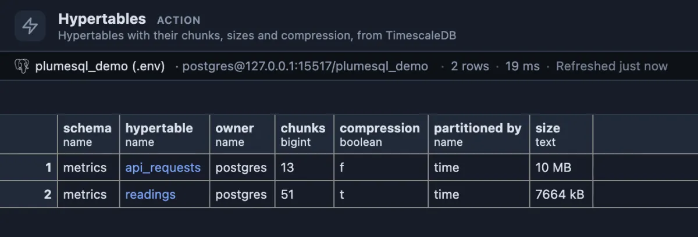
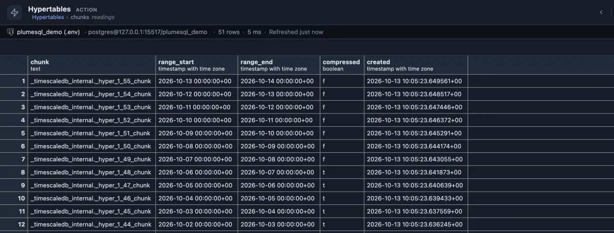

# Hypertables

Every TimescaleDB hypertable in the database at a glance: how many chunks it has, whether it is compressed and how much disk it takes.



Two hypertables. `api_requests` holds three days of request timings in 13 chunks of six hours each, with compression off: 10 MB. `readings` holds seven weeks of sensor readings in 51 daily chunks, with compression on: 7.5 MB, less than the three days of requests.

**TimescaleDB** is a PostgreSQL extension for data that arrives over time: sensor readings, metrics, events, prices. Its central idea is the **hypertable**: you query it like one ordinary table, but underneath it is split by time into many small tables called **chunks** (one per day, say). Old chunks can then be compressed or dropped one at a time, without touching the rest.

## When to use it

- **You join a project that uses TimescaleDB** and want the lay of the land: which tables are hypertables, how big they are, which are compressed.
- **The disk is filling up**: the biggest hypertable with compression off is the first place to look.
- **You set up compression or a retention policy** and want to see it working: the size should stop growing as fast, and with retention the chunk count should level off instead of climbing every day.

## How to read it

One row per hypertable:

| Column | Meaning |
|---|---|
| schema, hypertable | The table. |
| owner | Who owns it. |
| chunks | How many chunks it is split into now. |
| compression | Whether compression is switched on for it (`t`) or not (`f`). On means old chunks CAN be compressed; Hypertable compression says how many are. |
| partitioned by | The column the chunks are cut by, nearly always the time column. |
| size | Everything on disk: every chunk, compressed or not, with its indexes. |

What to look for: a large hypertable with compression `f` is usually disk space you can win back (time series data often shrinks to a fifth or less). A chunk count that keeps climbing on a table whose old data nobody reads means nothing is ever dropped; a retention policy (Add retention policy) does that for you.

## Try it

Run it from the Extensions side tab: its row's **Run**. It reads the database the tab is connected to.

On a test database you can make a hypertable in a few lines and see it appear:

```sql
create extension if not exists timescaledb;
create table sensor_data (time timestamptz not null, sensor int, value double precision);
select create_hypertable('sensor_data', by_range('time', interval '1 day'));
insert into sensor_data
select t, s, random() * 100
from generate_series(now() - interval '30 days', now(), interval '1 minute') t,
     generate_series(1, 4) s;
```

Run Hypertables again: `sensor_data` is there with 31 chunks, one for each day the rows cover.

**Chunks** on a hypertable's name opens its chunks, newest first: the time range each one covers, whether it is compressed and when it was made.



The chunks of `readings`, one per day. The newest seven read `f`: its compression policy leaves the last week alone, so new rows are written fast, and compresses each chunk once it is a week old (`t` from 6 October back).

## Good to know

Reads only. It reads `timescaledb_information.hypertables`, `timescaledb_information.chunks` and `hypertable_size()`, which are not schema qualified on purpose: they live wherever the extension was installed, and only the server knows where. From TimescaleDB 2.18 on, compression is also called the "columnstore" (the policy is named Columnstore Policy); the meaning is the same.

For one hypertable in more detail, open it from the object tree: Hypertable chunks (with each chunk's size), Hypertable compression and Hypertable policies all work on the table you open them on.

## Requirements

PostgreSQL 13 or newer with the `timescaledb` extension in the connected database; without it the run answers with the server's own error.
