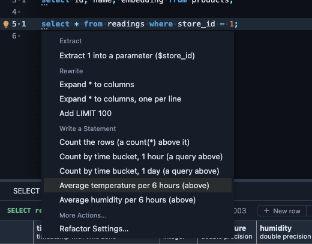
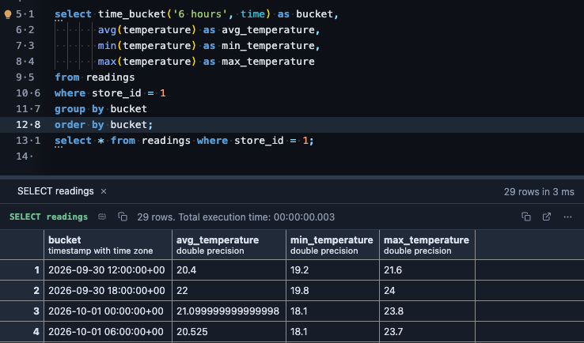

# TimescaleDB refactors

Time series read best per time bucket. On a `SELECT` over a TimescaleDB hypertable, the editor's lightbulb (Ctrl+. or ⌘.) offers the same rows summarized per time bucket, written as a query above the one you have, which stays as it was.

Once the query has run, it also picks a bucket that fits your data and averages its numbers.

## What it offers

**Count by time bucket**, by the hour or by the day. From

```sql
select * from metrics where device = 7;
```

the lightbulb's **Count by time bucket, 1 hour** writes above it

```sql
select time_bucket('1 hour', ts) as bucket, count(*)
from metrics
where device = 7
group by bucket
order by bucket;
```

with the hypertable's own time column and the query's own `WHERE`. **Count by time bucket, 1 day** does the same by the day. This one needs no run: it reads the statement.

**Average per bucket**, once the query has run. The lightbulb looks at the timestamps the query returned and picks a bucket that holds about ten rows: readings every minute get 15 minutes, readings every 10 minutes get 6 hours, hourly ones get a day. Each number column of the result (up to three, ids left out) gets its own offer:



**Average temperature per 6 hours** writes the average, the minimum and the maximum per bucket above your query, and runs as it is:



Change the bucket or the aggregate in the new query to taste: it is plain SQL.

All of them appear only on a query over one hypertable that does not group already.

## What it reads

The statement and its hypertable's time column, from PlumeSQL's dictionary of the connection. For **Average per bucket**, also the first rows of the query's last run in this tab, which PlumeSQL already has. Nothing is asked of the server until you run the query.

## Where it applies

In the SQL editor, wherever the extension is attached (everywhere from the install on; change it on its page).

## Requirements

PostgreSQL 13 or newer with TimescaleDB (`create extension timescaledb`), and PlumeSQL 0.24.0 or newer.
