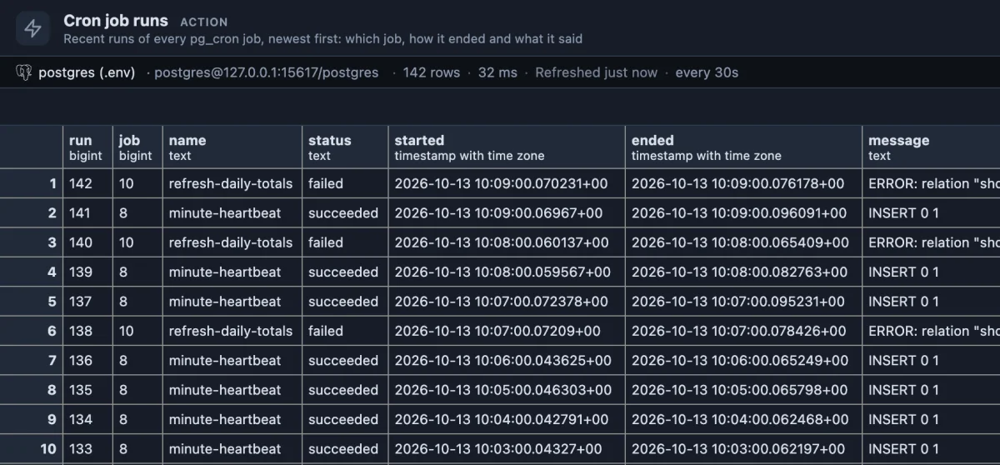

# Cron job runs

The latest runs of every pg_cron job, newest first: which job ran, whether it worked and what it said. It refreshes every thirty seconds while you watch.



Two jobs run every minute. `minute-heartbeat` succeeds each time (`INSERT 0 1`). `refresh-daily-totals` fails each time with the server's own error: the summary it refreshes, `shop.daily_totals`, does not exist any more. Nothing else would have said so.

**pg_cron** is a PostgreSQL extension that runs SQL on a schedule, inside the database. It never tells anyone when a job fails: the failure is written to its run log, `cron.job_run_details`, and stays there. This extension reads that log.

## When to use it

- **Right after scheduling a job**: watch the first runs come in and check they succeed.
- **Something scheduled has stopped happening** (the nightly cleanup, the summary refresh): the failed runs say why, in the server's words.
- **A slow night**: `started` and `ended` show how long each run took, and whether two runs overlapped.

## How to read it

One row per run, the 200 most recent:

| Column | Meaning |
|---|---|
| run | The run's number. |
| job, name | The job it belongs to. |
| status | `succeeded`, `failed`, `running` or `starting`. |
| started, ended | When it began and finished. |
| message | What the command answered (`INSERT 0 1`, `VACUUM`), or the error, verbatim. |
| command | The SQL as scheduled. |

What to look for: `failed` rows (read the message), runs that stay `running` far longer than usual, or no recent row at all for a job that should have run (it may be paused, or pg_cron's background worker is not running).

## Try it

Run it from the Extensions side tab: its row's **Run**, in the database where pg_cron is installed. On a test database, a job that succeeds and one that fails, every minute:

```sql
select cron.schedule('heartbeat', '* * * * *', 'select 1');
select cron.schedule('broken', '* * * * *', 'refresh materialized view no_such_view');
```

After two minutes the runs are there, the failures with their error. Remove both afterwards (`select cron.unschedule('heartbeat'); select cron.unschedule('broken');`), or with Cron unschedule job.

## Good to know

Refreshes every 30 seconds while its tab is the one in front (`@refresh 30s`). Reads only. The log grows with every run; pg_cron never trims it on its own, so a busy server's `cron.job_run_details` is worth a cleanup job of its own (`delete from cron.job_run_details where end_time < now() - interval '7 days'`). Logging can be turned off with `cron.log_run = off`. The `cron` schema is the extension's own fixed one, so it is qualified.

## Requirements

PostgreSQL 13 or newer with the `pg_cron` extension installed in the connected database; without it the run answers with the server's own error. Reading other users' runs needs superuser; anyone sees the runs of their own jobs.
