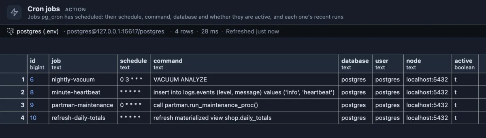
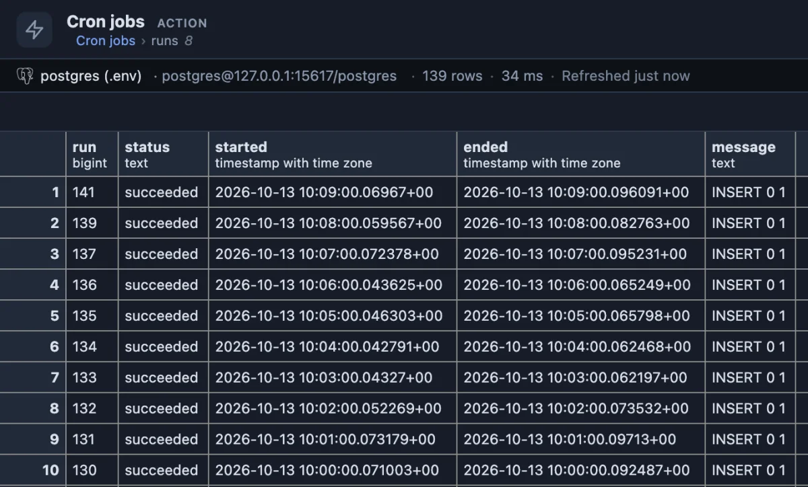

# Cron jobs

Every job pg_cron runs on a schedule in this database: when it runs, what it runs and whether it is switched on, with each job's recent runs one click away.



Four jobs. `nightly-vacuum` runs `VACUUM ANALYZE` at 03:00 every night; `minute-heartbeat` inserts a row every minute; `partman-maintenance` creates the coming days' partitions every hour (`0 * * * *`: minute 0 of every hour); `refresh-daily-totals` refreshes a summary every minute, and its runs fail (Cron job runs shows why).

**pg_cron** is a PostgreSQL extension that runs SQL on a schedule, inside the database: "every night at three, vacuum", "every hour, run the partition maintenance". It is the Unix `cron` for PostgreSQL. Its jobs live in the table `cron.job` and every run is recorded in `cron.job_run_details`.

## When to use it

- **Something should happen every night and you are not sure it does**: find the job, check that it is `active`, open its runs.
- **You inherit a database** and want to know what runs in it on its own.
- **A load spike every hour on the hour**: a job scheduled at minute 0 is the usual suspect.

## How to read it

One row per job:

| Column | Meaning |
|---|---|
| id, job | The job's number and name. |
| schedule | When it runs, in cron syntax (below) or as an interval such as `30 seconds`. |
| command | The SQL it runs. |
| database, user | The database it runs in and the role it runs as. |
| node | The server pg_cron connects to for it, `host:port`. |
| active | Whether it runs (`t`) or is paused (`f`). |

Reading a cron schedule: five fields, minute, hour, day of the month, month and day of the week; `*` means every. `0 3 * * *` is 03:00 every day, `*/15 * * * *` every fifteen minutes, `0 9 * * 1` 09:00 every Monday. The times are in pg_cron's time zone (`cron.timezone`), which is GMT unless the server sets it.

**Runs** on a job's number opens its recent runs, newest first: how each one ended and what it said.



## Try it

Run it from the Extensions side tab: its row's **Run**, in the database where pg_cron is installed (`cron.database_name`). Schedule a job to have something to see, with Cron schedule job or in a script:

```sql
select cron.schedule('nightly-vacuum', '0 3 * * *', 'VACUUM ANALYZE');
```

## Good to know

Reads only; Cron schedule job and Cron unschedule job are the writing halves, Cron job runs lists every run of every job. A job scheduled for another database (`cron.schedule_in_database`) is listed here too, in the database that holds the extension. The `cron` schema is the extension's own fixed one, so it is qualified.

## Requirements

PostgreSQL 13 or newer with the `pg_cron` extension installed in the connected database (its jobs are kept where the extension is); without it the run answers with the server's own error. pg_cron must be in the server's `shared_preload_libraries`.
