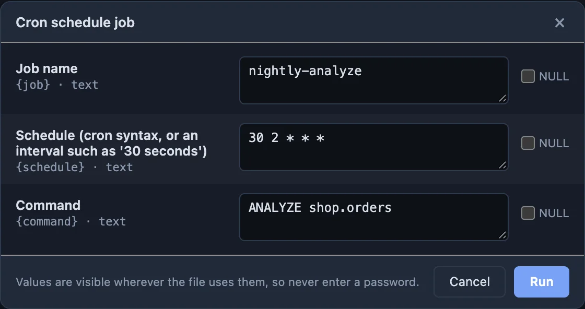
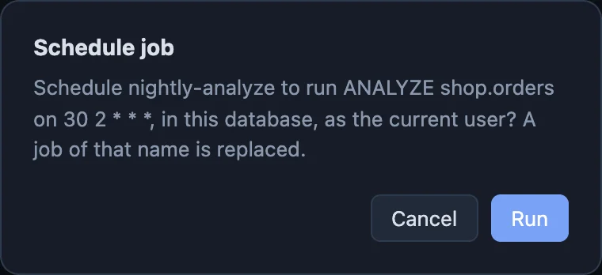
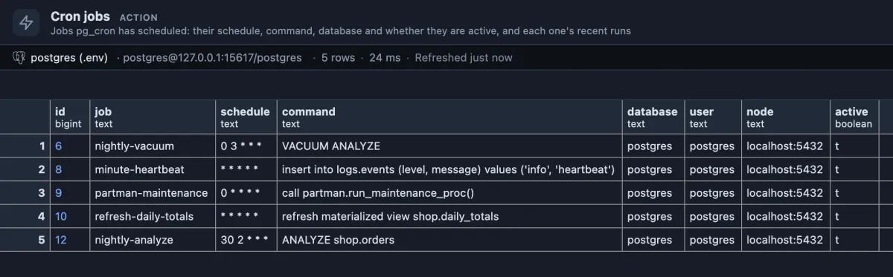

# Cron schedule job

Schedule SQL to run on its own, every night, every hour or every few seconds, from a short form: a name, when, and what.

A nightly `ANALYZE` of the orders table at 02:30: filled in, confirmed, and there it is among the jobs, number 12.

**pg_cron** is a PostgreSQL extension that runs SQL on a schedule inside the database, the Unix `cron` for PostgreSQL. This extension adds a job to it.

## When to use it

- **Regular housekeeping**: a nightly `VACUUM ANALYZE`, refreshing a materialized view every hour, deleting old log rows every Sunday.
- **Partition maintenance**: pg_partman's `call partman.run_maintenance_proc()` every hour.
- **A quick recurring check while you work**: a job every `30 seconds`, removed again when you are done.

## What it does

1. A form asks three things: the job's **name**, its **schedule** and the **command** (SQL).
2. It asks before it changes anything, repeating all three.
3. It calls `cron.schedule(name, schedule, command)` and answers with the job's number. A job with the same name is replaced, which the question says.

The job runs in the database you are connected to, as the role you are connected as.

## Settings

| Setting | Default | What it does |
|---|---|---|
| Job name (`job`) | nightly-vacuum | The job's name, used to find, replace or remove it. |
| Schedule (`schedule`) | 0 3 * * * | When it runs: cron syntax, or an interval such as `30 seconds` (1 to 59 seconds). |
| Command (`command`) | VACUUM ANALYZE | The SQL it runs. |

Cron syntax has five fields, minute, hour, day of the month, month and day of the week, and `*` means every: `0 3 * * *` is 03:00 every day, `*/10 * * * *` every ten minutes, `0 6 * * 1-5` 06:00 on weekdays. The times are in pg_cron's time zone (`cron.timezone`), GMT unless the server sets it.

## Try it

Run it from the Extensions side tab: its row's **Run**, in the database where pg_cron is installed. Fill in a harmless job to see it work:

| Field | Value |
|---|---|
| Job name | heartbeat |
| Schedule | * * * * * |
| Command | select 1 |

A minute later Cron job runs shows its first run, `succeeded`. Remove it with Cron unschedule job.

## Good to know

Every value is bound as a parameter, nothing is pasted into SQL text. The command runs with the privileges of the role that scheduled it. To schedule into another database, use `cron.schedule_in_database` in a script.

## Requirements

PostgreSQL 13 or newer with the `pg_cron` extension installed in the connected database; without it the run answers with the server's own error. The right to schedule jobs: superusers, and roles granted usage on the `cron` schema.
