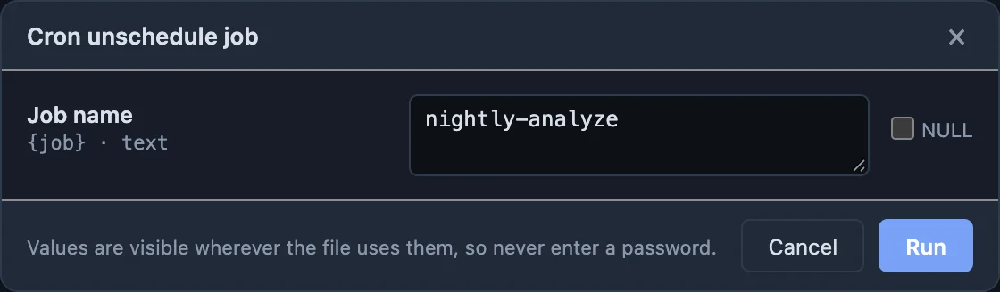
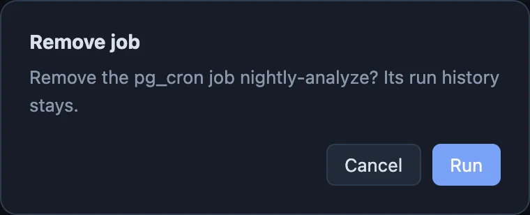
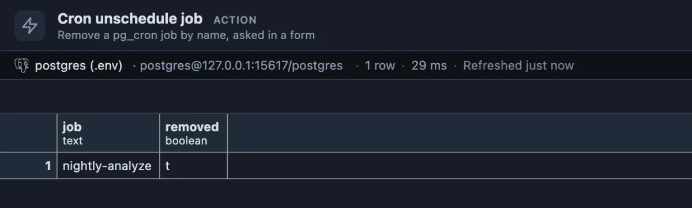

# Cron unschedule job

Stop a pg_cron job for good, by its name. Its past runs stay in the log.

The nightly `ANALYZE` scheduled with Cron schedule job, removed again: asked, confirmed, and the answer says it is gone.

**pg_cron** is a PostgreSQL extension that runs SQL on a schedule inside the database. This extension takes a job off its schedule.

## When to use it

- **A job is no longer needed**, or has been replaced by a better one.
- **A job keeps failing** and does harm (or fills the run log) until you can fix it.
- **Cleaning up after a test**: the `heartbeat` you scheduled to see pg_cron work.

## What it does

1. A form asks the job's **name** (Cron jobs lists them).
2. It asks before it removes anything.
3. It finds the job by name and removes it with `cron.unschedule`, answering with the job's name and `removed` `t`. A name no job has answers with no row at all, which is how you know nothing was removed.

To pause a job instead of removing it: `select cron.alter_job(job_id => 12, active => false);` in a script.

## Settings

| Setting | Default | What it does |
|---|---|---|
| Job name (`job`) | nightly-vacuum | The name of the job to remove. |

## Try it

Run it from the Extensions side tab: its row's **Run**, in the database where pg_cron is installed, and give the name of a job you scheduled, such as the `heartbeat` from Cron schedule job's example.

## Good to know

The name is bound as a parameter. The job's past runs stay in `cron.job_run_details`, so Cron job runs still shows them.

## Requirements

PostgreSQL 13 or newer with the `pg_cron` extension installed in the connected database; without it the run answers with the server's own error. The right to remove the job: its owner, or a superuser.
