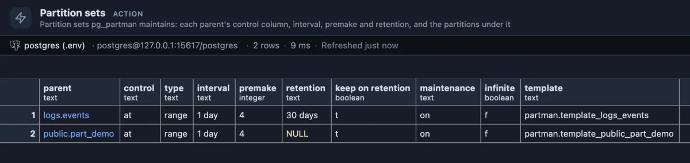

# Partition sets

Every table pg_partman looks after: how it is cut, how many partitions it keeps ready ahead, how long it keeps old ones, with each table's partitions one click away.



Two partition sets. `logs.events` is cut by its `at` column into one partition per day, keeps 4 days ready ahead, and lets go of partitions older than 30 days, keeping them as plain tables. `public.part_demo` is cut by day too, with no retention (`NULL`): it keeps everything.

**pg_partman** is a PostgreSQL extension that looks after partitioned tables. A partitioned table is split into child tables, the **partitions**, usually one per day or month; queries for a date range read only the partitions that cover it, and an old month can be dropped in an instant instead of deleted row by row. PostgreSQL does the splitting but never makes the next partition on its own; pg_partman does, ahead of time, and removes the old ones. Each table it manages is a **partition set**, configured in its table `part_config`.

## When to use it

- **Inserts fail, or rows pile up in the default partition**: check that the set exists, that `maintenance` is `on` and how many partitions it makes ahead.
- **The disk keeps growing** on a partitioned table: is there a retention, and does it drop old partitions or only detach them (detached tables still take space)?
- **You inherit a database** and want to know which tables pg_partman manages and how.

## How to read it

One row per partition set:

| Column | Meaning |
|---|---|
| parent | The partitioned table. |
| control | The column the partitions are cut by (a date or a number). |
| type, interval | How it is cut (`range`, `list`) and how much each partition holds (`1 day`, `1 month`, `100000`). |
| premake | How many partitions pg_partman keeps ready ahead of the newest data (or of today, with `infinite` on). |
| retention | How old a partition may get before maintenance removes it; `NULL` keeps everything. |
| keep on retention | `t`: an old partition is detached and kept as a plain table; `f`: it is dropped with its rows. |
| maintenance | Whether the regular maintenance run covers this set (`on`). |
| infinite | `t`: partitions are made ahead of today even when no data arrives; `f`: only ahead of the newest data. |
| template | A table whose indexes and settings each new partition copies. |

What to look for: `maintenance` `off`; a `retention` you did not expect (or none on a table that grows forever); `keep on retention` `t` on a set whose old partitions nobody needs.

**Partitions** on a parent opens its partitions, straight from PostgreSQL's catalog: each one's bounds and size.


One partition per day. The gap between 26 September and 13 October is real: nothing was written in those days (the server was off), and with `infinite` off pg_partman makes partitions only ahead of the newest data. The partitions up to 17 October are made ahead of time. The default partition catches any row no other partition covers.

## Try it

Run it from the Extensions side tab: its row's **Run**. A form asks for pg_partman's schema (`partman` by default, the name its documentation uses).

On a test database with pg_partman (5.x), a daily partition set:

```sql
create schema if not exists partman;
create extension if not exists pg_partman schema partman;
create table events (id bigserial, at timestamptz not null default now(), message text) partition by range (at);
select partman.create_parent(p_parent_table => 'public.events', p_control => 'at', p_interval => '1 day', p_premake => 4);
```

Partition sets then lists `public.events`, and its Partitions show today, four days ahead, four days back, and the default.

## Good to know

Reads only. Run maintenance makes the next partitions now, and Set retention changes how long a set keeps them. pg_partman's schema is the installer's choice, so the form asks for it; the name is placed in the query as an identifier, quoted by the server, since a schema name cannot travel as a parameter. The drill-down reads `pg_inherits`, so it needs nothing of pg_partman's.

If rows ever land in the default partition (dates no partition covers), maintenance does not move them; pg_partman's `partition_data_proc` does, making the partitions they need.

## Requirements

PostgreSQL 13 or newer with the `pg_partman` extension; without it the run answers with the server's own error.
