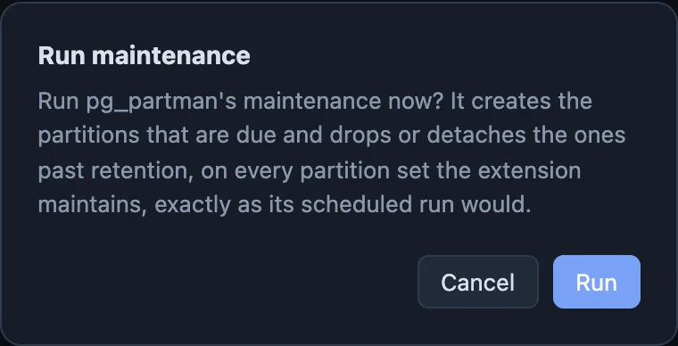
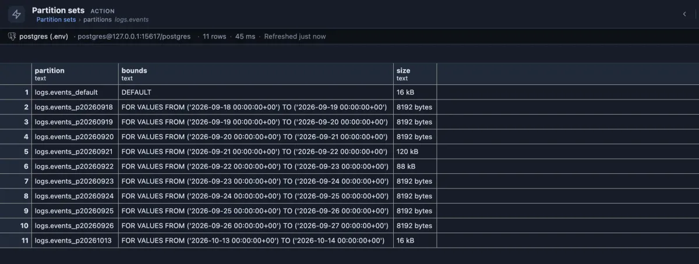
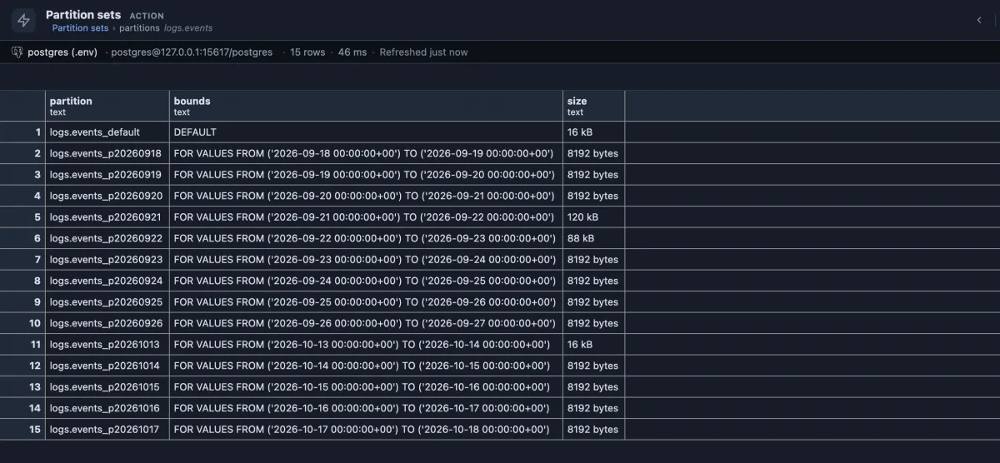

# Run maintenance

Make pg_partman do its housekeeping now instead of at its next scheduled run: create the partitions that are due, remove the ones past their retention.







Before, the newest partition of `logs.events` was today's (13 October). After Run maintenance there are four more, 14 to 17 October, ready before their rows arrive, as the set's premake of 4 asks.

**pg_partman** is a PostgreSQL extension that looks after partitioned tables: tables split into child tables, the **partitions**, one per day or month. PostgreSQL never makes the next partition on its own; pg_partman's **maintenance** does, ahead of time, and removes partitions past their retention. Normally it runs on a schedule; this runs it once, now.

## When to use it

- **You just created or changed a partition set** (a new premake, a retention) and want the result now, not in an hour.
- **Inserts fail or land in the default partition** because the partitions for today or tomorrow do not exist yet: maintenance was not running.
- **You lowered the retention** and want the space back today.

## What it does

1. A form asks for pg_partman's schema (`partman` by default).
2. It asks before it runs, and the question says that partitions past retention are dropped or detached.
3. It calls `run_maintenance()`, which goes over every partition set with maintenance `on`, exactly as the scheduled run would.

The answer is a single empty cell: the function returns nothing. What it did shows in Partition sets (open a set's partitions) and, for retention, in the tables that are gone or detached.

## Settings

| Setting | Default | What it does |
|---|---|---|
| pg_partman schema (`partman_schema`) | partman | The schema pg_partman was installed in. |

## Try it

Run it from the Extensions side tab: its row's **Run**. With the daily `public.events` set from Partition sets' example, run it on the next day: a new partition for the day after the last one appears.

Maintenance must also run on its own, regularly. With pg_cron, every hour:

```sql
select cron.schedule('partman-maintenance', '0 * * * *', 'call partman.run_maintenance_proc()');
```

or with pg_partman's own background worker (`pg_partman_bgw` in `shared_preload_libraries`).

## Good to know

With retention set and `keep on retention` off, maintenance DROPS old partitions with their rows; read the set's retention in Partition sets before you run it. Maintenance never moves rows out of the default partition; pg_partman's `partition_data_proc` does. The schema is placed in the query as an identifier, quoted by the server, since a schema name cannot travel as a parameter.

## Requirements

PostgreSQL 13 or newer with the `pg_partman` extension; without it the run answers with the server's own error. The right to run the maintenance (the owner of the partition sets, or a superuser).
