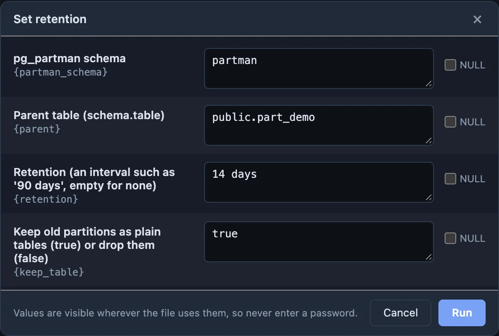
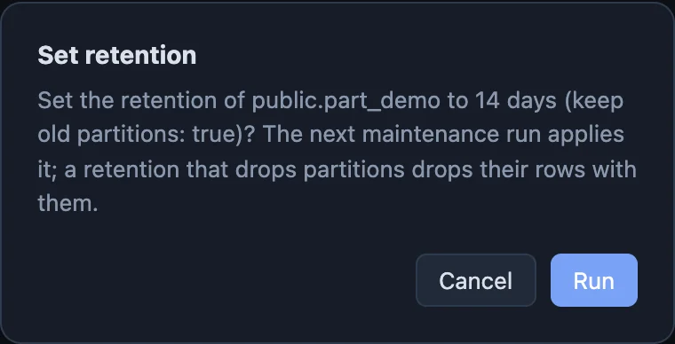
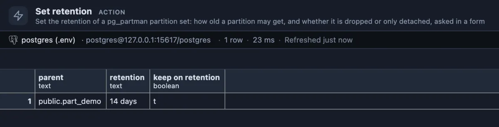

# Set retention

Decide how long a pg_partman table keeps its old partitions, and whether an old partition is deleted or just set aside, from a short form.

`public.part_demo` kept everything; now partitions older than 14 days are detached at the next maintenance and kept as plain tables. The answer is the set's row as it now stands.

**pg_partman** is a PostgreSQL extension that looks after partitioned tables: tables split into child tables, the **partitions**, one per day or month. Its **retention** says how old a partition may get; at each maintenance run, older ones are either **dropped** (gone, with their rows) or **detached**: no longer part of the table, so queries skip them, but kept as a plain table you can archive, dump or drop yourself.

## When to use it

- **A partitioned table grows forever** and nobody reads data older than a few months.
- **Rules say how long you may keep data**: logs 30 days, personal data a year.
- **Archive before delete**: keep old partitions as plain tables (keep `true`), dump them, then drop them at your own pace.

## What it does

1. A form asks pg_partman's schema, the parent table, the retention and whether to keep old partitions.
2. It asks before it changes anything, naming the table and the new retention.
3. It updates the set's row in `part_config` and answers with the row as it now stands. No row at all means the table is not a set pg_partman manages (check the name in Partition sets).

Nothing is removed yet: the next maintenance run applies the retention (Run maintenance runs it now).

## Settings

| Setting | Default | What it does |
|---|---|---|
| pg_partman schema (`partman_schema`) | partman | The schema pg_partman was installed in. |
| Parent table (`parent`) | asked | The partitioned table, as `schema.table`, exactly as Partition sets lists it. |
| Retention (`retention`) | 90 days | How old a partition may get, as an interval (`30 days`, `6 months`); empty for no retention, which keeps everything. |
| Keep old partitions (`keep_table`) | true | `true`: detach old partitions and keep them as plain tables; `false`: drop them with their rows. |

## Try it

Run it from the Extensions side tab: its row's **Run**. With the daily `public.events` set from Partition sets' example, set `public.events` to `2 days`, keep `true`, then Run maintenance: the partitions older than two days are no longer under `events` in Partition sets, but still exist as tables of their own.

## Good to know

With keep `false`, the next maintenance run deletes data for good; the question says so. Detached tables still take disk space until you drop them. The values are bound as parameters; only the schema is placed in the query as an identifier, quoted by the server.

## Requirements

PostgreSQL 13 or newer with the `pg_partman` extension; without it the run answers with the server's own error. The right to update pg_partman's `part_config` table.
