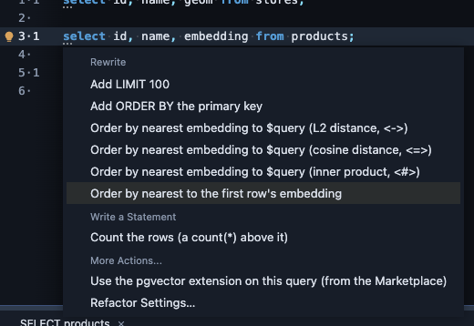
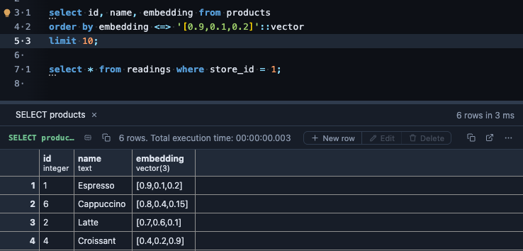
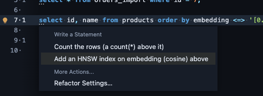

# pgvector refactors

The nearest neighbour query is the one everybody writes by hand. On a `SELECT` over a table with a vector column, the editor's lightbulb (Ctrl+. or ⌘.) writes it for you: an `ORDER BY` the distance to a vector and a `LIMIT`.

```sql
select id, content from items
order by embedding <=> $query::vector
limit 10;
```

Once the query has run, it can also find the rows most like one you already have, with no vector to paste.

## What it offers

**Order by nearest**, in the three distances pgvector indexes: L2 distance (`<->`), cosine distance (`<=>`) and inner product (`<#>`), one offer per vector column (`vector`, `halfvec` or `sparsevec`, cast to match). `$query` is a run parameter: PlumeSQL asks for it when you run the query, so paste the vector (`[0.1, 0.2, ...]`) there. This one needs no run: it reads the statement.

**Order by nearest to the first row's** column, once the query has run. The lightbulb takes the vector the first row returned and writes it into the query, so you see the rows most like that one, by cosine distance:



```sql
-- before
select id, name, embedding from products;

-- after
select id, name, embedding from products
order by embedding <=> '[0.9,0.1,0.2]'::vector
limit 10;
```

Run it again: the first row comes first (its distance to itself is zero), then the rows nearest to it.



To start from another row, put it first (a `where id = ...`, say), run, and ask again. The vector is written into the query in full, and PlumeSQL hands an extension at most 4096 characters of a value, about 400 dimensions: a longer vector is not offered. Use **Order by nearest** with `$query` for those.

Both appear only on a query without an `ORDER BY` or a `LIMIT` of its own.

**Add an HNSW index.** A nearest neighbour query over a column with no index for its distance reads the whole table, row by row. When your query orders by a vector column's distance (`order by embedding <=> ...`) and the table has no HNSW or IVFFlat index on that column for that distance, the lightbulb writes the index that serves it, above the query, with the operator class of the query's own distance (`vector_cosine_ops` for `<=>`, `vector_l2_ops` for `<->`, `vector_ip_ops` for `<#>`; `halfvec_` and `sparsevec_` for those types):



```sql
create index on products using hnsw (embedding vector_cosine_ops);
select id, name from products order by embedding <=> '[0.9,0.1,0.2]' limit 5;
```

Run the `create index` once; building it on a large table takes a while. The offer reads the table's indexes from PlumeSQL's dictionary, and stays quiet until the dictionary knows them (it does from PlumeSQL 0.24.0, after the connection's tables are read once more).

## What it reads

The statement and its tables' columns, from PlumeSQL's dictionary of the connection. For **Add an HNSW index**, the table's indexes, from the same dictionary. For **Order by nearest to the first row's**, also the first row of the query's last run in this tab, which PlumeSQL already has. Nothing is asked of the server until you run the query.

## Where it applies

In the SQL editor, wherever the extension is attached (everywhere from the install on; change it on its page). Reading vector values in a result is the **pgvector** extension's: install that one too, and attach each where you want it.

## Requirements

PostgreSQL 13 or newer with pgvector (`create extension vector`), and PlumeSQL 0.24.0 or newer.
