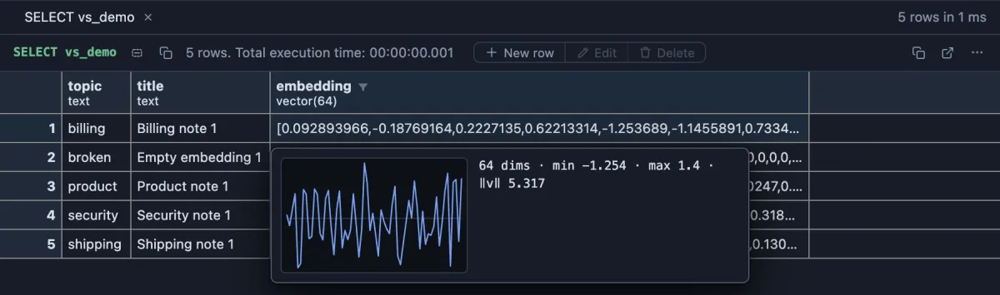
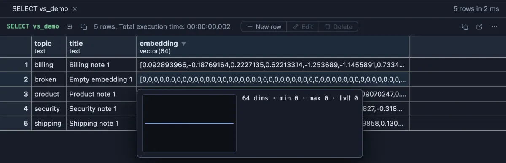
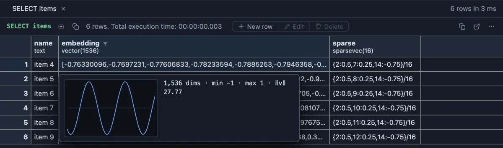

# pgvector

See what an embedding in the grid looks like (how many numbers, how big, what shape) instead of a wall of decimals.



Support notes stored with an embedding each: 64 numbers an AI model computed from the text, so that notes about the same thing get similar numbers. The grid can only show the start of the list. Hover the cell and the card sums it up: 64 numbers between -1.254 and 1.4, a length (norm) of 5.317, and a sparkline of all of them, so you see at a glance that the vector is filled and has a shape.

## What it is for

- **Checking that embeddings were stored at all**: a vector of zeros, or one with the wrong number of dimensions, is the usual sign that the step that computes them failed. Both stand out in the card at once.
- **Knowing what a column holds**: 1,536 dimensions or 384, normalised to length 1 or not. That decides which distance operator (`<->`, `<=>`, `<#>`) and which index fit the column.
- **Comparing neighbours**: in a similarity search, hovering the top results shows whether they look alike, which is what a short distance promises.

## How to read it

- **Hover** a cell: one reading line (`64 dims · min -1.254 · max 1.4 · ‖v‖ 5.317`) and a sparkline of the components over a zero line. `dims` is how many numbers the vector has, `min` and `max` the smallest and largest, and `‖v‖` its length (the square root of the sum of the squares). Many models return vectors of length 1, so a norm of exactly 1 is normal for them.
- **Peek** a cell (Space): the same line and sparkline above the value as stored.
- **Open Value in Tab** (right-click the cell): the column's type, the reading line and the sparkline above the whole value in the editor.

A vector of zeros has nothing to say: its norm is 0 and its sparkline is a flat line on the zero line. A distance to it means nothing (the cosine distance to it is `NaN`, not a number), so such rows quietly spoil a similarity search.



A long vector is shown in fewer points than it has numbers (each point the average of its neighbours, which keeps the shape). A `sparsevec`, which stores only its nonzero numbers, reads as its dimensions and how many of them are not zero, and its sparkline spikes where those entries are.

## Try it

These run on a database with the pgvector extension and a table with a `vector` column. In the examples the table is `vs_demo` (a note's `title`, its `topic` and a 64 dimension `embedding`); use your own table and column names.

**A few rows and their vectors**, the pictures above:

```sql
select topic, title, embedding
from vs_demo
where title in ('Billing note 1', 'Shipping note 1', 'Security note 1', 'Product note 1', 'Empty embedding 1')
order by topic;
```

**Find a vector's nearest neighbours** and compare them: the notes most similar to one billing note, by cosine distance (0 is the same direction).

```sql
select title, topic,
       round((embedding <=> (select embedding from vs_demo where title = 'Billing note 1'))::numeric, 3) as distance,
       embedding
from vs_demo
where topic <> 'broken'
order by distance
limit 8;
```

The first row is the note itself (distance 0); every other neighbour is another billing note, 0.10 to 0.12 away. Hover a few of their embeddings: the sparklines differ in detail, as they should, but sit in the same range.

**Find the empty ones** before they spoil a search (`vector_norm` comes with pgvector):

```sql
select title, topic
from vs_demo
where vector_norm(embedding) = 0;
```

A long vector reads the same way: here a `vector(1536)`, the size of OpenAI's common embeddings, whose sparkline is a smooth wave because this test table's vectors were made from a sine curve.



## Settings

None. Install it and every vector column reads this way.

## Where it applies

Every column whose declared type is `vector`, `halfvec` or `sparsevec` (with a dimension such as `vector(1536)`, and schema qualified when the extension lives outside the `search_path`), in every result, from the install on (a global scope you can change on its page). A JSON array of numbers in a `json` or text column keeps its own face.

## Good to know

The range and the norm are computed from the numbers as stored (a `halfvec` stores fewer digits). Copying cells, exporting and the Log's console keep the value exactly as the server sent it. To see many vectors at once instead of one, **Vector Space 3D** (`vector-space-3d`) draws a whole column of them as points in space, and **pgvector refactors** (`pgvector-refactors`) writes the similarity queries for you from the editor's lightbulb.

## Requirements

PostgreSQL 13 or newer with the pgvector extension (`create extension vector`). Nothing runs on the server: the values are read from what the grid already holds.
